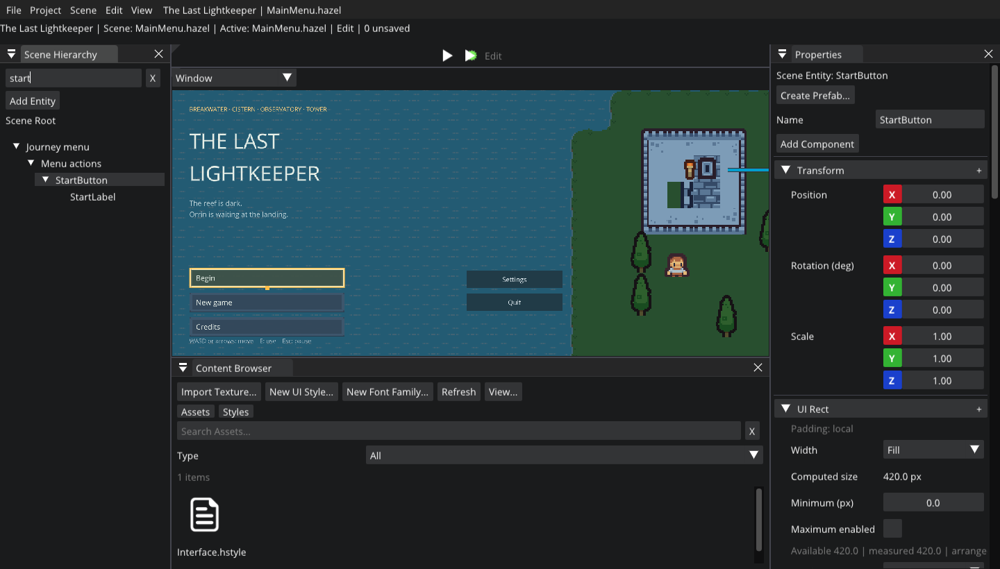
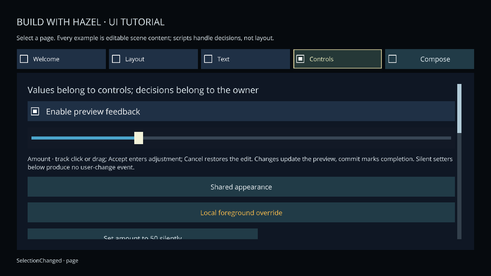
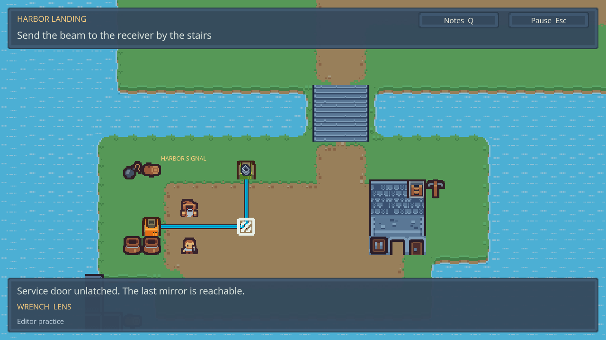
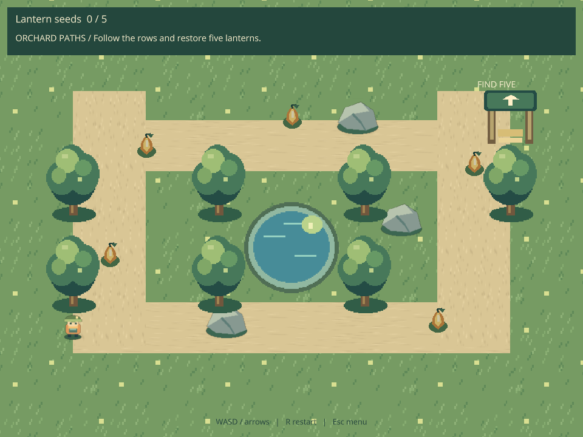

# Hazel

A C++ 2D game engine with a scene editor, C# scripting and standalone game export, for **Windows, Linux and Apple Silicon macOS**.


*The Last Lightkeeper in Hazelnut: menu authoring, hierarchy, properties and shared styles. [Full resolution](docs/images/hazelnut-lightkeeper.png).*

**Hazel** is the engine library. **Hazelnut** is its editor. **Nutella** runs the exported game without the editor. This fork builds on [TheCherno's public Hazel source](https://github.com/TheCherno/Hazel/tree/1feb70572fa87fa1c4ba784a2cfeada5b4a500db); it is separate from TheCherno's commercial Hazel product.

## Start here

| Try it | Make something | Explore |
| --- | --- | --- |
| [Downloads and snapshots](docs/packaging.md#choose-a-snapshot) | [Platform setup and Xcode](docs/getting-started.md) | [Documentation](docs/README.md) |
| [Run an example](docs/README.md#learn-from-an-example) | [Editor guide](docs/editor-guide.md) · [C# scripting](docs/scripting.md) | [Contribute / report a bug](CONTRIBUTING.md) |
| [Exported-game requirements](docs/platforms-and-dependencies.md#platform-status) | [Sprites](docs/sprite-authoring.md) · [Runtime UI](docs/runtime-game-ui.md) | [Development and CI](docs/development.md) |

The engine includes a 2D renderer, Box2D physics, sprite regions/animation, scene hierarchy and detached prefabs. Menus and HUDs use authored screen-space UI: measured layout, styles, font families, text, controls, scrolling, focus and remappable input. Hazelnut provides native authoring, bounded document history, script builds and game export.

## Build and open the tutorial

Install the [platform prerequisites](docs/getting-started.md#prerequisites-installed-by-you), then clone master with its pinned submodules:

```sh
git clone --recurse-submodules https://github.com/cringlekaden/Hazel.git
cd Hazel
scripts/setup.sh --tests
python3 scripts/hazel.py script-build examples/Sandbox/Sandbox.hproj --config Debug
python3 scripts/hazel.py run Hazelnut --config Debug --project examples/Sandbox/Sandbox.hproj
```

On Windows, use `./scripts/setup.ps1 --tests` and `python`. Setup prepares tools/checks the environment and builds Debug with two compiler jobs; Premake is the build system. `run` launches existing products. [Getting started](docs/getting-started.md) has complete prerequisites, Mono SDK selection, outputs and troubleshooting.

Open **Assets/Scenes/UI Tutorial.hazel** and Play. Its [five pages](examples/Sandbox/README.md) demonstrate layout, typography, controls, screens and reusable compositions. Stop returns to the authored scene.


*Controls, styles and event ownership are editable scene content; game scripts handle decisions.*

## Example games

| [The Last Lightkeeper](examples/LastLightkeeper/README.md) | [MeadowRun](examples/MeadowRun/README.md) · [Skybound](examples/Skybound/README.md) |
| --- | --- |
|  |  |
| Island restoration, dialogue, persistent journeys and settings | Collectibles, physics, sprite animation, parallax and prefab spawning |

[SceneTransitions](examples/SceneTransitions/README.md) is the smallest runtime/scripting example. Every project has source launch and export instructions. Prepared game packages need **no compiler, Python or source SDK**; changing scripts and exporting requires the authoring toolchain.

The `feature/3d-foundations` branch adds shared static 3D/PBR/prepared IBL and
Metal 4 for supported Apple Silicon/macOS 27+ configurations. Automatic now prefers available native Metal 4 there and OpenGL elsewhere; both remain explicitly selectable. Native Apple M4 and Linux software-GL qualification pass; full Windows CI is deferred. See [backend selection and Project Settings](docs/backend-selection.md). Use the
[branch-specific clone instructions](docs/getting-started.md#test-the-3d--metal-development-branch)
and [Metal shader/build commands](docs/development.md#experimental-metal-shader-resources).
[M3](docs/design/metal-m3.md), [M4](docs/design/metal-m4.md) and
[M5](docs/design/metal-m5.md) have local Apple M4 qualification. The
[M6 production-readiness record](docs/design/metal-m6.md) separately tracks
clean-source, application packaging, platform CI and matched measurements.
M6 is a revision-specific qualification record. The [next default-backend checkpoint](docs/design/metal-default-qualification.md) tracks Automatic selection, renderer cleanup and measured verification/performance work; the accepted checkpoint keeps the remaining Windows full-suite timeout explicitly deferred.

## Status and support

Windows/Linux require **OpenGL 4.1 core**; macOS uses the [selected backend](docs/backend-selection.md). Windows x64 and Linux x86_64/X11 (including Xwayland) are maintained; official Linux packages target Ubuntu 24.04/glibc 2.39+. Native Wayland is not implemented. Native arm64 macOS 27.0+ supports [Xcode development and local ad-hoc bundles](docs/getting-started.md#apple-silicon-macos-270), qualified with real Apple rendering, relocated products and cross-platform CI. Outstanding physical clipboard/mixed-display/controller checks and distribution-signing limits are recorded in the [Mac qualification record](docs/design/macos-port.md). See [platform scope and UI limits](docs/platforms-and-dependencies.md#platform-status).

[](https://github.com/cringlekaden/Hazel/actions/workflows/c-cpp.yml?query=branch%3Amaster)

Mac integration qualification [`631af3b`](https://github.com/cringlekaden/Hazel/actions/runs/41705072658): all Linux, Windows and Mac jobs passed. These completed results cover that historical checkpoint. The development branch’s Metal changes have separate local qualification records and do not inherit that CI verdict. The master badge reports subsequent runs separately.

M6 baseline feature-branch run [`819ac353`](https://github.com/cringlekaden/Hazel/actions/runs/44168056768)
passed hosted macOS compilation/CPU checks and failed Windows/Linux Debug builds
because a Metal-only source was selected there. The local correction and remaining
qualification limits are tracked in [M6](docs/design/metal-m6.md); that run does
not qualify the M6 candidate. [Candidate run 44212291235](https://github.com/cringlekaden/Hazel/actions/runs/44212291235)
tests `35e4f4116cba7bc57a12e4451bdf293acc2c5cf3`: hosted macOS passed, while
Windows/Linux software rendering failed the exact unlit picking/depth invariant.
See the [current checkpoint](docs/design/metal-default-qualification.md) for diagnostics and subsequent candidate evidence.

The badge is **workflow-wide**. Open a run for its separate Windows/Linux Debug, Release and extracted-binary jobs and the Mac build/CPU/service/managed subset. [CI coverage](docs/development.md#canonical-ci) includes software/GL4.1 regressions, editor/tutorial authoring and relocated packages; Apple GPU qualification is local. There is no published release; [download guidance](docs/packaging.md) identifies snapshot contents and retention.

The owner completed the recorded Xcode/editor acceptance and approved integration. Automated checks remain distinct from unexecuted physical checks, competent-reader typography acceptance and public signed distribution. Native static-mesh direct PBR, offline HDR preparation and image-based lighting are available on the implementation branch. See [Stage 4](docs/design/3d-environment-stage4.md) for supported authoring, reference cases and actual qualification limits.

For engine code navigation, start with [Follow a frame](docs/follow-a-frame.md).
The [Rendering Showcase](examples/RenderingShowcase/README.md) demonstrates prepared IBL and material surfaces separately from diagnostic references.

## License and attribution

[Apache-2.0](LICENSE), retaining upstream attribution. Dependencies, fonts and project art/audio have their own [licenses and provenance](docs/platforms-and-dependencies.md#licensing-and-provenance). Lightkeeper uses Kenney CC0 assets; MeadowRun and Skybound include original example art. [Historical records](docs/history.md) preserve the project's migration/design evidence.
