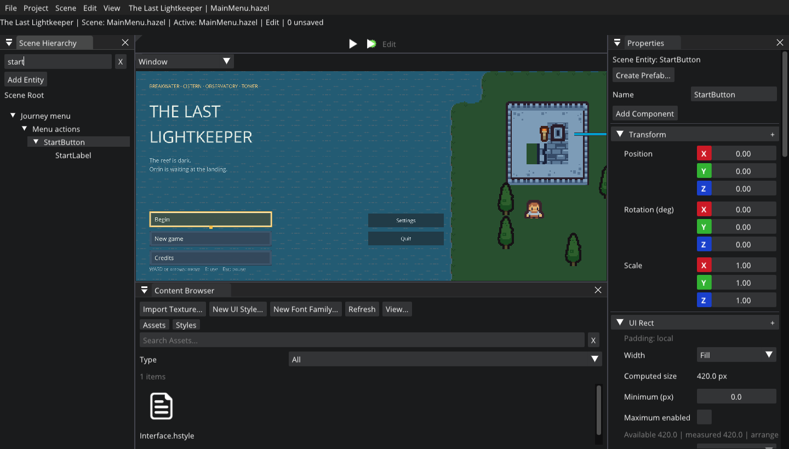
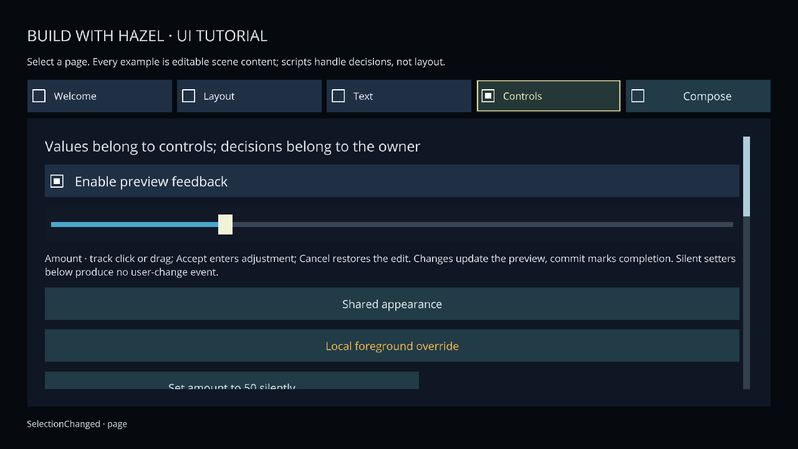
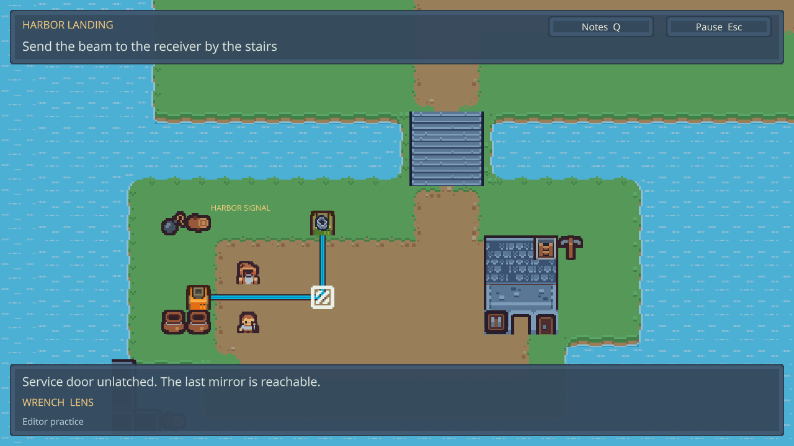
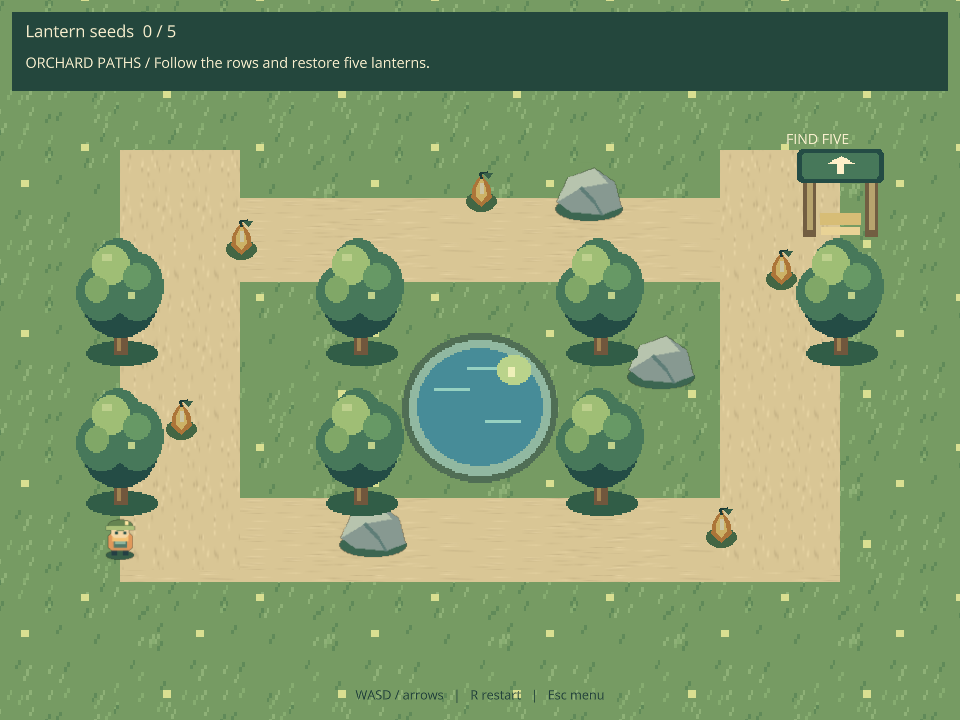

# Hazel

A C++ 2D game engine with a scene editor, C# scripting and standalone game export, for **Windows and Linux**.


*The Last Lightkeeper in Hazelnut: menu authoring, hierarchy, properties and shared styles. [Full resolution](docs/images/hazelnut-lightkeeper.png).*

**Hazel** is the engine library. **Hazelnut** is its editor. **Nutella** runs the exported game without the editor. This fork builds on [TheCherno's public Hazel source](https://github.com/TheCherno/Hazel/tree/1feb70572fa87fa1c4ba784a2cfeada5b4a500db); it is separate from TheCherno's commercial Hazel product.

## Start here

| Try it | Make something | Explore |
| --- | --- | --- |
| [Downloads and snapshots](docs/packaging.md#choose-a-snapshot) | [Set up Windows or Linux](docs/getting-started.md) | [Documentation](docs/README.md) |
| [Run an example](docs/README.md#learn-from-an-example) | [Editor guide](docs/editor-guide.md) · [C# scripting](docs/scripting.md) | [Contribute / report a bug](CONTRIBUTING.md) |
| [Exported-game requirements](docs/platforms-and-dependencies.md#platform-status) | [Sprites](docs/sprite-authoring.md) · [Runtime UI](docs/runtime-game-ui.md) | [Development and CI](docs/development.md) |

The engine includes a 2D renderer, Box2D physics, sprite regions/animation, scene hierarchy and detached prefabs. Menus and HUDs use authored screen-space UI: measured layout, styles, font families, text, controls, scrolling, focus and remappable input. Hazelnut provides native authoring, bounded document history, script builds and game export.

## Build and open the tutorial

Install the [platform prerequisites](docs/getting-started.md#prerequisites-installed-by-you), then clone master with its pinned submodules:

```sh
git clone --recurse-submodules https://github.com/cringlekaden/Hazel.git
cd Hazel
scripts/setup.sh --tests
python3 scripts/hazel.py script-build examples/Sandbox/Sandbox.hproj --config Debug
python3 scripts/hazel.py run Hazelnut --config Debug --project examples/Sandbox/Sandbox.hproj
```

On Windows, use `./scripts/setup.ps1 --tests` and `python`. Setup prepares tools/checks the environment and builds Debug with two compiler jobs; Premake is the build system. `run` launches existing products. [Getting started](docs/getting-started.md) has complete prerequisites, Mono SDK selection, outputs and troubleshooting.

Open **Assets/Scenes/UI Tutorial.hazel** and Play. Its [five pages](examples/Sandbox/README.md) demonstrate layout, typography, controls, screens and reusable compositions. Stop returns to the authored scene.


*Controls, styles and event ownership are editable scene content; game scripts handle decisions.*

## Example games

| [The Last Lightkeeper](examples/LastLightkeeper/README.md) | [MeadowRun](examples/MeadowRun/README.md) · [Skybound](examples/Skybound/README.md) |
| --- | --- |
|  |  |
| Island restoration, dialogue, persistent journeys and settings | Collectibles, physics, sprite animation, parallax and prefab spawning |

[SceneTransitions](examples/SceneTransitions/README.md) is the smallest runtime/scripting example. Every project has source launch and export instructions. Prepared game packages need **no compiler, Python or source SDK**; changing scripts and exporting requires the authoring toolchain.

## Status and support

Requires **OpenGL 4.1 core**. Windows x64 and Linux x86_64/X11 (including Xwayland) are maintained; official Linux packages target Ubuntu 24.04/glibc 2.39+. Native Wayland is not implemented. Native arm64 macOS 27.0+ has an [experimental Xcode application foundation](docs/design/macos-port.md), with qualification and packaging pending. See [platform scope and UI limits](docs/platforms-and-dependencies.md#platform-status).

[](https://github.com/cringlekaden/Hazel/actions/workflows/c-cpp.yml?query=branch%3Amaster)

Integration qualification [`77bea96`](https://github.com/cringlekaden/Hazel/actions/runs/40876819630): [Linux](https://github.com/cringlekaden/Hazel/actions/runs/40876819630/job/123457665523) · [Windows](https://github.com/cringlekaden/Hazel/actions/runs/40876819630/job/123457665758). These completed results cover that source checkpoint; the master badge reports subsequent runs separately.

The badge is **workflow-wide**. Open a run for its separate **Windows Debug, Release and extracted binaries** and **Linux Debug, Release and extracted binaries (Ubuntu 24.04)** results. [CI coverage](docs/development.md#canonical-ci) includes software/GL4.1 regressions, editor/tutorial authoring and relocated packages. Master includes the accepted runtime UI and cleanup milestone. There is no published release; [download guidance](docs/packaging.md) identifies snapshot contents and retention.

The owner completed hands-on acceptance and approved integration. The links above identify the exact source checkpoint that passed qualification. Automated/software graphics checks remain distinct from physical-platform and competent-reader typography evidence. macOS compatibility is the next platform milestone, followed by 3D work.

## License and attribution

[Apache-2.0](LICENSE), retaining upstream attribution. Dependencies, fonts and project art/audio have their own [licenses and provenance](docs/platforms-and-dependencies.md#licensing-and-provenance). Lightkeeper uses Kenney CC0 assets; MeadowRun and Skybound include original example art. [Historical records](docs/history.md) preserve the project's migration/design evidence.
