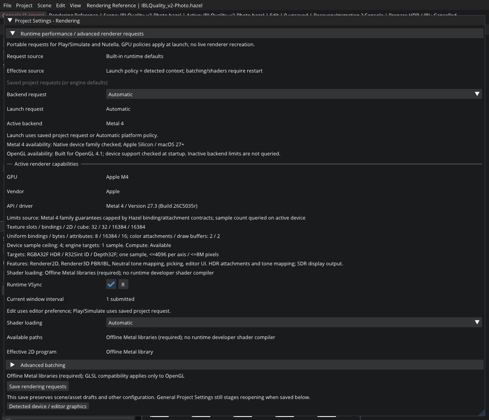
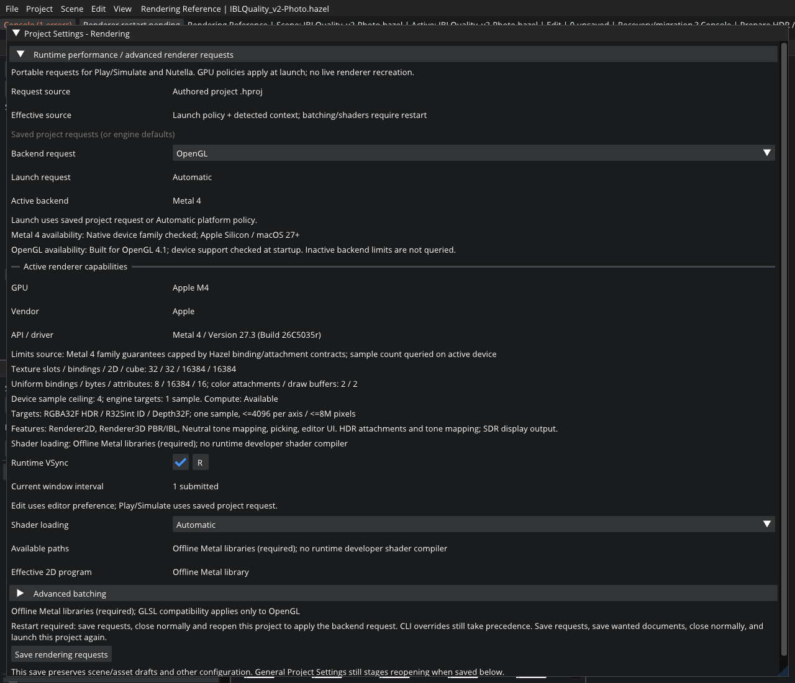

# Backend selection and Project Settings

On `feature/3d-foundations`, Hazelnut and Nutella resolve the backend **before**
creating the window, graphics context or queue. The current checkpoint and its
native/CI verdict are in the [default-backend qualification record](design/metal-default-qualification.md).

Selection precedence is:

1. CLI override: `--metal`, `--opengl` or `--automatic` (choose one).
2. The project's `Rendering.Backend`: `Metal`, `OpenGL` or `Automatic`.
3. Missing settings, including legacy projects, use `Automatic`. Existing explicit
   backend choices and all other serialized renderer settings are retained. The
   default is centralized in `DefaultRendererBackend`.

Automatic prefers Metal 4 on native Apple Silicon/macOS 27+ when the system's
native device reports Metal 4 family support. Otherwise it selects OpenGL, whose
actual 4.1 context support is checked during startup. Windows/Linux select OpenGL.
The prelaunch Metal probe creates no queue, window or renderer. A supported family
is availability evidence, not a guarantee that later resource allocation succeeds.
An explicit unsupported Metal request reports its reason and suggests `--opengl`.
Renderer initialization, missing/corrupt shaders and runtime failures propagate;
there is no fallback after renderer startup fails.

```sh
python3 scripts/hazel.py run Hazelnut --config Release --opengl --project examples/RenderingReference/RenderingReference-IBLQuality-Photo.hproj
python3 scripts/hazel.py run Nutella --config Release --metal --project examples/RenderingReference/RenderingReference-IBLQuality-Photo.hproj
python3 scripts/hazel.py run Hazelnut --config Release --automatic --no-restore
```

`Nutella --metal-renderer2d` remains a legacy Metal override alias. Editor explicit
project/session/default-project selection remains unchanged; the selected descriptor
is read without activating it before graphics startup. The editor's VSync preference
continues to apply in Edit, with saved runtime VSync on Play/Simulate. Texture slots
and shader loading requests retain their existing serialization and precedence.

In **Project → Project Settings → Runtime rendering**, select the backend and
**Save rendering requests**. Save wanted documents, close normally and launch that
project again. No live GPU-device replacement is attempted. The selector shows the
saved/draft request; the launch request and actual active backend are separate.
A CLI override remains effective after restart until removed. Opening another
project with a different backend request also requires restarting with that project.

A backend change is persisted transactionally with the other rendering requests;
scene/asset/general-settings drafts remain owned by their existing editors. A
pending backend request prevents Play/Simulate from accidentally qualifying the
new request against the old device. Unsupported requests can be saved for another
machine; use an explicit OpenGL CLI override to open them here.

## Active capabilities and limitations

Project Settings reports active GPU name, vendor and API/driver identity, texture
and binding limits, uniforms, vertex attributes, attachments, sample support,
compute, target formats, shader loading and available rendering features. Requested
and effective texture/shader policies include limitation reasons. Metal's driver
identity includes the current OS version; no separately versioned Apple GPU driver
number is invented.

| Capability | OpenGL backend | Metal 4 backend |
| --- | --- | --- |
| Availability | Platform build supports GL; actual 4.1 context checked at startup | Apple Silicon/macOS 27+, native Metal 4 family probe |
| Limit provenance | Queried active GL context | Metal 4 family guarantees capped by Hazel binding/target contracts; sample counts queried on active device |
| Shader loading | GLSL 410; optional SPIR-V specialization on capable contexts | Required offline Metal libraries; no runtime developer shader compiler |
| Compute | Unavailable through Hazel's GL4.1 backend | Existing bounded color-pass interface; explicit dependencies/readback |
| HDR / display | RGBA32F radiance, RGBA16F display-linear; FP32 display supported for diagnostics | RGBA32F radiance and display-linear |
| Picking / depth | R32Sint / Depth24Stencil8 | R32Sint / Depth32F |
| Scene samples | 1; queried device limits do not enable scene MSAA | 1; queried device support does not enable scene MSAA |
| Targets | Existing GL limits | 1…4096 per axis, at most 8,388,608 pixels; bounded resource/allocator budgets |
| Rendering | Renderer2D, static Renderer3D PBR/IBL, Neutral tone mapping, IDs, editor UI | Same shared scene submission/features; detached windows on one monitor |
| Output | SDR encoded display; HDR attachments do not imply HDR monitor output | Same |

Inactive backend limits are **not queried**. An availability row is not a detailed
capability record for a device/context that has never been initialized. Metal's
reported binding/attachment ceilings describe Hazel's usable contracts rather than
claiming to be unrestricted device maxima. Physical device coverage, hosted builds
and software GL remain distinct in qualification reports.

No XeGTAO, bloom, Forward+, new lights, SSR or reflection probes are introduced.
Frozen PBR/IBL references and the accepted split-sum approximation remain unchanged.


## Native Project Settings captures

These are native Apple M4/macOS 27.3 captures of the production Project Settings
widget in the maintained editor regression fixture. The first shows Automatic
resolved to Metal 4, with queried sample support separated from Metal-family and
engine limits. The second follows an actual saved OpenGL request: the active
Metal device remains intact until restart. They are automated fixture captures,
not a claim of physical mouse/menu interaction. Deliberately rejected authoring
operations in that fixture may remain in the background Console.




