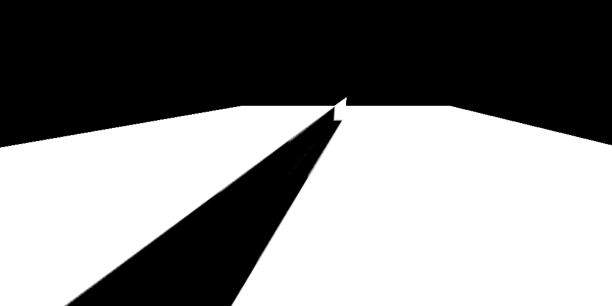
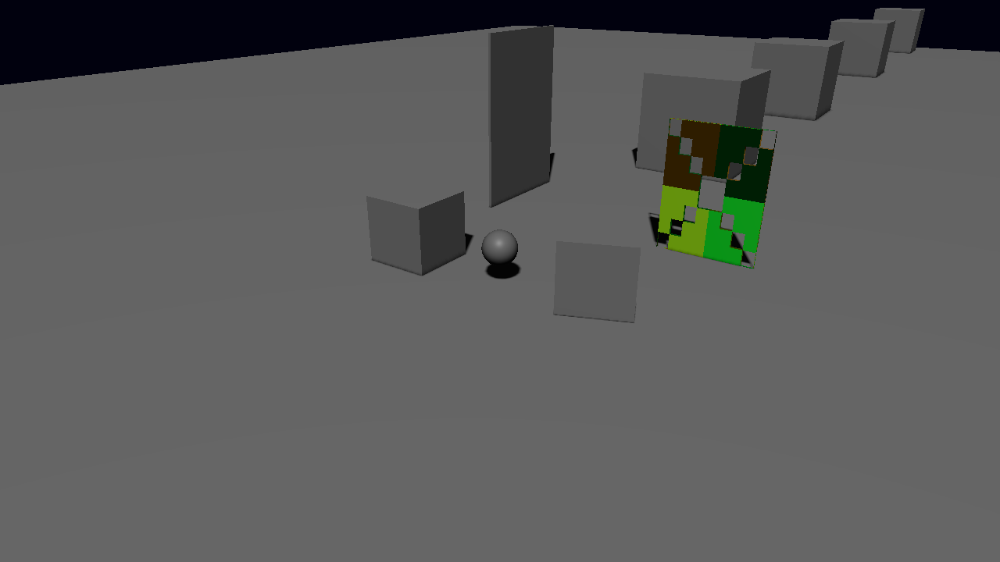
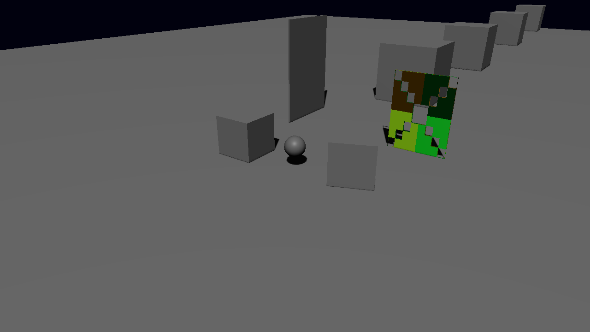

# Directional shadows: first CSM foundation

Baseline: `feature/3d-foundations`, `c36fd1a15e2774a3e0d6bdf15f7fe38163b5104f`.
The owner accepted that revision's local-light terminator correction. Preserve
its direct BRDF, authored-surface visibility and independent indirect lighting.

Status: cohesive first foundation implemented; **production milestone INCOMPLETE**.

## CSM cohesion follow-up: qualification contract

The owner accepted the TAA entry correction `878303e` separately. This follow-up
investigates physical PCF/bias differences before and throughout an overlap,
including edge position and 10–90% contour width. The original epsilon split
crossing test remains required, but cannot by itself detect a softness band.

Before running the expanded fixtures, retain the existing analytic visibility
limit .02, RGB backend parity .003, exact IDs, depth parity 1e-6 and split/fade
crossing limit .01. Add an independent FP64 ray/box depth-grid integration check
against .02 visibility error, plus a contact-edge allowance of one projected
coarser-map texel plus the explicitly calculated receiver displacement. Report
per-boundary map disagreement, 50% contour displacement and 10–90% widths as
measurements, rather than inventing a production visual threshold from the data.
Use fixed exposure/viewpoints and preserve all frozen references. Owner acceptance
and untested platform/configuration coverage remain separate gates.

The expanded fixture covers 512/1024/2048, distances 40/80, low/high camera poses,
flat/tilted receivers and ordinary/grazing lights. Native combined AO/TAA motion,
reconfiguration and 3200×1800 presented editor checks are required. PCSS remains
design-only and is not authorized by this follow-up.

## Audit and selected design

`Scene::DrawView` → `SceneRenderer::Collect/Render` → `Renderer3D::Render` is the
single scene/material submission path. Collection currently drops off-frustum
meshes. CSM must retain conservative casters in the same collection, independently
of camera visibility. Mesh bounds, immutable assets, mirrored winding, material
MASK and double-sided state are reusable. World 2D remains outside mesh shadows.

`SceneRenderView` owns per-view targets; Metal framebuffer generations and draw
uniform snapshots survive GPU completion. DepthPBR already writes masked depth
without color/IDs. Metal supports depth32F preparation; OpenGL's DEPTH32F enum
is not yet implemented by OpenGLFramebuffer. Both require an explicit depth
producer-to-lighting dependency. Extend the existing packet ownership pattern,
not scene traversal or a render graph. Camera ViewProjection is authoritative,
including direct test submissions which omit separate View/Projection matrices.

Four cascades in one 2×2 atlas avoid array/layer rendering and sampler-array
indexing differences on OpenGL 4.1. Each cascade uses an explicit viewport and
depth-only draw. Initial per-cascade resolutions: 256, 512, 1024; atlas dimensions
remain within Metal's existing framebuffer limits. No backend default changes.

Practical logarithmic/uniform perspective splits, linear orthographic splits,
and configurable shadow distance. Reconstruct finite frustum corners from the
unjittered authoritative VP and physical camera forward. Fit each overlapping
slice with a bounding sphere rather than a tight light-space box: this spends
resolution to keep scale independent of camera rotation. Quantize radius, snap
light-space XY to texels, reserve filter/snap/bias margins. Fit depth conservatively
to receiver and overlapping caster bounds; never camera-cull casters. A fixed
light basis may change at its pole-selection threshold under moving lights;
temporal invariance is promised only for fixed light/projection/settings.

Canonical GLSL owns depth lookup and deterministic 3×3 bilinear PCF (16 shared depth fetches). Atlas texelFetch
prevents hardware comparison/filter differences and adjacent-cascade leakage.
Shared projections use RH OpenGL [-1,1] clip depth, standard Z, Less, clear 1.
Metal's existing SPIRV-Cross clip-depth/Y fixups also apply to shadow producers;
sampling explicitly converts canonical NDC to [0,1]. No reversed Z conversion.

Bias is receiver-side, in world/texel units, derived from the actual geometric
plane rather than mapped shading normals. Bounded normal offset and slope/depth
allowance must be tested on contacts and grazing surfaces. Shadow visibility
multiplies directional incident RGB only; leave GGX/Kulla–Conty, local lights,
emission, AO and IBL unchanged. Smooth shading still follows actual caster
triangles, so geometric shadow terminators require explicit visual qualification.

Authored opt-in settings use existing ScenePresentation serialization/editor
draft/apply mechanisms. Changing settings invalidates TAA through presentation
equality. No PCSS, contact hardening, spot/point shadows or update scheduler.

## Acceptance gates declared before implementation

- CPU/FP64: split anchors/order, finite matrices, inverse-VP slice coverage,
  conservative off-camera casters, light directions including poles, scale and
  texel-grid invariance under camera translation/rotation; invalid inputs fail.
- GPU: independent analytic blocker/receiver visibility, exact unchanged camera
  depth/IDs, deterministic captures, contact/acne/detachment, near/far transitions,
  cascade blending continuity and distance fade. Test opaque/MASK, smooth/hard,
  mirrored/nonuniform transforms, off-frustum and moving casters/lights/cameras.
- Native Metal/OpenGL matched captures and bounded parity; API/GPU validation,
  two views, queued frames, resize/reconfiguration/cancel/recreation/retirement.
- Unmodified frozen GGX/IBL, accepted local-light terminator, AO/TAA regressions;
  Debug/Release warnings, editor/player and packaged artifact coverage.
- Performance: matched off/on generation versus forward sampling where counters
  permit; warmup 5, at least 20 samples, median/p95 at 720p/1080p, 512/1024 maps.
  Distinguish GPU completion intervals from serialized readback/frame pacing.
- Owner visual acceptance remains separate. Unavailable gates are NOT RUN or
  BLOCKED; never infer a production PASS from one image or backend.

Design references: [Microsoft CSM guidance](https://learn.microsoft.com/windows/win32/dxtecharts/cascaded-shadow-maps)
and [sample fitting/snapping implementation](https://github.com/microsoft/DirectX-SDK-Samples/blob/main/C%2B%2B/Direct3D11/CascadedShadowMaps11/CascadedShadowsManager.cpp).
These inform tradeoffs; Hazel's source and independent tests define its contract.

## Implemented foundation and ownership

The implementation uses a 400-byte std140 `DirectionalShadowData` block at
binding 5 during forward rendering; motion uses binding 5 in its separate pass.
Captured per-draw versions prevent aliasing. Texture 10 is the atlas; material/
IBL 0–7, AO 8 and light tiles 9 retain their meanings. OpenGL 4.1 guarantees
sufficient fragment units; actual capability admission now requires eleven.
The tracked `ForwardPBR.hzmetal` is regenerated from canonical GLSL, with reflected
CPU layout checks. No native shading implementation was added.

`SceneCollection.cpp` fills both camera-visible meshes and the conservative
caster list in the same traversal. No shadow visibility cache or directional
UUID is needed yet: the single enabled key's entire atlas is regenerated per
view. `SceneRenderer` fits the unjittered view, records the atlas before AO/forward,
and supplies those matrices unchanged to jittered shading. `Renderer3D` reuses
MASK/material/cull/mirrored-winding behavior for each depth viewport. The camera
pass still owns authoritative signed IDs and depth.

OpenGLFramebuffer now allocates actual GL_DEPTH_COMPONENT32F depth-only storage
and explicitly binds the atlas for lighting. Metal permits bounded viewports on
**depth-only** targets; the existing color-target viewport restriction remains.
The consumer packet moves/retains its `ShadowSource`, recursively prepares and
accounts its allocations, encodes it before lighting, and orders producer stages
before fragment sampling. Reconfiguration, cancellation, view destruction and
backend recreation follow existing framebuffer-generation ownership. No separate
queue submission, readback synchronization or render graph was introduced.

Four cascades use practical splits (default lambda .65, distance 100), with linear
splits for orthographic views including negative near planes. Each next cascade
includes the preceding blend band. The final band fades to unshadowed light.
The sphere radius is rounded upward in 1/16 world-unit increments; XY uses a
world-anchored light basis and texel snapping. Padding reserves filter, snapping
and normal-offset coverage. Depth includes all overlapping caster bounds, even
behind the eye or beyond camera far; this is conservative but can spend precision
on downstream/outlier geometry. Standard finite non-oblique camera planes and
unit physical forward/light directions are validated. Infinite, oblique and
reversed-Z cameras are explicitly unsupported by this slice.

Bias uses a light-facing **geometric** receiver offset, scaled by world texel
width and grazing angle, plus a small texel-scaled depth allowance. PCF taps use
receiver-plane depth correction; slopes are capped at 8 and denominators at .05
to avoid singular grazing offsets. There is no blanket front-face cull or
backend-specific polygon-offset tuning. Actual triangular geometry still casts
shadows on smooth surfaces; the accepted authored-normal BRDF is untouched.

The first nearest-texel PCF experiment exposed four cross-backend edge pixels
(max RGB .0856) and visibly stepped contacts. The final filter is the average
of nine bilinear comparison lookups, combined into a shared 4×4 footprint:
per-axis weights `(1-f, 1, 1, f)/3`. Its 16 explicit depth fetches keep weights
continuous at texel boundaries. This fixed the strict parity gate without
changing its tolerance. Atlas clamping stays inside the selected tile.

## Native checkpoint evidence

Apple M4, macOS 27.3 (26C5047e), Xcode 27.3 (27C5020n). Native Metal 4 with API/GPU
validation and Apple OpenGL 4.1 through canonical shaderc/SPIRV-Cross GLSL 410;
no software-GL result is substituted for native coverage.

[Machine-readable qualification](evidence/DirectionalShadows_v1/qualification.json),
[Debug](evidence/DirectionalShadows_v1/debug-results.json),
[Release](evidence/DirectionalShadows_v1/release-results.json) and
[math preservation](evidence/DirectionalShadows_v1/canonical-math.json) retain
scope and source/artifact hashes. Raw local logs and intermediate failures remain
under `build/csm-evidence/` rather than being represented as passing runs.

- PASS Debug/Release: 1,536 independent FP64 frustum-corner probes per process,
  analytic split anchors, rotation-independent scale, whole-texel translation,
  light poles, orthographic negative near, invalid projection rejection and YAML
  settings roundtrip.
- PASS both configurations/backends: 18 analytic blocker/receiver cases across
  256/512/1024, near/far camera positions, light pole and off-frustum casters;
  approximately 892k interior receiver samples per backend. Maximum visibility
  error .014685 against the predeclared .02 bound. Filter boundaries remain in
  captures and are excluded conservatively from the hard-visibility oracle.
- PASS strict native parity: zero ID mismatches, max depth delta 9.84e-7 against
  1e-6, max RGB delta .000318 against .003. Static captures are deterministic;
  split/final-fade crossings have maximum RGB-vector change 7.3e-6.
- PASS exercised Metal lifetimes: atlas+AO in three gated frames, separate-process
  TAA three-successor queue test, busy cancellation and view destruction before
  completion. Lit combined shadows/AO/TAA also exercise moving camera/light/caster,
  target resize and resolution replacement. Exercised shutdown resources retire
  and native validation assertions remain clean. These are not long-session or
  motion-quality acceptance results.
- PASS Debug/Release: tools, both GPU fixture executables, Hazelnut and Nutella
  build. No new warnings were identified in changed first-party code; existing
  component-copy, unused-parameter and UI warnings remain. A standalone include
  check covers the new portable shadow header on local Clang only.
- Focused AO/TAA and accepted local-light/Forward+ regressions retain their frozen
  thresholds. Exact configuration/iteration attribution is in qualification.json.
  No accepted fixture or reference data was reset.


This is a production-path offscreen readback, not an editor/presentation capture
or owner approval. It includes hard/smooth contacts, mirrored geometry, thin and
masked casters and far blocks. Continuous PCF improves the observed contact
stepping; grazing bias, geometric smooth-shadow terminators, leaks, detachment
and moving-scene quality still require deliberate owner review.

## GPU cost

[Raw samples](evidence/DirectionalShadows_v1/performance.csv) and
[median/p95 summaries](evidence/DirectionalShadows_v1/performance.json): Release,
Apple M4, 32 cubes plus ground, four cascades, warmup 5 and 20 measured samples
per case. API/GPU validation disabled for timing. Each sample waits for offscreen
completion/readback; this is not presented frame pacing or an FPS claim.

| Physical extent | Cascade resolution | Atlas interval ms median / p95 | Forward off → on median ms | Difference of medians ms |
|---|---:|---:|---:|---:|
| 1280×720 | 512 | .0164 / .0304 | .660 → 1.025 | .365 |
| 1280×720 | 1024 | .0839 / .1563 | .651 → 1.079 | .427 |
| 1920×1080 | 512 | .0211 / .0433 | 1.654 → 2.267 | .613 |
| 1920×1080 | 1024 | .0445 / .0696 | 1.395 → 2.135 | .740 |

Atlas timing brackets the depth command interval; forward brackets forward/world
execution and includes the shadow-sampling path. Differences include cache and
shader execution effects, not an isolated per-fetch cost. Short intervals and
run-order/driver variance are visible; do not infer inverse resolution scaling
or a general performance guarantee from this workload. OpenGL GPU pass timing is
NOT MEASURED here. CPU fitting/collection is included only in serialized elapsed
time, not separated as an optimization claim.

Depth storage is 4 MiB at 512 and 16 MiB at 1024 per atlas generation; up to four
bounded completion/idle generations per view can retain 16/64 MiB respectively.
Existing attachment accounting includes them. This excludes view HDR/AO/TAA,
uniform/upload buffers and native allocation overhead.

An initial benchmark read the reset view metrics object and yielded zeros. It
was discarded. Only `performance-qualified/` is reported: it reads completed
frame-owned counters and checks their validity, positive generation when enabled,
and positive forward intervals.

## Reproduction and remaining gates

```sh
python3 scripts/hazel.py build --config Debug --tests --target MetalShaderTools --target MetalRenderer2DQuadSmoke --target MigrationRenderer2DSmoke
python3 scripts/macos/metal_shaders.py --config Debug --output Hazel/Resources/shaders/metal
python3 tools/assets/generate_directional_shadows.py
python3 scripts/macos/directional_shadows.py --config Debug --resources Hazel/Resources --output NEW_DEBUG_EVIDENCE
# Repeat build/qualification with Release.
python3 scripts/macos/directional_shadows.py --config Release --resources Hazel/Resources --backend metal --benchmark --output NEW_PERFORMANCE_EVIDENCE
```

The [study instructions](../../examples/RenderingReference/README.md#directional-shadow-study)
cover editor/player launch and manual movement. Authored settings are opt-in;
existing scenes retain shadows off. Public editor/example/README documentation
is updated; static README link checking passes. CI triggers/badges remain unchanged;
no branch CI, Windows/Linux/Intel/AMD/NVIDIA execution or new packaging/relocation
campaign is claimed. Detached-view stress, long-session presentation, full
interactive editor/player and owner visual acceptance remain NOT RUN.

The cohesive first foundation is implemented and independently testable.
**The production milestone is INCOMPLETE.** It is available for owner inspection,
but automated numerical/lifetime checks and this one observed image do not
establish production visual acceptance. No PCSS, point/spot shadows or next-stage
work is authorized by these results.

## Owner-found editor TAA failure — follow-up to dd85be4

The owner reported enabling XeGTAO and then TAA in the shadow reference editor
crashed with `Bind a qualified framebuffer before Renderer2D::BeginScene`.
The initial authored-camera offscreen fixture missed the actual editor lens,
saved orbit pose, Retina footprint and host error/overlay path.

Three concrete problems were reproduced:

1. Large Retina views could exceed the original M1 proof's 1 GiB aggregate
   storage ceiling. A native 3200×1800 presentation fixture also exceeded it
   with AO alone. Private HDR world intermediates unnecessarily retained
   completion-versioned attachment pools despite having no external readers.
2. After memory admission, jitter phase 6 at the saved off-origin editor pose
   failed XeGTAO's orthogonality check. Subtracting nearby near-plane points in
   FP32 lost accuracy with a 30-degree lens and .1/1000 clip range. This is a
   false rejection of a valid camera, not evidence for relaxing the threshold.
3. SceneRenderer cancelled failed Metal packets; Scene::RenderScene attempted
   fallback UI and Hazelnut then attempted overlays without a bound host packet.
   The secondary BeginScene exception masked the primary rendering error.

The fix reconstructs the AO camera basis and projection constants in FP64 on
CPU, then narrows to the existing FP32 GPU ABI. The orthogonality tolerance and
shader algorithm are unchanged. Independent camera-pose axes now cover all
64 jitter phases at the failing lens/pose/extent.

Private world intermediates are configured before first use and reuse one
attachment generation on the existing single queue. Queue-stage barriers protect
previous consumers before new writes, including the temporal compute path's
existing compute/blit barrier. Direct presentation/readback of private scratch
is rejected. Public view targets and atlas completion ownership stay versioned.
At 3200×1800, avoiding two redundant HDR/ID/depth world generations saves up to
approximately 264 MiB compared with three slots. This follows the existing private
TAA producer contract, rather than permitting arbitrary render-target aliasing.

Memory admission now shares an explicit **2 GiB** resource ceiling between
framebuffer allocation and aggregate device accounting. Idle/in-flight storage,
uploads and editor UI remain counted; the separate 64 MiB allocator bound remains.
Reuse alone does not make the full Retina AO/TAA footprint fit the old proof's
ceiling. The bound is retained, not disabled; larger/multiple views can still
require more memory than admitted and are not universally qualified.

On an editor rendering failure, Scene::RenderScene restores and clears its host
packet before fallback UI and overlays. The original RenderError remains visible;
failed frames clear stale picking IDs. A regression deliberately rejects an
invalid shadow distance and verifies the original error, a subsequent overlay
BeginScene and completed fallback readback.

Focused qualification and native-window results for this follow-up are recorded
in the [follow-up qualification](evidence/DirectionalShadows_v1/editor-taa-fix.json). The new window fixture
uses the actual scene editor entry point, saved orbit pose, 3200×1800 scene target,
ImGui presentation, live shadow → AO → TAA toggles and repeated off/on changes.
It waits for positive presentation evidence rather than treating CPU updates as
presented frames. The original performance table predates this ownership fix;
no new GPU timing claim is made here. Production visual acceptance remains separate.

The follow-up passes native Debug/Release at 3200×1800 with API/GPU validation:
23/44 positive completed presentations, zero validation errors and zero remaining
exercised resources/attachment generations after shutdown. Debug executed 3,666
CPU ticks while waiting for positive presentation; Release executed 60. These
counts are not interchangeable or an FPS benchmark. Tracked active resources
peaked at 1.52/1.65 GiB respectively; all attachment storage peaked at 1.19/1.49
GiB (overlapping accounting scopes, not additive). Focused CSM parity, AO/TAA,
editor-error recovery and queued-output lifetime checks pass in Debug/Release.
Hazelnut and Nutella are rebuilt in both configurations. Windows/Linux and other
GPUs remain unverified; this scoped fix does not close production visual review.

Reproduce the presentation regression from the repository root on an unlocked,
visible native desktop (replace Debug paths/configuration for Release):

```sh
python3 scripts/hazel.py build --config Debug --tests --target MetalM1Smoke
DYLD_LIBRARY_PATH="$PWD/build/dependencies/mono/macos-arm64/sdk/lib" MTL_DEBUG_LAYER=1 MTL_SHADER_VALIDATION=1 bin/Debug-macos-arm64/MetalM1Smoke/MetalM1Smoke build/NEW_SHADOW_EDITOR_EVIDENCE --shadow-editor-settings Hazel/Resources
```

## CSM cohesion investigation and Ultra

Follow-up to foundation `dd85be4` and owner-accepted TAA correction `878303e`.
Adopted scope: **2048 Ultra, private-atlas storage reuse and transient diagnostics**.
The tested continuous-footprint sampling change was **rejected**, and production
retains the established per-cascade PCF/bias. This investigation did not resolve
the owner-reported visual defects. The measured bias/footprint/grid mechanisms
explain the diagnostic contacts; they do not establish every cause in the owner's
unspecified smooth/masked mesh-edge observation. No PCSS is implemented; production qualification
and owner acceptance remain incomplete.

### Diagnosis and implementation

The old PCF and both receiver biases were expressed in each sampled map's texels.
For the 80-unit perspective fixture at 512, cascade texels measure approximately
.04047/.08291/.16014/.41996 world units. Consequently an overlap blended different
physical kernels and different displaced receiver points. Smoothstep only made
that mixture continuous; it did not make the two shadows agree. Grazing incidence
amplifies normal displacement into a larger ground-contact shift. A zero-bias
ablation must leave fitting unchanged: changing authored NormalBias also changes
projection padding, which otherwise confounds the experiment.

**Rejected experiment (not production).** The experiment constructs one continuous world receiver scale from the stable
projection's texel-density anchors. Cascade zero uses its native texel width.
In interval c>0, interpolate the preceding/current widths over the physical view
interval; at each split the two interval expressions agree exactly. Both maps in
an overlap receive that same scale and geometric receiver. Normal and depth bias
retain the authored values and angular/receiver-plane semantics, using this scale.
The physical PCF box width is three times the scale. Integrate its overlap with
map texel cells exactly, rather than changing the physical box with map selection.
Its width is never above three texels in either participating map, so the same
4×4/16 explicit fetches suffice. Relative cell coordinates avoid cancellation in
small area weights at 2048. The old three-texel box is recovered at density anchors.
The [archived experiment patch](evidence/CSMCohesion_v1/rejected-filter.patch)
reproduces this proposed sampling in isolated resources only.
This reduces coarse-map filtering between anchors; it does not add blur, widen
blend bands, change incident energy, or reinterpret the AA footprint as a penumbra.

In both the experiment and adopted implementation, bounding-sphere fitting, radius quantization, texel snapping, overlap fitting,
conservative off-frustum caster collection and light-depth spans are unchanged.
The same 400-byte GPU block uses previously reserved Range.w for transient shadow
inspection. Canonical GLSL still owns all raster math. Inspection disables TAA
history, like other numerical inspections. Current/next/blend occupy RGB; individual
maps, native world texels, receiver displacement and an unbiased pair are available.
The unbiased pair changes only receiver bias, keeping the same depth atlas.
[Canonical math hashes](evidence/CSMCohesion_v1/canonical-math.json) independently
confirm exact preservation of accepted direct GGX, surface energy, smooth-normal
visibility, BRDF lookup and the entire indirect IBL block against `c36fd1a`.

**2048 (Ultra)** is an authored per-cascade option, without changing defaults.
Its four tiles form a 4096² Depth32F atlas (64 MiB). Metal permits up to 16M pixels
only for depth-only targets; color/readback targets retain the 8M limit and the
renderer retains its total 2 GiB budget. Native OpenGL 4.1 renders the same atlas.

The first Ultra Retina test failed the existing budget at an AO/TAA toggle. Private
shadow maps previously accumulated idle/in-flight atlas generations. They now reuse
one storage generation per view, with the **existing** all-stage queue barrier
contract: each parent encodes its captured depth producer immediately before its
forward consumer on the single queue. The atlas cannot be read back or presented
directly. CPU packets, draw/uniform versions, and replaced-size generations remain
completion-retained. AO storage, public output/readback generations, and TAA history
ownership are unchanged. A dedicated lit moving-shadow test checks serialized vs
three queued frames, actual shadow changes, shared Ultra storage, replacement,
busy cancellation, destruction before completion, and final retirement. The older
unlit lifetime tests alone could not prove this read/write dependency.

### Captures and numerical results

The additive fixture uses fixed exposure 0, matching camera transforms and a long
wall casting onto a flat or tilted floor. It exercises all three internal boundaries,
near/far views, distances 40/80, 512/1024/2048, ordinary/grazing light (flat-receiver N·L approximately .845/.302), and geometric
contact. Extreme grazing beyond the slope/denominator clamps and light motion
across the basis-selection threshold remain unqualified. The authored study adds hard, smooth, mirrored, masked and thin geometry.
Twelve study states cover AO/TAA independently off/on and moving camera translation,
rotation, light and caster with both AO/TAA on and both off. Saved steps 0/7/15 make
motion reproducible; they are observations, not a frozen visual-quality oracle.

| Native Metal measurement | Baseline | Rejected experiment |
|---|---:|---:|
| Overlap ground samples | 611,232 | 611,232 |
| Mean absolute current/next visibility disagreement | .001995 | .000904 |
| Median coarse/fine 10–90% contour-width ratio | 1.9435 | 1.0000 |
| Mean absolute width mismatch, world units | .23988 | .01389 |
| Mean 50% contour disagreement, world units | .02614 | .03494 |
| Maximum 50% contour disagreement | .28899 | .44335 |
| Mean absolute analytic contact-edge error | .01792 | .02090 |
| Maximum analytic contact-edge error | .33491 | .25153 |

These are 474 contour rows from 24 cases; [per-case/boundary data](evidence/CSMCohesion_v1/continuous-release-v2-metal-continuity.json)
and [matching comparison](evidence/CSMCohesion_v1/continuity-comparison.json) retain
all results. OpenGL measurements agree closely. **Width cohesion improves, but
mean contour alignment does not.** Point-sampled caster silhouettes on different
stable grids still have different edge phases. The old bias sometimes accidentally
cancelled that error. Matching the receiver/filter removes that accidental
compensation and exposes sharper coarse-grid quantization. No claim that mesh-edge
misalignment is completely fixed is supported. All measured contact contours stay
within the declared projected-coarse-texel plus receiver-displacement allowance;
that numerical bound is not a visual acceptance threshold.

1024 baseline / rejected experiment, raw visibility at the same pose:


Adopted baseline sampling at 2048 Ultra, same pose:



Rejected experiment at 2048 Ultra, same pose:


Authored study, baseline / rejected experiment, fixed exposure 0 and identical camera, AO/TAA off:




The FP64 oracle independently ray-traces the geometry at projected texel centers
and integrates cell areas; it uses measured matrices as inputs, not production
fitting/depth/PCF helpers. Existing analytic corner/grid tests independently test
fitting. There are 95,880 visibility probes per backend/configuration. Exact-center
reference error reaches .04448 in the experiment (.11111 baseline) where a native
rasterizer covers a subpixel edge that the exact ray misses. The retained oracle
therefore also reports an explicit ±1/256 shadow-texel coverage interval for failing
probes, rather than discarding them or changing .02. Two experimental probes and twelve
baseline probes need that interval. Maximum error outside it is .01412 experimental
and .01790 baseline, below the unchanged .02 bound. This is a scoped raster-coverage
uncertainty model, not certification of every GPU's raster precision.

**New stress full-frame inspection parity is INCOMPLETE.** The strict .003 RGB /
1e-6 depth / exact-ID check was not weakened: it fails in both baseline and experiment.
There are up to three floor/wall camera-coverage ID differences per image, depth
roundoff up to 1.97e-6 in these wide perspective fixtures, and large differences in
unused coarse-map inspection channels on wall edges. Even common-ground final
visibility has one experimental contact pixel at .0046604 (.0004205 maximum baseline
in that case), above .003. These results are retained in
[stress results](evidence/CSMCohesion_v1/stress-release-results.json) and
[ground visibility parity](evidence/CSMCohesion_v1/stress-ground-parity.json).
They must not be represented as a production parity PASS or hidden by an aggregate
image score. The established analytic/rendered RGB suite still passes its original
thresholds; visibility diagnostics and radiance have different numerical scales.

Higher resolution and shorter shadow distance reduce quantization, at explicit
memory/coverage cost. Increasing fine-map blur to match the coarse grid would hide
some phase error and spend extra fetches; it was not selected. Recovering subtexel
caster coverage/planes from the existing depth-only samples is not generally exact.
A coverage/depth representation change needs a separate measured design decision.
The sampling candidate is retained only as an isolated experiment. It is not
shipped: restoring filter-width cohesion by sharpening coarser maps worsened
contour phase/alignment and did not establish temporal visual quality. Do not
replace the baseline merely because average visibility disagreement improved.
The next design must address subtexel coverage/edge phase or explicitly select a
world-footprint/filter-cost tradeoff with evidence. Ultra and diagnostics are
independently useful; **the requested visual milestone remains blocked**.

The concrete prerequisite is not a new render graph or a different camera fitter.
With fine/coarse texels T and U>T, a common box at least three coarse texels wide
needs `3*U/T` fine texels per axis. Exact cell integration generally exceeds the
existing 4×4 fetch budget. Keeping that budget by narrowing the coarse kernel is
the rejected experiment above. A wider physical filter cannot be adopted merely
to conceal the mismatch. The smallest next comparison should explicitly evaluate
a bounded 36/64-fetch matched-support reconstruction against a coverage-preserving
depth representation. A small multisample depth/coverage prototype is one concrete
alternative, but changes both backend sample/format admission and atlas memory
(four Depth32F samples would be 256 MiB at Ultra before other resources). Neither
alternative is selected or implemented here. Predeclare contour/temporal/contact
gates and cost bounds before choosing; preserve current fitting/caster semantics
unless those measurements identify a coverage failure.

### Qualification, performance and reproduction

Adopted production sampling remains the baseline. Two isolated Release Metal runs
(pooling 40 measured samples per case, 5 warmups per run) measured:

| Output / cascade | Atlas generation median / p95 ms | Forward median / p95 ms | Forward on−off median ms |
|---|---:|---:|---:|
| 720p / 512 | .0135 / .0199 | .9199 / 1.1928 | .2930 |
| 720p / 1024 | .0935 / .1603 | 1.0280 / 1.2503 | .3885 |
| 720p / 2048 | .3140 / .4341 | .9651 / 1.2690 | .3328 |
| 1080p / 512 | .0229 / .0387 | 2.0451 / 2.6885 | .4872 |
| 1080p / 1024 | .0473 / .0885 | 2.2409 / 2.6883 | .9551 |
| 1080p / 2048 | .3009 / .3855 | 2.3487 / 2.7568 | .8186 |

[Performance records](evidence/CSMCohesion_v1/performance-summary.json) include the
33-mesh workload, raw per-run summaries and scope. The pre-change 1024 baseline
measured generation/forward .0671/1.0383 ms at 720p and .0530/2.2108 ms at 1080p.
Those separate runs do not establish a speedup/regression or presented throughput.
Forward on−off includes sampling and pass differences, not isolated shader clocks.
The rejected experiment's 1080p forward medians were 2.724–2.726 ms at 512/1024,
versus adopted-run ranges 1.991–2.305 ms. It did not justify its extra filtering ALU
with improved contour correctness. OpenGL pass cost and Retina performance remain
NOT MEASURED; the 3200×1800 test establishes presentation/lifetime, not FPS.

The final [qualification manifest](evidence/CSMCohesion_v1/qualification.json) lists
exact commands, hashes, configurations and individual PASS/INCOMPLETE/NOT RUN gates.
Native macOS uses Apple M4 Metal 4 and Apple OpenGL 4.1; no software GL is substituted.
Windows/Linux and non-Apple GPUs, long sessions, detached Ultra views and final
interactive owner acceptance remain unverified. Existing frozen references and
thresholds are unchanged. Raw captures, validation logs and discarded experiments
remain under `build/csm-cohesion/`.

```sh
python3 scripts/macos/shadow_continuity.py --config Release --resources Hazel/Resources --output NEW_BEFORE --baseline
python3 scripts/macos/shadow_continuity.py --config Release --resources Hazel/Resources --output NEW_EXPERIMENT --experiment --compare NEW_BEFORE
python3 scripts/macos/directional_shadows.py --config Debug --resources Hazel/Resources --output NEW_DEBUG
python3 scripts/macos/directional_shadows.py --config Release --resources Hazel/Resources --output NEW_RELEASE
python3 scripts/macos/directional_shadows.py --config Release --resources Hazel/Resources --backend metal --benchmark --output NEW_TIMING
```

The baseline command creates isolated resources using historical `878303e` sampling
plus neutral transient inspection; it never changes production/frozen resources.
The experiment command applies the archived patch only to isolated resources.
Both stress runs intentionally return nonzero on the unresolved strict full-frame
inspection-parity gate. Compare saved `continuity.json` despite that reported failure.
`--capture-only` records fixtures without claiming numerical qualification;
`--inspect-only --model baseline` evaluates previously saved baseline captures.

### PCSS recommendation — design only

The current ownership, linear orthographic depth atlas and canonical shader path
can support a small directional PCSS experiment. **This investigation has not established
the visual/contact/parity readiness needed to proceed.** Obtain owner acceptance of
the CSM tradeoffs and explicit implementation authorization first.

Use one directional-light angular **half-radius in radians**, independent of shadow
resolution and quality. For receiver/blocker separation d along light travel,
penumbra radius is `tan(angularHalfRadius) * max(d,0)` in world units. Decode d as
normalized depth difference times the cascade's light-depth span; do not use a
perspective point-light depth ratio or compare normalized depths from different
spans. If averaging blockers across maps, decode world light depth using VP's depth
translation/span first. Shadow visibility must continue to attenuate incident direct
RGB only. The accepted BRDF/IBL/energy math remains outside shadow filtering.

Start with a bounded 16-sample blocker search and 16 bilinear-comparison filter
locations in canonical GLSL, a fixed light-space disk pattern and a documented
maximum world penumbra/search radius. This is roughly 16+64 depth fetches per map,
up to twice that in overlaps; measure before choosing budgets. Keep the current
16-fetch PCF mode as a quality/performance option. Ultra specifies resolution,
not angular light size. Avoid frame-randomized patterns initially; TAA must remain
optional and must not be required to conceal blocker-search noise. No new compute,
render graph, atlas type, mip hierarchy, or platform-specific shading model is needed
for this first experiment. OpenGL 4.1 bounded loops and explicit texel fetches are
feasible; native shader compilation and cost still require measurement.

Both maps must use the same physical search/filter support and receiver bias in an
overlap. Their blocker estimates may disagree; qualify that disagreement explicitly
before selecting a radius-combination rule. A finite **world** search/filter bound
also requires larger stable fitting/caster-coverage margins than today's two-texel
PCF padding. Reject unbounded requests; document clipping rather than silently
missing off-frustum blockers. Do not implement PCSS inside current padding unchanged.
Keep geometric receiver-plane correction for filter taps, separately qualify blocker
classification bias, reject clear-depth samples as blockers, and demonstrate contact
radius tending to zero without introducing self blockers or detached shadows.

Predeclare FP64 parallel-plane blocker/separation/radius references, thin and multiple
blockers, no-blocker/fully-blocked limits, equal world penumbrae across every split,
contact 50% position/10–90% width and temporal edge-motion bounds, fixed-pattern
camera/light/caster motion with AO/TAA off/on, and full filter-support coverage at
cascade/atlas edges. Preserve the existing .02 analytic/.003 RGB/depth/ID gates,
and resolve the new stress failures rather than broadening them. Measure generation,
blocker search and filtering separately at 720p/1080p/Retina and 512/1024/2048 before
proposing a modest preset. Owner visual acceptance is required independently.

References: NVIDIA's [PCSS integration guide](https://developer.download.nvidia.com/assets/gamedev/docs/PCSS_Integration.pdf)
and [blocker-search description](https://developer.nvidia.com/gpugems/gpugems3/part-ii-light-and-shadows/chapter-8-summed-area-variance-shadow-maps#86-percentage-closer-soft-shadows).
The angular directional-light specialization and Hazel ownership/padding choices
above are this proposal, not claims that the perspective-light sample implements them.
