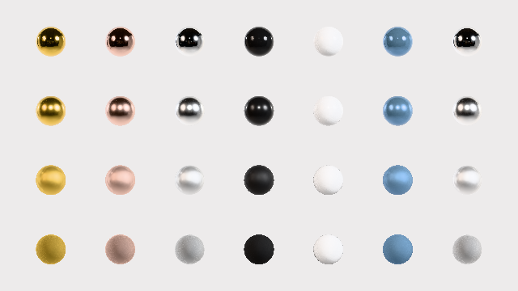
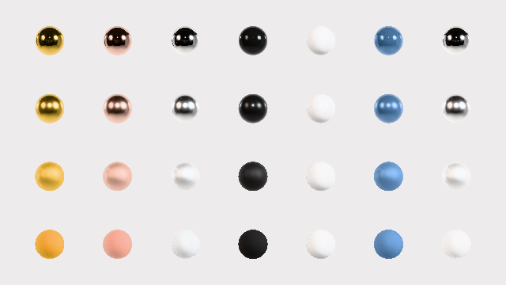

# GGX multiscattering — RuntimeBRDF_v2 implementation and qualification

Implementation baseline: `feature/3d-foundations`,
`3b517f86ac3a5955136a2f26a2dc0e056f3550ac`. Owner authorized reciprocal
Kulla–Conty, coordinated scalar diffuse, shared GLSL, and a separately versioned
converged runtime table. This record describes the implementation and its
qualification; the [manifest](ggx-multiscattering-qualification.json) carries the
final gate status. Owner visual acceptance is a distinct, outstanding requirement.
No environment convolution or concluded split-sum directional study is reopened.

## Original failure and independently established cause

The [rejected v1 record](evidence/Multiscattering_v1/original-failure.txt), its
[qualification](evidence/Multiscattering_v1/qualification.json), historical assets,
bake identities and reference outputs are retained. A split-sum furnace closed
while the intrinsic analytic BRDF failed conservation. The newly reproduced
[refined FP64 study](evidence/Multiscattering_v2/historical-study-refined.csv) separates these:

| Legacy LUT case | Analytic SS E | Sampled legacy E | Intrinsic compensated energy |
| --- | ---: | ---: | ---: |
| r=.045, NoV=.01, perfect | .9757146978 | .9627345961 | 1.0295481402 |
| r=.045, NoV=.01, white dielectric | same | same | 1.0143733833 |
| r=1, NoV=1, perfect | .3068528194 | .3116532877 | .9951995317 |

At r=1, V=N, the exact anchor is `E=1-ln(2)`. The old table samples texel
centers and clamps endpoints: its last knot represents r=NoV=.99609375, whose
analytic E is .3115314048. Thus most of the .00480047 endpoint mismatch is
coordinate/discretization error; about .000122 remains from old integration.
More samples at unchanged knots do not correct endpoint clamping.

At the floor/grazing case, old mean missing energy is .00001621518; integrating
`max(1-A-B,0)` gives .00002342438. Dividing clipped directional deficits by the
raw missing average amplifies the mismatch by approximately 1.4446. The existing
single-scattering response was never altered to conceal that error. Historical
native Metal/OpenGL r=1 furnaces measured .99520138/.99520139. CPU sampling and
GPU response agreed closely, excluding a backend sampling disagreement as the
primary cause. The initial 1e-4 absolute-error reference reproduced 1.02955095 /
.99520578; the stronger boundary-split reference above removes several ppm of
reference integration error, preserving the failure and diagnosis. Original raw
results remain alongside the refined study. The KC formula was algebraically correct; its directional and
average inputs were inconsistent with the analytic direct lobe and clipping.

## Mathematical model

All lighting remains in `Hazel/Resources/shaders/ForwardPBR.glsl`. The original
single-scattering GGX NDF, correlated Smith visibility and Schlick Fresnel remain
unchanged: `fss=D*Vcorrelated*F`, `alpha=max(r,.045)^2`,
`F0=mix(.04,base,metal)`. Both lobes use the same resolved shading normal and
material values. Energy bounds assume physical reflectance inputs in [0,1]. Bars denote `2 integral_0^1 value(mu)*mu dmu`.

```
E = A+B;  d = max(1-E,0);  dbar = max(1-Abar-Bbar,0)
Fbar = F0+(1-F0)/21
C = Fbar^2*Ebar / ((1-Fbar)+Fbar*Ebar)
fms(i,o) = C*di*do / (pi*dbar)
R(o) = F0*Ao+Bo+C*do
q(o) = 1-max(R(o).rgb)
fd(i,o) = (1-metal)*base*qi*qo / (pi*qbar)
```

The scalar residual reserves diffuse energy below every specular channel;
colored C preserves repeated-bounce absorption rather than multiplying all
channels by a common brightness factor. Metalness retains its existing F0
interpolation and suppresses diffuse by `(1-metal)`. RGB Schlick is still an
approximation to spectral conductors. The model is reciprocal before NoL
weighting and is bounded under its tabulated SS model. Actual analytic SS versus
table error is measured independently, not assumed away by furnace closure.

For stability, let `f=max(F0)`, `t=f+(1-f)/21` and
`k=(20/21)*(1+t*Ebar)/((1-t)+t*Ebar)`. Then
`q=(1-f)*(A+k*d)`, and direct diffuse is evaluated as
`(1-f)*(Ai+k*di)*(Ao+k*do)/(pi*(Abar+k*dbar))`.
This removes a vanishing residual denominator as f approaches one. At exactly
f=1 diffuse is zero. At exactly dbar=0 the MS lobe takes its analytic zero limit;
the degenerate unit-Fresnel C denominator takes its unit-reflector limit. There
are no new arbitrary roughness/grazing clamps or compensating constants.
Negative missing energy from numerical overshoot is bounded without changing SS.

Direct lighting evaluates `fss+fms+fd`, then NoL and incident radiance. IBL is:

```
SS = prefiltered(reflect(-V,N),r) * (F0*A+B)
MS = irradiance(N)/pi * C*dview
Diffuse = irradiance(N)/pi * (1-metal)*base*qview
```

Direct integration and IBL therefore share the same uniform-environment energy
budget, up to separately measured analytic SS/table error. Under nonuniform HDR,
the new broad lobes use an irradiance approximation; the existing reflection-
directed split-sum approximation remains unchanged. Neither is exact stochastic
Smith transport. Geometric view/light horizon restrictions, shading-normal
resolution, roughness-to-mip mapping and environment rotation/gain are preserved.
XeGTAO remains diffuse-indirect only; material AO still attenuates indirect
specular and diffuse. No TAA, depth, picking or scene submission change.

## Versioned table and integration evidence

Active data: `Hazel/Resources/BRDF/GGX-MS_v2.hlight`; its
[provenance](../../Hazel/Resources/BRDF/GGX-MS_v2.json) records data/source hashes,
recipe, command, producer and precision. Recipe:
`Hazel.RuntimeBRDF_v2.GGX-correlated-Schlick.r045.mu4.endpoints.FP64GL-boundedNDF-VNDF-edge2.AB1e-7.loss1e-3`.
Historical environment A/B assets, `IBLRecipe`, producer contracts and cached
bake keys are unchanged. This is an intentional current rendering-model change,
not a claim of historical output parity.

`tools/HazelImport/Environment/RuntimeBRDF.cpp::IntegrateRuntimeBRDF` is an offline
FP64 visible-normal integral of production GGX/correlated Smith/Schlick A and B.
It uses two conditioning regimes of the same integral: a boundary-split NDF
integral when `NoV>=alpha`, and exact correlated G2/G1 VNDF integration otherwise,
including NoV=0. This selects offline quadrature, not another BRDF or runtime
clamp. Gauss–Legendre radial and periodic azimuth rules adapt from 32 to 4096.
Adjacent A/B changes must be <=1e-7 **and** missing-energy change must be
`<=max(1e-10,1e-3*missing)`. The disk-area transform `u=1-(1-t)^2`, with its
Jacobian, resolves a slow edge tail; the NDF radial interval ends at the analytically
solved reflected hemisphere boundary. No visibility convention is substituted.
Uniform-area and insufficient-order failures are retained in ignored evidence;
no physical acceptance tolerance was widened.

The first v2 candidate passed energy gates but its absolute-only 1e-5 stopping
rule was insufficient when missing energy itself was only a few ppm. The original
independent VNDF oracle also missed that small tail. A separate boundary-split
NDF reference exposed both errors. At r=.045, NoV=.894427, true missing energy is
4.6275275e-6; the first candidate sampled 8.4498824e-6. The final stopping rule
checks the loss scale directly. The [rejected candidate](evidence/Multiscattering_v2/candidate-absolute/)
is retained, with its original reference and provenance. Passing a furnace alone
was not treated as sufficient qualification.

New endpoint knots are `NoV=(x/(side-1))^4`,
`r=.045+.955*y/(side-1)`. `sampleBRDF` explicitly remaps those coordinates to
texture centers. This allocates grazing resolution and represents floor/one
endpoints exactly. The selected 256-square bake required at most order 4096;
maximum accepted adjacent A/B delta was 9.99964e-8. Final FP32 conversion directs B
down only if independently rounded A+B exceeds one (less than one unit-energy FP32 ulp). Bilinear
interpolation then preserves E<=1 by convexity. This does not modify historical
bytes or insert a brightness calibration.

[128](evidence/Multiscattering_v2/study-loss-128.csv) and
[256](evidence/Multiscattering_v2/study-loss-256.csv) off-grid independent FP64
studies cover 12 roughness values and 13 view angles down to 1e-5. Maximum
perfect/white direct energy error falls from .00108168 to **.000301344**.
Worst 256 case is r=.047, NoV=.002: energy .9996986558. Means are compared against
independent view quadrature; raw A and B are reported separately. The independent
NDF-domain oracle refines to 1e-7 with a separate missing-energy criterion and
retains the analytic `1-ln(2)` and ordinary-domain legacy integral cross-checks.
At the roughness floor, 64→128 view-node A/B mean-vector change is 9.15e-11; final reference
means use 64 nodes. [64 collocated knots](evidence/Multiscattering_v2/study-knots.csv)
separate integration from interpolation error: maximum independent A/B error is
4.12448e-7, below the predeclared 5e-7 study bound. The worst knot is r=.284686,
NoV=.00396789, outside the small-loss regime. An adjacent-rule stopping test is
empirical convergence evidence, not a formal error bound.

`EnvironmentResources::PackBRDFTable` preserves current runtime A/B bits and
integrates the actual piecewise-linear interpolant in `t=mu^(1/4)` exactly:
`2mu dmu=8t^7dt`. BA holds Abar/Bbar for each row. Roughness interpolation
commutes with averaging. Independent five-point Gauss integration of every
segment/row agrees within 2.93509e-8 after packing. No mismatch between clipped
deficit and the mean remains for this energy-bounded new table.

`HazelProject prepare-runtime-brdf OUTPUT.hlight 256` is a maintainer-only native
command; it refuses existing outputs. Runtime never bakes. The 128/256/512 CLI
choices support offline convergence studies, not runtime quality modes. Source
harnesses and raw convergence/bake records are retained with the v2 evidence.

## Integration, ownership and costs

- `Environment.h`: distinct runtime recipe/resource constants, no material codec.
- `EnvironmentResources.cpp`: loads current engine data for every realization,
  still validates accepted historical environment BRDF inputs, packs/upload RGBA32F.
- `Renderer3D::EnsureResources`: existing fallback bundle supplies the same current
  table for direct-only lighting. Existing per-environment ownership/retirement is
  retained; no global cache, extra binding or new rendering path.
- `ForwardPBR.glsl::surfaceEnergy`: common view/material factors once per surface;
  `direct` adds one light-direction table lookup. IBL adds broad energy terms.
  Generated `ForwardPBR.hzmetal` comes from the pinned canonical toolchain.
- Qualification-only historical resources pair old shader/data without a permanent
  production branch. Project/resource exports include the engine BRDF directory.

One 256-square RGBA32F table is **1 MiB**, versus the original environment's
128 KiB RG32F table. Fallback plus one environment is 2 MiB versus approximately
128 KiB plus eight bytes historically: about **1.875 MiB added**, not 128 KiB.
Transient packing is 1 MiB, plus the 512 KiB decoded table and backend staging.
The existing four-entry environment cache plus fallback can retain five tables
(5 MiB versus approximately .5 MiB historically). Native counters include actual
allocation/retirement, not just asset byte sizes. New disk RG32F data is 512 KiB.
No per-frame allocation/bake, extra sampler, environment mip, or material data.
Point/spot/clustered lights can reuse the same per-surface energy and directional
BRDF; future area/probe/SSR integration must use the same energy budget, without
being designed in this slice.

## Numerical and visual interpretation

A separate native test then exposed pre-existing FP32 cancellation in the sharp
SS lobe: at r=.045, V=N, Metal reflected **1.0065719754** with the final LUT.
Its MS budget is only about 4.1e-6, so this gain was not caused by compensation.
`1-NoH^2` loses the small tangent component before GGX squares its denominator.
The current shader uses the mathematically equivalent unit-vector expression
`dot(cross(N,H),cross(N,H)) + alpha^2*NoH^2`. This preserves analytic GGX, Smith,
Fresnel and roughness; it changes numerical evaluation, not the BRDF. A separate
[FP32 CPU diagnostic](evidence/Multiscattering_v2/fp32-denominator.log) confirms the
cancellation; its exact bias differs from native instruction selection. No clamp,
brightness constant or change to historical references was used.

Native Release direct furnaces, unchanged `1 +/- .003` gate:

| Case | Metal | OpenGL |
| --- | ---: | ---: |
| r=1, NoV=1, F0=1 (64-node direct quadrature) | .9999988492 | .9999988554 |
| r=.045, NoV=1, F0=1 (256-node NDF importance quadrature) | .9999966536 | .9999965973 |
| r=.045, NoV=.01, F0=1 (two-technique MIS) | .9996494306 | .9996349608 |

The smooth normal test bounds the tiny unresolved broad MS budget separately;
its full budget is below 4.2e-6. Grazing uses 16384 samples per VNDF/cosine technique.
These are quadrature estimates of the actual FP32 production shader, not asserted
exact analytic energy. FP64 sweeps, knot/interpolant studies and native captures
separate reference, integration, discretization and shader errors. Tested positive
views extend down to NoV=1e-5 in FP64; exact geometric horizon rejection is retained.
No negative/NaN/infinite contribution, reciprocity, <=1.003 reflected channels and
roughness-floor continuity remain required. The .003 conservation bound is unchanged. A matching independent FP64 MIS study
at 8192/16384/32768/65536/131072 samples per technique gives
.99890303/.99965738/.99992419/.99996204/.99994170. At the native 16384 count,
Metal/GL differ from that same estimator by about 7.95e-6/2.24e-5; quadrature bias
is distinguished from shader/runtime sampling error. This deterministic sequence
is convergence evidence, not a stochastic confidence interval.

735 native Release linear FP32 components per backend have maximum exact-table
errors 7.92220e-6 Metal / 1.23053e-5 OpenGL; backend difference 8.66037e-6.
The largest continuous-model point discrepancy is **9.99319e-5**, now below the
ordinary .002 bound without the first candidate's extreme-case exception. The
current-model runner explicitly enforces that bound; historical `--single`
qualification retains its own original admitted LUT accuracy.
Native sphere comparisons retain identical IDs/depth; maximum RGB backend
difference is approximately .000162. All failures and rejected intermediates
remain recorded rather than being recast as successful historical parity.

The independent checksum-pinned stochastic Smith reference uses 262144 paths
for 45 cases, seed 20261125, FP64, per-channel standard errors and first-bounce
checks. KC's largest sampled discrepancy is about .040531 in gold blue at
r=.25, NoV=.05 (KC .516038, Smith .556569, stderr .000401). KC is a reciprocal
energy-compensation approximation, not exact multiple-bounce Smith transport.
The RGB-Schlick reflection walk is not a layered dielectric/substrate solution;
complementary diffuse is validated as the approved reciprocal energy-allocation model.
The original run remains in v1 evidence; the [refined-reference rerun](evidence/Multiscattering_v2/smith-comparison.csv)
confirms the same .04053096 maximum discrepancy after repairing the small-loss
oracle. This is approximation error, not a shader or LUT failure.

[Multiscattering_v2 conditions](../../examples/RenderingReference/Assets/Reference/Multiscattering_v2/README.md)
separate intentional changes from regressions: rough metal energy increases,
colored absorption remains; diffuse uses the coordinated residual; current SS IBL
changes slightly from converged A/B. Historical frozen results remain historical.
Direct/diffuse/specular FP32 captures, photo/neutral environments, normal maps,
horizons, mixed metals and temporal highlights are checked through existing and
new fixtures at matched exposure. PNGs below are native offscreen SDR previews,
not product screenshots. Inspection shows the intended stronger rough-metal
response; owner approval of appearance remains pending.

| Historical single scattering | Multiscattering_v2 |
| --- | --- |
|  |  |

## Performance and qualification

The [v1 measured matrix](ggx-multiscattering-performance.json) remains historical:
1080p forward median .575583→.613917 ms (+.038334 ms / 6.66%), missing the
provisional 5% relative target while meeting .2 ms absolute. It is not substituted
for a v2 measurement. [Final v2 measured matrix](ggx-multiscattering-v2-performance.json): native M4,
Release, TAA enabled, identical private copy of the authored inputs for both
executables. Inputs match the original WIP performance fixture byte-for-byte;
unrelated owner edits are not committed. Historical executable/resource provenance
is retained. Each preset renders 720 frames per extent with 120 warmup / 20 tail
excluded. Only positive presentation and valid ordered GPU intervals count. A
focused Medium repeat runs candidate then historical, reversing the primary order.

| Medium AO + TAA | Historical median / p95 ms | v2 median / p95 ms | Valid samples before / after |
| --- | ---: | ---: | ---: |
| 720p forward interval | .246417 / .250625 | .282417 / .288500 | 94 / 299 |
| 1080p forward interval | .567458 / .575083 | .651959 / .660958 | 68 / 78 |
| 720p whole submission | 4.991375 / 5.025125 | 4.701500 / 5.033583 | 573 / 565 |
| 1080p whole submission | 11.035750 / 11.113250 | 11.138083 / 11.217792 | 580 / 580 |

1080p forward median adds **.0845005 ms / 14.89%**. Reversed-order repeat adds
**.0766455 ms / 13.52%** (.566917→.643563 ms; p95 .575458→.654167; 71/86 samples).
The .2 ms absolute target is **MET**; the provisional 5% relative target is
**MISSED**, not redefined. This supersedes the historical v1 +.038334 ms result
for the final implementation, including the larger table, coordinate transform
and necessary FP32 NDF stabilization. No ablation isolates each contributor.
Ultra 1080p has one valid forward record per run; it remains in the matrix but
is not presented as a meaningful p95. No other-GPU or backend speedup is claimed.

CPU intervals are also retained: Medium 720p scene median .073583→.388271 ms,
repeating .073083→.312667. The 1080p primary .073146→.392917 increase did not
repeat (.073375→.074458). Other presets do not show that same jump. Inspection
confirms cached environment realization, no per-frame LUT work, identical steady
buffer allocations (115), and reuse without allocation growth. Cause of this
renderer/driver interval behavior remains **unresolved**; it is not attributed
to CPU BRDF arithmetic. Scene/submit/GPU completion scopes are nonexclusive and
must not be added. Whole-submission and frame-loop distributions remain in the
JSON rather than being replaced by a favorable phase statistic.

Final Debug/Release builds, 18 native regressions each, 135 Metal/OpenGL production
captures each, 735 dedicated components per backend/configuration, numerical
references, shader/cache/rejections, AO/TAA, 1x/2x visible lifetimes, signed exports,
source/SDK/compiler-denied offscreen relocation and pristine Metal/OpenGL editor/
player startup/normal-close gates **PASS**. Initial locked-console attempts were
correctly rejected; the owner unlocked the desktop before the remaining gates.
The [manifest](ggx-multiscattering-qualification.json) records source/data hashes
and the [native lifetime evidence](evidence/Multiscattering_v2/native-window-lifetimes.json).
No new warnings came from changed production paths. Existing unrelated first-party,
vendor/libtool and Xcode build-phase warnings remain recorded.

Technical correctness/integration: **PASS**. Overall acceptance remains
**INCOMPLETE pending owner visual/performance review**, including the missed
relative target and CPU timing concern. Windows/Linux/other GPU execution and
branch CI are **NOT RUN** locally. Source-free automated product checks are not
owner visual acceptance. Historical frozen assets/results remain immutable; no
merge, release, default change or next rendering feature is authorized.

References: [Kulla–Conty](https://blog.selfshadow.com/publications/s2017-shading-course/imageworks/s2017_pbs_imageworks_slides_v2.pdf),
[Heitz et al.](https://jo.dreggn.org/2016_microfacets.pdf),
[Heitz VNDF sampling](https://jcgt.org/published/0007/04/01/paper.pdf),
[Fdez-Agüera](https://jcgt.org/published/0008/01/03/paper.pdf),
[DSPBR](https://dassaultsystemes-technology.github.io/EnterprisePBRShadingModel/spec-2022x.md.html).
