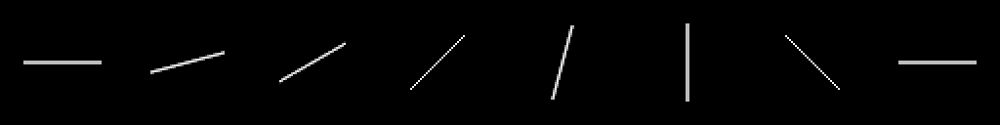
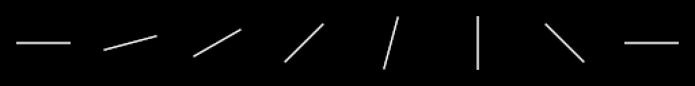
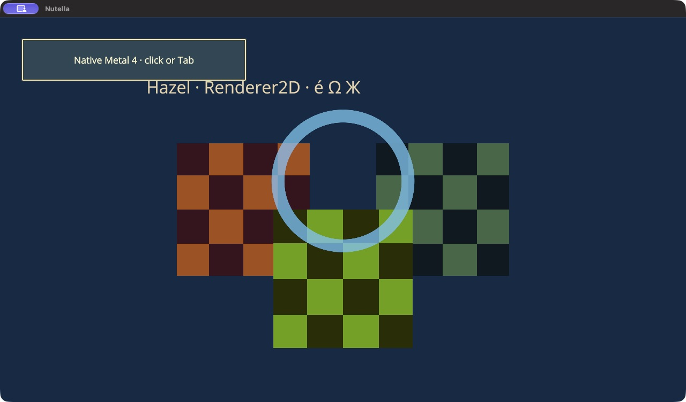

# M3 shared deterministic lines

Working-tree continuation from `808e31d5eecbd3cc51d3efcae5d46aa5e3afe798`,
`feature/3d-foundations`. The user explicitly approved changing Renderer2D's
legacy OpenGL line rasterization. This implements that bounded change; M4,
Renderer3D, backend defaults and unrelated shaders are unchanged.

**M3 PASS on the available Apple M4 host.** Independent numerical, frozen
reference, cross-backend, native Debug/Release live-window and actual Nutella
interaction gates pass. Windows/Linux/Intel execution is NOT RUN. Commands,
hashes, tests and measurements are recorded in
[deterministic results](metal-m3-deterministic-results.json).

## Rendering contract

- `Renderer2D::SetLineWidth` specifies a positive finite width in **physical
  framebuffer pixels**, default 2. Camera zoom and UI logical scale affect
  endpoint positions, not width. At native 2×, one physical pixel occupies half
  a logical pixel. Callers wanting a logical-pixel width must explicitly scale
  it by the framebuffer/logical ratio. Raw backend native-line capabilities do
  not limit this expanded-geometry path.
- A line is a butt-ended rectangle around its projected centerline. There are
  no implicit joins. `DrawRect` remains four independent butt segments, in the
  existing order; overlapping corner coverage composites by source-over.
  Intersections and repeated segments also composite in submission order.
  A zero-length projected segment has no area and draws nothing.
- CPU submission clips the centerline against near and far homogeneous planes
  before dividing by w, and fixes clipped endpoint depth exactly to the plane.
  X/Y clipping acts on the expanded triangles, so a wide line with an offscreen
  centerline can still cover the viewport. The viewport is captured with the
  camera at BeginScene; change targets/viewports between scenes.
- Four vertices and six indices conservatively bound the stroke plus its
  half-pixel box-filter support plus a half-pixel conservative rasterization guard. The authoritative GLSL fragment shader clips
  a unit pixel square against the four stroke edges and computes intersection
  area. Computation uses pixel-relative coordinates to avoid large-area
  cancellation. A conservative support rejection avoids clipping work outside
  the stroke. Neither API's native line rasterizer defines coverage.
- Coverage is clamped to [0,1]. Areas <=1e-6 pixel are the explicit shared FP32
  numerical-zero floor and are discarded. This small rendering floor is part
  of the newly approved contract, not a readback tolerance. Effective alpha is
  `clamp(tint.a,0,1) * coverage`; zero effective alpha discards before color,
  entity or depth output. Positive surviving alpha uses straight RGB with the
  existing separate source-over RGB/alpha factors.
- Entity output remains a flat exact signed 32-bit ID. A surviving fragment
  claims its ID only when the existing picking mask permits it and depth passes.
  A passive line still composites color and follows existing depth state while
  preserving the previous ID. Integer attachment blending is disabled; it does
  not approximate coverage. Fully transparent lines claim neither IDs nor depth.
- Fragment window depth is linear along the projected centerline, with the
  projection parameter clamped at the endpoints throughout the AA cap fringe.
  Extrusion does not move that depth. The shader writes [0,1] window depth;
  the existing GLSL-to-Metal vertex fixup remains responsible for vertex clip
  depth and offscreen orientation. Primitive UI clip rectangles retain the
  existing physical pixel-center, half-open discard rule.

## Ownership and old versus new behavior

Renderer2D owns one camera/viewport snapshot, CPU packer, line stream, ordered
runs and statistics. Backend-neutral DrawLine produces the same 80-byte vertex
ABI for OpenGL and Metal. Both use ordinary indexed triangles, including normal
40,000-segment capacity flushes. Width is per-segment data, so changing widths
can coalesce into one run. GeometryCount counts valid submitted segments even
when CPU clipping/transparent/degenerate rejection produces no vertices.

The Metal native-line draw branch, per-run line width, and old two-vertex stream
are removed. GPU tables, copies, encoding, barriers, residency and retirement
stay backend-owned. Camera overloads now call the common BeginScene path rather
than repeat backend branches. No parallel renderer, general compatibility layer,
production test API, hand-edited MSL, geometry shader or render graph is added.

Previously Apple OpenGL clamped all widths to one and GL_LINE_SMOOTH supplied
orientation-dependent driver coverage, including some zero-alpha picking IDs.
Metal emitted aliased native lines. Both now implement the contract above,
including real fractional/wide strokes. GL_LINE_SMOOTH remains enabled for any
raw legacy backend line callers; Renderer2D triangles do not depend on it.
Quads/circles/sprites/text and all unrelated canonical shader sources are intact.

The [legacy investigation](metal-m3-lines.md), its
[measured results](metal-m3-lines-results.json), and original raw captures under
`build/metal-m3-evidence/line-investigation/final-{debug,release}/reference` are
preserved. Legacy images and new contract images are distinct evidence, never
silently regenerated as the same reference. The obsolete aliased-GL diagnostic
CLI is removed. The old M2-A line-shader-as-triangle proof now uses the shared
quad ABI/white slot-31 texture for its original HDR/near/depth assertions;
production Renderer2D tests own analytical line qualification.

The following are real GPU readback contact sheets, linear RGB encoded once to
sRGB, with 2× nearest-neighbor enlargement for inspection. Columns are 0°, 15°,
30°, 45°, 75°, 90°, 135°, 180° at phase zero and physical width one. They are
numerical fixture images, **not window screenshots or native-DPI observation**.

Legacy Apple OpenGL:



New native Metal (OpenGL independently qualifies the same new contract):



## Independent qualification

`tests/macos/Renderer2DLines.h` defines 62 shared submissions. The separate FP64
Python oracle intersects pixel squares with projected butt rectangles using a
different polygon formulation, computes source-over RGBA, signed picking and
strict depth ownership. It calls no production clipper, vertex packer or shader.
It has independent unit-box, diagonal-area/conservation and near-clip self-checks.
Each backend must satisfy this oracle **as well as** cross-backend comparison.
The newly qualified, line-only `tests/fixtures/renderer2d-lines-v1.zip` freezes
these 62 inputs/readbacks and qualification provenance (60,970 bytes). Both
backends also compare against it at the same thresholds. Unrelated frozen
references are untouched; changing the line input metadata now requires explicit
reference review.
Tolerances remain 2e-5 RGBA, 1e-6 depth and exact IDs; the new coverage floor is
also explicitly applied by the independent reference.

Cases cover horizontal/vertical/diagonal lines at four subpixel phases, reversed
endpoints, short/degenerate segments, widths 0.5/1/2/4/16, width changes in one
run, 40,001 submitted lines and capacity/statistics assertions, rectangles,
intersections, transparent/zero-alpha/passive overlap, clipping, an offscreen
wide centerline, orthographic/perspective projection, near/far/fully-clipped
segments, depth ordering and synthetic 1×/2× physical targets. Existing authored
world/UI fixtures, normal/reduced slots, atlases/Unicode, mixed primitive order,
source-over, depth, HDR/Neutral and orientation comparisons remain in M3.
A further authored RuntimeSession fixture supplies synthetic Tab/Accept device
samples through the existing router, asserts one activation for the focused
button, and renders its actual UI focus outline at 720p/1080p. This exercises
RuntimeUI's DrawRect through ordinary SceneRenderer ownership; it is not physical
keyboard input, an Application event pump or live-window acceptance. The initial
probe incorrectly used host events without an Application (which polls device
modifiers); it was corrected to use the existing headless DeviceSample API,
without adding a production workaround.

A further precision case (and its reversal) places the endpoint at x=41.0001.
Without a conservative raster guard, hardware vertex rounding cropped two
positive-coverage pixels per direction (4.95904e-5 color error), despite the
correct coverage shader. The bounding geometry now has an extra half-pixel
padding; the shader's coverage and thresholds are unchanged. The two new inputs
were independently qualified before extending the line-only reference. All
original 60 reference readbacks remain byte-identical. Failure data is preserved
in `raster-boundary-before*`.

The oracle caught a real shared far-plane bug that cross-backend agreement did
not detect: floating-point clipping left endpoint depth just below 1, allowing
three cap-fringe fragments through strict Less. Production now sets clipped
plane depth exactly. That failure is retained in `deterministic-debug-1`; the
fixed cases qualify without changing thresholds.

Reproduction (build the existing smoke targets first, or add `--build`):

```sh
python3 scripts/macos/metal_m3.py --config Debug --texture-slots 2 --resources Hazel/Resources --output build/m3-shared-debug-fresh
python3 scripts/macos/metal_m3.py --config Release --resources Hazel/Resources --output build/m3-shared-release-fresh
python3 scripts/macos/metal_m3.py --config Release --runtime-frames 2400 --resources Hazel/Resources --output build/m3-shared-reuse-fresh
python3 scripts/macos/metal_m3_lines.py --captures build/m3-shared-debug-fresh
python3 scripts/macos/metal_m3_lines.py --legacy-reference build/metal-m3-evidence/line-investigation/final-release/reference
```

The legacy command only reads preserved captures. The earlier investigation's
capture commands refer to its historical implementation, not current production.
Native tests run with Metal API/GPU validation and source-free packaged shaders;
cache/corruption/relocation tests are separate. GPU timings are now joined by the
actual submission serial, avoiding shifts when qualification cases are added.
The extended runner checks stable attachment/buffer allocation counters and idle
retained bytes after warmup; it cannot replace a long live-window session.

## Qualification at this checkpoint

| Gate | Debug | Release |
| --- | --- | --- |
| Native Metal/OpenGL mixed + authored world/UI parity | PASS, two texture slots | PASS, four texture slots |
| Independent line coverage/depth/IDs, 62 cases | PASS | PASS |
| New frozen line references + cross-backend comparison | PASS | PASS |
| Authored UI Tab/Accept and rendered focus outline | PASS, synthetic samples | PASS, synthetic samples |
| Shader production/cache/corruption/source-free relocation | PASS, 17 rejections | PASS, 17 rejections |
| Six focused native OpenGL/runtime regressions | PASS | PASS |
| Extended offscreen allocation/retirement check | 80 frames/extent sanity | PASS, 2,400 frames/extent |
| Native 1×/2× lifecycle, Nutella UI/camera input and shutdown | PASS | PASS; 7.5-minute visible session |
| Windows/Linux/Intel execution | NOT RUN | NOT RUN |

Both final offscreen fixtures complete 254 native submissions with zero Metal
API/GPU validation errors, including two explicit focus-outline frames and one
pending-work shutdown. The longer Release reuse run completed 4,894 submissions.
Independent line error is <=3.602e-6 RGBA / 1.632e-7 depth, with zero ID mismatches;
line cross-backend error is <=1.193e-7 RGBA / 5.961e-8 depth. The focus display
comparison has zero ID mismatches and <=5.961e-8 depth error; raw color difference
reaches 0.000976205 because OpenGL stores RGBA16F and Metal RGBA32F. Every pixel
still satisfies the unchanged three-FP16-ULP +2e-5 bound and <=one encoded RGB
level. No new bound was introduced for focus outlines.

The nine original 6,272-pixel numerical fixtures plus the retained readback are
byte-identical to earlier Debug/Release captures. Builds have zero new first-party
warnings; existing unused-parameter/variable, deprecated-copy, test missing-field,
archive and Xcode phase warnings remain. Shader/cache regressions also report no
native validation errors. The public audit checks 73 Markdown files and 600 local
links/images with zero findings. Master CI badge/workflow claims and defaults are
unchanged; no CI or unavailable platform execution is inferred from these runs.

## Resource cost and remaining gates

A retained segment uses 320 vertex bytes instead of 96; a 40,000-segment CPU
stream is 12,800,000 instead of 3,840,000 bytes. OpenGL preallocates the matching
GPU stream and a shared 240,000-entry index buffer (960,000 bytes versus 480,000).
Metal captures only actual submitted vertices and uses the existing retired-slot
buffer pool and per-frame shared index storage. There are no new attachments or
synchronization domains. Actual 720p/1080p draw/batch/CPU/GPU and memory counters
are in the results record; these include validation and offscreen readbacks.
They are not live window costs or proof of performance improvements.

Release's 2,400 frames per extent give 2,380 measured samples after ten warmup
and ten tail frames. At 1280×720 / 1920×1080, scene CPU median is 0.057 / 0.063 ms,
submit CPU 1.244 / 1.295 ms, GPU 0.822 / 1.405 ms (GPU p95 1.028 / 1.922 ms).
Each scene frame has 13 draws, eight batches and 48 geometry items. Attachment
bytes stay 46,309,632 / 101,097,728; idle retained buffers stay 66,422,880 /
149,394,016 bytes, chiefly diagnostic readback storage. Neither allocation
counter increases during either measured interval. Cumulative attachment
allocations are nine / eleven rather than the historical six / eight because
additional line probes resize the shared small target; they do not grow each
runtime frame. Peak frame/resource bytes are 254,998,880; peak allocator bytes
7,892,520. Counters overlap and are not additive. Shutdown reports zero pending
resource bytes; the deliberately retained framebuffer owner is released when
the fixture returns. This is 4,800 serial scene frames, not an extended visible
player session or a matched legacy-line speed comparison.

## Live presentation, input and extended session

The earlier locked-console attempt remains preserved. After the user unlocked
the intended session, final native lifecycle runs passed in Debug/Release at
both real backing scales. Correlated GPU-completed/positive-presented counts
are 324 / 326 (Debug 1×/2×) and 324 / 324 (Release 1×/2×). The 2× runs select an
advertised native display mode, verify Cocoa and GLFW scale 2 and exact doubled
framebuffer dimensions, then restore the exact original display mode. No injected
extent substitutes for native scale. Initial 2× window content is 1280×563 logical /
2560×1126 physical because the desktop fits the window to available space; after
resize, steady rendering is 1920×1080 physical. Each run exercises real minimize/
restore, VSync changes, unavailable/zero drawable paths and pending-work shutdown.

Actual current-build Nutella processes were observed through native UI automation
in both configurations: Tab focus outlines, Return and pointer interaction,
RMB+W camera movement and held Home reset, with screen UI remaining anchored.
Inspector mode deliberately disables runtime UI input, so camera and normal UI
were tested separately. These are OS-level events through the real Application,
GLFW and RuntimeSession input path, distinct from synthetic DeviceSample tests;
no human keyboard/controller hardware claim is made. The private ad-hoc `.app`
wrappers contain the built Nutella executable and ordinary bundle metadata for
computer-use discovery, not a separate renderer or test production API.



Release completed **80,303 frames** over a positive-presentation timestamp span
of **450.99 seconds**; 80,289 were positively presented at the final snapshot.
A live resize reached 1703×920 physical pixels; native minimize/menu restore and
subsequent input/rendering recovery were observed. Across 669 resource samples,
attachment allocations plateau at six before resize and twelve afterward;
six attachment generations remain available for the three world/display frame
slots. Buffer allocations plateau at 48, then 60/66 when additional focus-outline
runs warm the slots. Those bounded changes correspond to resize/input, not
per-frame growth. The final attachment allocation count stays twelve; allocator
storage stays 7,745,064 bytes. Peak frame/resource bytes are 239,367,264 and peak
attachment-owner bytes 234,749,952 (overlapping counters, not additive). Normal
shutdown reports zero pending bytes, zero live attachment generations and zero
API/GPU validation errors. Debug UI and camera processes also close normally
with all submissions completed and no pending resources.

The initial live inspector trace exposed redundant native encoder state calls.
Backend-local pass state tracking now skips unchanged pipeline, effective depth,
viewport, cull, winding and scissor values, including Metal's documented encoder
defaults. Current live runs have **zero redundant-state validation warnings**;
the earlier trace is preserved rather than suppressed. Existing HAZEL_METAL_TRACE
adds periodic M3_RESOURCES counters for production diagnostics; no new test API
or synchronization mechanism is introduced.

Windows/Linux/Intel execution remains NOT RUN. Master CI claims are unchanged;
these native Apple results are local evidence, not CI certification. OpenGL is
still the default. Metal Renderer3D/PBR/IBL, Hazelnut Metal ImGui and general Metal
game export remain outside this milestone's supported/qualified surface.

The recommended M4 entry is the previously proposed bounded unlit cooked-GLB
vertex/index/material submission with depth and signed IDs through existing
SceneRenderer ownership. M4 is not started and requires separate authorization.
