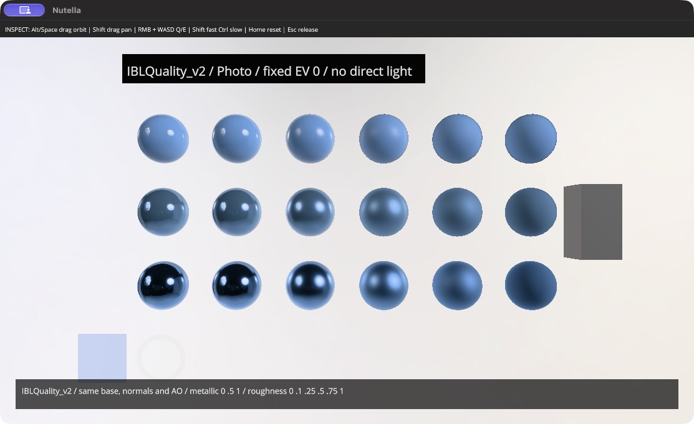

# Metal 4 M4 — Renderer3D and prepared PBR/IBL parity

Authorized baseline `2b96a1d0fe667a7bf67ea2ca869ac752a1e892b1`, branch
`feature/3d-foundations`. **PASS on the recorded local Apple M4 host**. Required available-host gates passed;
platforms and configurations not executed remain explicitly identified below.

Acceptance is the complete M4 user request. Work proceeds through mesh/depth/ID,
material/direct, prepared environment/IBL, then integrated runtime checkpoints.
OpenGL stays default. No M5, merge, release or new lighting model is authorized.

## Gates declared before comparison

- Identical accepted cooked geometry/material/environment generations and saved
  camera on both APIs. Exact signed IDs, AA-off coverage and depth <=1e-6.
  Full-frame color comparisons must distinguish FP32 shader arithmetic, filtering,
  and OpenGL's display RGBA16F stores. M3's independent 2e-5 FP32 blend bound and
  <=3 FP16 ULP +2e-5 / <=1 encoded RGB level display bounds remain unchanged.
  Direct/IBL independent mathematical checks keep their established per-case
  bounds (including ordinary direct RGB <=.002); no full-BRDF split-sum pass.
- Independent geometry/clipping/winding/mirroring, normal mapping, masked depth
  and IDs, roughness/metal sweeps, HDR/exposure/debug terms, yaw/sky/cube seams.
  Frozen Direct_v1, IBL and silhouette inputs remain unchanged.
- Debug/Release production Nutella real-window camera/input, resize, presentation,
  pending shutdown and extended stability, matched 720p/1080p CPU/GPU timing and
  memory. Positive presentation timestamps distinguish presentation from completion.
- Completion-retained immutable buffers/textures/UBOs, bounded allocations,
  cache admission including pending owners, failure cleanup, zero new unresolved
  first-party warnings or API/GPU validation errors in exercised paths.
- Relevant native OpenGL, Renderer2D, assets and shader/cache/relocation regressions;
  public docs/commands/examples/screenshots and capability matrix at completion.
  Windows/Linux/physical Intel and new CI execution reported separately.

## Ownership

Scene collection and Renderer3D retain the existing submission/material model.
Resource factories realize Metal buffers, uniform values, textures and prepared
cubes. Indexed draw capture joins the existing ordered native frame packet;
MetalDevice owns argument tables, residency, encoding and completion retirement.
GLSL remains authoritative and generated shader artifacts remain output.

Raw commands, compiler logs and readbacks: `build/metal-m4-evidence/`.

The sampled texture axis limit uses the guaranteed Metal 4 16,384 minimum from
[Apple's feature tables](https://developer.apple.com/metal/Metal-Feature-Set-Tables.pdf),
replacing the earlier 4096 sample-texture proof limit. The framebuffer's separate
4096-axis / 8M-pixel admission and existing frame budgets remain in force.

## Current checkpoint — PASS, local Apple M4 (2026-11-17)

Machine-readable checkpoint: [M4 results](metal-m4-results.json).

The M4 change is based on the baseline above. The available host
is Apple M4 arm64, macOS 27.3 (26C5035r), Xcode 27.3 (27C5020n). OpenGL identifies
as Apple M4 / 4.1 Metal - 91.7. No Windows/Linux/physical Intel or new CI execution
is claimed. The user authorized committing and pushing this qualified M4 change only.

### Implemented production ownership

`MetalBuffer` implements the existing vertex/index/vertex-array/uniform factories.
Mesh packing remains `MeshGeometry`'s existing 64-byte stream; indexed draws use
the accepted first-index/count ranges. Uniform bindings retain CPU storage weakly,
then capture values at each draw, preserving Bind/SetData semantics and avoiding
per-draw overwrites. Shader sampler assignments must match reflected GLSL bindings.
Native resources reject binding through a foreign backend. Indexed submission statistics remain owned by RenderCommand; a two-draw assertion prevents double counting in the native adapter.

The existing native ordered frame packet now also captures mesh buffer versions,
PBR/sky pipelines, raster state, textures and immutable UBO slices. It submits
through the same Metal 4 queue, allocator slots, residency, barriers, framebuffer,
world conversion and output machinery as Renderer2D. There is no new traversal,
material model, hand-edited MSL or alternate scene renderer. Per-frame packets are
bounded to 65,536 draws / 256 MiB. Native admission checks the allocation union
with pending work and idle slot storage **before commit**, deduplicating shared
assets across frames and world/UI passes. The existing 1 GiB device-frame budget
and mesh 64-resource / 128 MiB and four-environment-generation cache admission
remain. Frame-owned mesh/environment/texture owners prevent pending generations
from escaping those cache limits. These counters are not total process/driver RSS.

Prepared RGB cubes expand losslessly to native RGBA32F; every accepted face/mip
uploads explicitly and is never regenerated. BRDF LUTs use RG32F. Material color
maps retain sRGB decoding and data maps remain linear. FP32 lighting inspections,
background, environment yaw/gain, direct PBR, split-sum IBL, exposure and Neutral
conversion use the unchanged authoritative GLSL and generated packages.

`SceneRenderer` invokes the same Renderer3D before world 2D and screen UI. Removed
M3 mesh/light/environment rejection and per-frame filesystem re-audit; normal
RuntimeSession startup validation and accepted asset freshness boundaries remain.
Nutella accepts `--metal`, retaining `--metal-renderer2d` as an alias. OpenGL stays
default. Premake now supplies the existing shader-library search directory to all
macOS consumers; the broad build exposed the missing path on TypographySmoke.

### Executed evidence and limits

| Gate | Debug | Release |
| --- | --- | --- |
| Native engine/player and affected test builds | PASS | PASS |
| Maintained native OpenGL suite, 18 executables | PASS | PASS |
| Existing Renderer2D frozen/independent/cross-backend offscreen suite | PASS, two slots | PASS, four slots |
| Twelve saved production 3D selectors + FP32 inspection terms | PASS targeted capture/oracles | PASS targeted capture/oracles |
| Same photographic scene at 1280×720 and 1920×1080 | PASS offscreen | PASS offscreen |
| Gated three-frame mesh/object/material snapshots and cache-owner retirement | PASS offscreen | PASS offscreen |
| Shader compiler/cache/source-free relocation suite | PASS | NOT RUN (shared implementation) |
| Standalone native headers without PCH | PASS | shared syntax check |
| Relocated Metal 3D with no HDR/GLB, shader source or project assembly | PASS offscreen | NOT RUN |
| Real Nutella 3D camera/input, resize, native 1×/2× and positive presentation | PASS | PASS |
| Matched 720p/1080p real-window CPU/GPU timing and memory | PASS | PASS |
| Extended visible resource stability | Short interaction sessions; long completion stress | PASS, 361 continuous seconds |
| Windows/Linux/physical Intel/new CI | NOT RUN | NOT RUN |

Raw directories and exact commands are under `build/metal-m4-evidence/`.
`regressions-{debug,release}.log` each report all 18 sequential native executable
passes, including existing direct/IBL/frozen assets, geometric visibility, asset
producer, runtime and editor regressions. These are local native Apple results,
not software GL or CI certification. Shader/cache evidence is in `shader-debug/`;
current direct shader checks and source-free production captures have separate logs.

The production comparisons cover **135 captures / 10,656,000 pixels per
configuration**. Signed IDs match exactly throughout. Maximum depth difference
is 1.7881393432617188e-7. The 720p/1080p photographic display differences are
.000526428 / .000533044 maximum linear RGB, zero declared FP16-bound failures and
at most one encoded 8-bit RGB level. Debug/Release captures agree. These are GPU
readbacks, not window captures or visual presentation evidence.

Independent oracles exercise the direct roughness/metal grid against the existing
FP64 evaluator (.002 ordinary-point bound), analytic cube depth, signed IDs,
negative/nonuniform transforms, whole-object near/far rejection, masked coverage,
FP32 HDR, all six prepared faces, fractional mip sampling (1e-4), roughness-1
irradiance reconstruction (1e-5), dielectric diffuse/Fview and zero conductor
diffuse, environment gain/yaw, cube edges/corners, sky orientation/yaw/ID/depth,
and mesh exposure/Neutral (.001). The near/far tests and whole-frame reference
comparisons are distinct from real moving-camera window qualification.

FP32 inspection differences are measured separately: ordinary lighting/probe
maximum .000925303, including prefiltered sampling; maximum direct-term difference
.000252485. A 13,584,323-blue-channel highlight differs by four absolute units from
OpenGL, about four FP32 ULP (the center RGB differences are four/five/four ULP).
The runner records these raw probe measurements rather than treating the display
bound as a full-radiance or full-BRDF accuracy gate. Accepted split-sum directional
approximation/Fresnel limitations remain unchanged; the earlier
[view-dependent investigation](ibl-view-dependent-investigation.md) stays open.
No model repair, baked generation reset or frozen reference update occurred.

Both configurations complete 215 native submissions in the focused suite, with
zero positive presentation timestamps. Peak frame/resource bytes are 216,530,356,
peak attachment-owner bytes 124,231,936 and peak allocator bytes 8,089,128. The
counters overlap and must not be added.

The offscreen lifetime test holds three mesh frames behind the existing queue
gate, releases project cache ownership, and calls Renderer3D shutdown while GPU
work is pending. Both signed object IDs and distinct per-draw/per-frame colors
survive; cache owners remain alive while pending and expire after completion.
Final device/frame resource and attachment-owner counters retire to zero with
zero API/GPU validation errors in exercised paths. This does not replace a full
pending-player-shutdown or extended-session gate. Offscreen counters include
readback storage; they are not matched runtime CPU/GPU performance results.

### Retained failed corner experiment

`seam-diagnostic.log` and `seam-gl-diagnostic.log` retain a newly introduced,
over-strong test expectation: three distinct constant face values were assumed
to average equally at an exact cube corner. Both APIs returned .671875 versus
that test's .6875 expectation. This is not evidence of a Metal divergence.
[OpenGL 4.1 section 3.8.10](https://registry.khronos.org/OpenGL/specs/gl/glspec41.core.pdf)
permits another fourth-corner texel construction and requires preservation when
the neighboring values agree. The corrected test keeps the distinct-face edge
oracle and tests constant preservation at corners using a distinct synthetic
resource generation. Its 1e-4 bound is unchanged; no driver-specific weights,
production shader changes or frozen asset changes were introduced.

### Reproduction and historical interruption

Build the existing `MetalRenderer2DQuadSmoke` and `MigrationRenderer2DSmoke` targets
in each configuration through Premake/Xcode, then run (fresh output directories):

```sh
python3 scripts/macos/metal_m4.py --config Debug --resources Hazel/Resources --output build/m4-debug-fresh
python3 scripts/macos/metal_m4.py --config Release --resources Hazel/Resources --output build/m4-release-fresh
python3 scripts/hazel.py test --config Debug --profile native
python3 scripts/hazel.py test --config Release --profile native
python3 scripts/macos/metal_m1.py --config Debug --build --renderer3d Hazel/Resources --output build/m4-window-debug-fresh
```

The first window attempts refused execution because the intended console was
locked (`console-final.json`). A later relock interrupted interaction
(`console-interaction.json`). These earlier INCOMPLETE checkpoints and traces
remain evidence; the unlocked continuation below supersedes their outstanding
gates. Zero timestamps and hidden/offscreen completions never count as visible
presentation. No performance improvement is claimed.

There are no new unresolved first-party warnings in the focused changed-source
builds. Existing deprecated-copy/unused-parameter and test initializer/unused
warnings, vendor/archive, Xcode script-phase and C# fixture warnings remain in
retained broad logs. No blanket suppression was added. README/development/example
capabilities now disclose the local M4 qualification; M2 status and historical M3 wording are
reconciled while preserving the original failure evidence. The local public-docs
link audit passes. Master CI remains labelled as master; no branch CI success,
full Metal game export, Hazelnut ImGui, merge, release or M5 work is implied.

## Unlocked continuation — native runtime PASS

The user unlocked the intended console. Native `--renderer3d` lifecycle runs now
pass Debug/Release at actual 1× and 2×. Correlated GPU-completed / positive-presented
counts are 324 / 326 at 1× and 324 / 324 at 2×, respectively. The native snapshot
at teardown can precede late presentation callbacks; the log join retains that
distinction. Every run completed all submissions, held three pending frames at
shutdown, retired frame/attachment owners to zero, and reported zero API/GPU
validation errors. Minimize/restore, unavailable/zero drawable, resize, camera
motion, VSync changes and subsequent default OpenGL recovery pass. Both native
2× runs restored the exact original display mode. Evidence:
`unlocked-window-{debug,release}-{1x,2x}/` and `window-lifecycle-summary.json`.

The real current Release Nutella player was observed with photographic prepared
IBL, its 18 roughness/metal spheres, a mesh cube, world sprite/circle/text and screen
UI. OS-level RMB+W changed the camera, held Home restored it, and a real window
resize reached 1113×650 physical content pixels while screen UI stayed anchored.
A private Debug copy of the same scene adds a normal UIButton to the existing
screen label (no production or frozen asset changes); Tab focus produced the
shared gold focus outline over the 3D scene.



The first interaction interval ended with another console lock. Release had
62,458 consecutive positive presentations over 361.097 seconds before that lock.
522 positively correlated resource samples show buffer allocations plateauing at
96 and allocator storage at 7,941,672 bytes. Attachment generations grew only at
the observed resize, then stabilized. The locked intervals are excluded from
visible qualification. The long processes nevertheless exercised completion and
resource retirement: Release completed 1,347,949 submissions and Debug 1,370,567,
with zero errors and final pending bytes / live attachment generations both zero.
Release's total positive presentation count was 66,912; Debug's was 5,597.
Both terminated normally after the user unlocked again. Evidence:
`nutella-live-{debug,release}.log` and `release-visible-resource-samples.json`.

After the second unlock, actual current Debug and Release Nutella players each
ran the private mixed UIButton scene. OS Tab, Return and pointer input were
exercised and the shared gold focus outline was observed over the 3D scene.
A separate Debug camera run verified RMB+W and held Home reset. All three closed
normally with zero errors, zero pending bytes and zero live attachment generations:
Debug input 4,707 submissions, Debug camera 1,643, Release input 3,801.
The final Release snapshot precedes late positive callbacks (3,797 at snapshot).
Evidence: `nutella-input-{debug,release}-final.log`, `nutella-camera-debug.log`,
`mixed-input-{debug,release}-focus.png`. These are observations of the normal
player, not a separate rendering or UI implementation.

### Matched runtime timing and memory

The existing `MetalM1Smoke` EventProof/RuntimeSession path supports bounded
`--benchmark-opengl` / `--benchmark-metal` observations. Both use the photographic
scene's authored camera/assets, four slots, one sample, VSync-off request and
normal production formats (OpenGL display RGBA16F, Metal RGBA32F). GPU validation
is disabled for timing; separate lifecycle and interactive runs enable validation.
Each extent runs 720 frames, excluding 120 warmup and 20 tail frames. The script
requires at least 500 warmed samples and positive Metal presentation correlation.
No production renderer or timing API was added.

An initial timestamp-query attempt could not collect GPU results on this Apple
OpenGL driver; `window-performance-release/` retains the failed attempt. The
existing test now uses 16 asynchronously polled `GL_TIME_ELAPSED` queries, matching
the established IBL probe approach. It does not wait for query availability or
introduce CPU/GPU synchronization. Metal uses native commit feedback.

Release results (milliseconds, median / p95):

| Backend / physical extent | Scene CPU | Layer CPU | Native submit CPU | GPU |
| --- | --- | --- | --- | --- |
| OpenGL 1280×720 | 2.311 / 3.386 | 2.423 / 3.556 | included in GL scene | 3.229 / 3.598 |
| OpenGL 1920×1080 | 4.522 / 4.796 | 4.609 / 4.877 | included in GL scene | 4.770 / 5.034 |
| Metal 1280×720 | .063 / .112 | .080 / .137 | 1.389 / 5.104 | .738 / .777 |
| Metal 1920×1080 | .118 / .324 | .149 / .394 | 2.013 / 5.667 | 1.417 / 1.508 |

Each row has 580 CPU samples; GPU counts are 580 OpenGL and 564 Metal per extent.
All rows submit 27 engine draws. Sampled process RSS peaks are 275,920 KiB OpenGL
and 234,976 KiB Metal. These are observations, not a speedup gate: CPU scene/layer
excludes presentation, Metal native submit includes drawable acquisition/encoding/
commit, and Metal feedback may include drawable synchronization. GPU intervals
cover the world/Neutral/UI/output work. Resource counters overlap and are not RSS.
Debug also passes: Metal GPU median/p95 .736/.769 ms at 720p and
1.401/1.442 ms at 1080p (552/569 positive samples); OpenGL 3.288/3.569
and 4.854/5.092 ms (580 each). Debug RSS peaks: Metal 250,768 KiB,
OpenGL 308,176 KiB. Full CPU distributions, commands, console state and memory samples:
`window-performance-release-elapsed/results.json` and
`window-performance-debug-final/results.json`.

Reproduce on an unlocked console with other players closed:

```sh
python3 scripts/macos/metal_m4_runtime.py --config Release --resources Hazel/Resources --output build/m4-runtime-release-fresh
python3 scripts/macos/metal_m4_runtime.py --config Debug --resources Hazel/Resources --output build/m4-runtime-debug-fresh
```

The optional final lifecycle repeat was refused before launch after the console
relocked (`final-window-debug-1x.log`). It does not supersede the four successful
validated lifecycle runs; production rendering sources are unchanged. Both final
benchmark builds pass without warnings.

### Verdict and limits

**PASS for M4 on this local Apple M4 host.** GLSL-authoritative split-sum IBL,
roughness-1 reconstruction, geometric-normal horizon repair and accepted Fresnel
behavior are unchanged. The accepted split-sum approximation error remains a
limitation; no full-BRDF accuracy PASS is claimed. Windows/Linux, physical Intel
and new CI are NOT RUN. Hazelnut Metal ImGui, general Metal game export, SSAO,
Forward+, shadows, extra lights/BRDFs and other M5 work remain outside this change.
OpenGL stays default. The master badge does not certify this feature branch.
