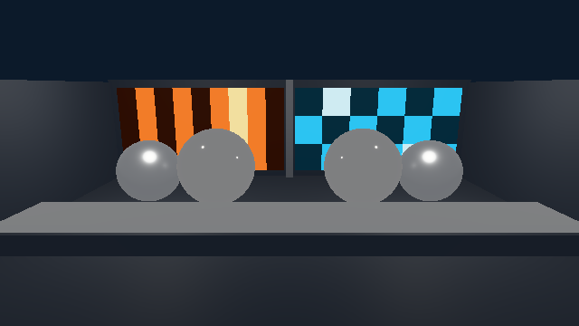
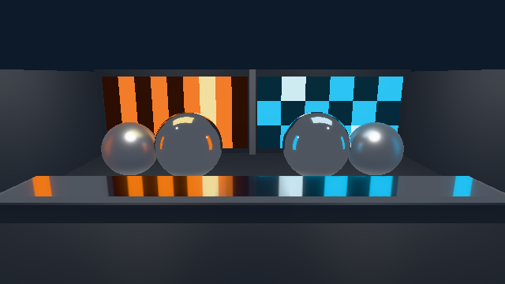

# Reflection Gallery

The orange room has vertical bars and one cream registration stripe. The cyan
room has a checkerboard and two pale registration squares. The wall meshes and
the two procedural HDR panoramas share the same panel positions and colors.
Each room has a large chrome sphere and a satin-metal sphere. A continuous
chrome rail crosses the probe overlap and makes changes in reflection scale and
registration easy to see on a flat surface. The scene uses a fixed exposure
of +0.1 EV in both variants.

| Global only | Local reflection probes |
| --- | --- |
|  |  |

## Launch and compare

From the repository root on macOS, build the native authoring helper and the app
you want to use. Start with the normal [macOS setup](../getting-started.md).

```sh
python3 scripts/hazel.py build --config Release \
  --target HazelProject --target Hazelnut --target Nutella
python3 scripts/macos/reflection_probes.py --config Release --diagnostic \
  --prepare-only --output build/reflection-gallery
```

The generator writes two project choices under the same asset directory.
Launch the same center camera in each. Use `--opengl` in place of `--metal`
to compare native OpenGL 4.1.

```sh
gallery='build/reflection-gallery/Study Project'
python3 scripts/hazel.py run Nutella --config Release --metal --inspect-camera \
  --project "$gallery/Reflection Gallery - Local.hproj"
python3 scripts/hazel.py run Nutella --config Release --metal --inspect-camera \
  --project "$gallery/Reflection Gallery - Global.hproj"
```

In Nutella, hold the right mouse button and use A/D to move across the rail.
Home restores the authored center pose. For an exact moving comparison, use the
paired capture below, where both sides follow the same camera path.

```sh
python3 scripts/hazel.py run Hazelnut --config Release --metal --no-restore \
  --project "$gallery/Reflection Gallery - Local.hproj"
```

In Hazelnut, open **ReflectionGallery-Local** in the Content Browser if needed.
Play starts at the authored camera. Stop and open **ReflectionGallery-Global**
to repeat at the same pose. In edit mode, select **Warm probe capture** or
**Cool probe capture** to see its influence and projection boxes. The Global
scene differs only in the two probe Enabled properties. Both projects use the
same material assets and Prepared HDR generations.

## Inspect parallax and overlap

Watch the cream stripe and pale squares in the rail. The box-projected image
keeps their scale and placement coherent as the camera travels. The
[distant-lookup control](evidence/ReflectionGallery_v1/distant-center.png)
uses the same local textures and influence weights with an oversized projection
volume for the center capture. On the rail it stretches and shifts the wall
patterns. The spheres show the change from sharp chrome to broader satin highlights.

The overlap is fixed in world space. Moving the camera reveals different parts
of that overlap on the rail. The colored boundary should stay near the center
of the gallery while reflected features move with viewpoint. See the
[left pose](evidence/ReflectionGallery_v1/local-left.png) and
[right pose](evidence/ReflectionGallery_v1/local-right.png).

The animated comparison places global-only on the left and local probes on
the right. It plays 33 matched poses over a nine-unit lateral sweep, then
returns along the same path.

[Open the moving comparison](evidence/ReflectionGallery_v1/matched-motion.png)

## Reproduce the native checks

```sh
python3 scripts/hazel.py build --config Release --tests \
  --target MetalRenderer2DQuadSmoke --target MigrationRenderer2DSmoke
python3 scripts/macos/reflection_probes.py --config Release --diagnostic \
  --project "$gallery/Reflection Gallery - Local.hproj" \
  --output build/reflection-gallery-captures
```

The runner uses both native backends by default. It verifies identical
authored state after accounting for probe enablement, exact within-backend
picking/depth coverage between matched modes, and the existing cross-backend
image tolerances. It also reruns the frozen six-face FP64 reference. The
original [two-room qualification study](static-reflection-probes.md) remains
available without the `--diagnostic` option.

Native Metal 4 and Apple OpenGL 4.1 passed these checks in Debug and Release
on Apple M4. The maximum same-surface RGB difference across the 67 captures
was 0.00146 and the largest picking difference was two pixels. At the center
pose, enabling probes changed 38,443 same-surface pixels by more than .08 in
at least one linear display channel. Changing the projection to the distant
control changed 13,246 pixels by the same threshold. Both project descriptors
passed native schema validation. Captures are offscreen readbacks.
[Qualification results](evidence/ReflectionGallery_v1/results.json)
