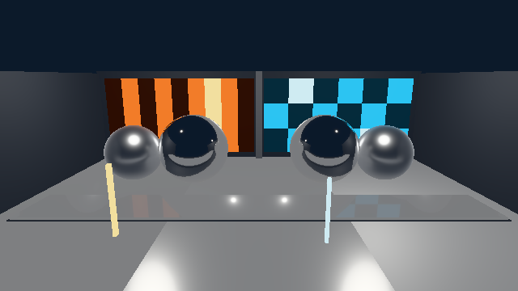
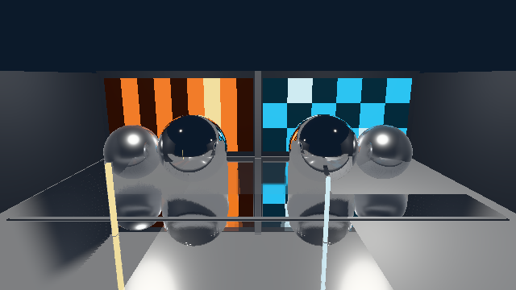

# Screen-space reflections

## Enable SSR

In Hazelnut, open **Scene Settings** for a scene-referred HDR scene and
enable **Screen-space reflections**. Apply the settings and save the scene.
Set the maximum ray distance and depth thickness in world units. Thickness is
the maximum accepted penetration behind visible depth along the camera's view
axis. Smaller values reject more silhouette mismatches. The quality setting
limits screen-space stride. High quality uses finer steps and covers fewer
pixels at a fixed step budget. Existing scenes load with SSR disabled.

## Frame and lighting contract

SceneRenderer renders opaque and masked 3D geometry once. With SSR enabled,
the forward pass writes the existing linear HDR color, depth, and picking
IDs, plus octahedral repaired shading and geometric normals, the material
roughness and single-scatter DFG weight, and the existing weighted
single-scatter probe/IBL term. Static probe captures skip SSR. World 2D and
screen UI are composited later.

The resolve reconstructs the receiver from depth and traces a view-space
reflection ray from the repaired shading normal. The geometric normal
rejects below-horizon rays and offsets the start. The ray walks a projected
segment using affine window depth, with a stride and sample cap. The first
front-to-back crossing is refined with up to five depth samples and accepted
only when it has sufficient camera-space thickness agreement and a
front-facing hit. The resolve fades at distance, budget, and screen limits.
Polished hits interpolate within their picking ID and fade as coverage is
lost. Rougher hits gather only depth- and normal-compatible texels before
fading to probes. This is a deterministic filter around a single ray.

The resolve interpolates between the existing single-scatter contribution
and reflected scene radiance multiplied by the same material DFG and
occlusion weight. That existing contribution already blends local probes
with residual global IBL. Direct illumination, diffuse IBL, emissive output
and Kulla–Conty energy compensation retain their forward evaluation. The ray
only reads the current forward target, before SSR or exposure, so it never
feeds resolved screen reflections back as ray sources.

Metal and OpenGL use the same GLSL resolve and offscreen row and depth
conventions. The bounded trace reads the forward depth directly. The
optional XeGTAO depth pyramid is specific to Metal. The fullscreen resolve preserves depth and picking, and runs
before world 2D and tone mapping. When Metal TAA is active it consumes the
jittered SSR radiance. Its existing depth, motion, and neighborhood checks
limit stale history. The SSR resolve has no independent history and uses
deterministic sampling with TAA off. The current OpenGL backend runs SSR
without XeGTAO or TAA.

## Gallery

On Apple Silicon macOS, generate the two-room study from the prepared
reference assets, then run it in Hazelnut or Nutella. To use captured probes, pass the local project from
the [static bake study](static-probe-baking.md) with `--from-gallery`.

```sh
python3 scripts/hazel.py build --config Release --tests \
  --target HazelProject --target Hazelnut --target Nutella \
  --target MetalRenderer2DQuadSmoke --target MigrationRenderer2DSmoke
python3 scripts/macos/screen_reflections.py --config Release --motion \
  --output build/ssr-gallery
python3 scripts/hazel.py run Nutella --config Release --metal --inspect-camera \
  --project 'build/ssr-gallery/SSR Gallery/SSR Gallery.hproj'
```

Use `--opengl` for the same scene on OpenGL. The automated suite sweeps 17
matched camera positions past polished, satin and matte floor sections,
metallic spheres, a mirror rail, and thin emissive uprights. It records SSR on
and off, an SSR plus global-only control, and a moving Metal SSR/AO/TAA
sequence. The independent geometry fixture tests a finite thin wall against
FP64 world-space plane intersections for both camera projections.

| Baked probes | SSR and baked probes |
| --- | --- |
|  |  |

[Matched camera sweep](evidence/ScreenReflections_v1/matched-motion.png) ·
[Metal SSR, AO and TAA](evidence/ScreenReflections_v1/ssr-temporal.png)

## Native GPU timing

Apple M4, macOS 27.3, Release. The same baked gallery used medium quality,
64 steps, and a 20-unit ray limit. The timed views used 15 alternating
on/off pairs after four warmup pairs. Each cell shows the median paired
increase and p95 increase in milliseconds.

| Physical pixels | Metal 4 | OpenGL 4.1 |
| --- | ---: | ---: |
| 1280×720 | 1.62 / 2.31 | 0.62 / 0.95 |
| 1920×1080 | 2.73 / 2.91 | 3.34 / 4.79 |
| 2560×1440 | 4.85 / 4.99 | 6.22 / 7.12 |

Metal measures its offscreen command packet including readback. OpenGL
measures world rendering through display composite with an elapsed query.
The 2560×1440 target has the physical dimensions of 1280×720 at 2×.
The test measures completed GPU work at that extent. The attached display
runs at 1×.

[Metal samples](evidence/ScreenReflections_v1/metal-timing.csv) ·
[OpenGL samples](evidence/ScreenReflections_v1/opengl-timing.csv)

```sh
python3 scripts/macos/screen_reflections.py --benchmark \
  --project 'build/ssr-gallery/SSR Gallery/SSR Gallery.hproj' \
  --output build/ssr-timing
```

## Qualification

Native Apple M4 Debug and Release matched the FP64 thin-wall reference at
5,762 of 5,762 guarded hits on Metal and 5,743 of 5,762 on OpenGL, with zero
false hits in 23,854 guarded miss pixels per API. Near the left and right
screen limits the reflected red channel fell below 8% of its corresponding
interior value across 59 rows. Across the 17-pose gallery the worst
same-surface RGB p99 difference was 0.000055 and the most picking
differences between backends were two pixels in a frame. Enabling SSR
preserved deterministic AA-off color and exact within-backend IDs and
depth in matched controls.

Metal passed moving SSR/AO/TAA, a stationary receiver with a suddenly
vanished reflected wall, and three queue-gated submissions through a view
reset and resize. No residual red was observed in the 2,350 compared floor
pixels after the disocclusion. Source-free Nutella relocation passed with
packaged Metal libraries and with the OpenGL runtime GLSL path. The
relocated Hazelnut and Nutella desktop smoke tests each rendered at least
60 frames on both APIs and shut down cleanly.

The OpenGL qualification here uses Apple's native 4.1 driver. Linux,
Windows, Intel GPUs, and native 2× backing-scale presentation were outside
the exercised hardware. The private SSR surface adds 56 bytes per physical
pixel before allocator alignment and in-flight retention.

[Qualification results](evidence/ScreenReflections_v1/results.json)

## Limits

Offscreen, occluded and low-confidence surfaces rely on prepared probes and
global IBL. Very thin geometry can fall between traversal samples. The
roughness filter approximates a glossy lobe and rolls out screen reflections
above roughness 0.55. Surface TAA motion approximates motion of the reflected
image. Future reflected-hit reprojection would require its own evidence.
