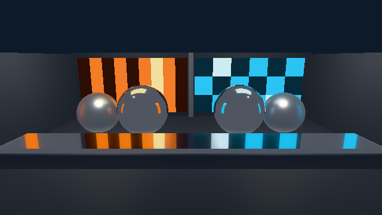
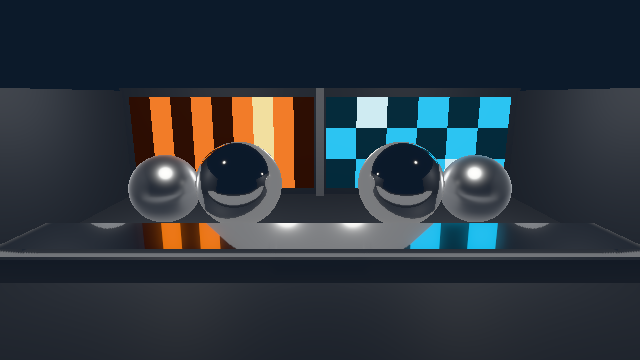

# Static reflection probe baking

## Fidelity

The original Gallery used a 512×256 equirectangular panorama and 256-pixel
specular faces. At the equator its source steps are 0.703° apart. A larger
cubemap can help only when the source contains finer information. In particular,
the 512-pixel bake profile pairs a dense scene capture with a 512-pixel
prefilter rather than upsampling the original Gallery panorama.

The table measures one known Gallery stripe boundary in warm −Z specular mip
zero. Use the equatorial cube row and find the descending 90% and 10% points
between s=.665 and .72 by interpolation between texel centers. The reference
linear red values are .970 and .024. Convert horizontal cube s to an angle with
`atan(2*s-1)`. The existing prefilter samples source radiance directly for mip
zero. The same roughness floor, FP32 mip interpolation and GGX convolution
continue to apply at runtime.

| Equirectangular source | Specular face | 10–90% edge width |
| --- | ---: | ---: |
| 512×256 | 256 | 0.629° |
| 512×256 | 512 | 0.585° |
| 2048×1024 | 128 | 0.629° |
| 2048×1024 | 256 | 0.608° |
| 2048×1024 | 512 | 0.203° |

Both stages limit this edge. Changing only one of them produced a modest
gain. The measured weakness is source and face sampling density. Higher
roughness still broadens the reflection as intended.

[Original Gallery capture](evidence/StaticProbeCapture_v1/gallery-original.png)
[Higher-resolution source and 512-pixel faces](evidence/StaticProbeCapture_v1/gallery-fidelity-512.png)

## Bake in Hazelnut

Open a scene with **Scene-referred** presentation. Select a **Reflection Probe**
in Edit mode, choose **Bake face size** and click **Bake Static Probe**.
Hazelnut captures the authored scene from the probe's world position, shows
progress in the Inspector and Console, and assigns the prepared environment
when it succeeds. Enable the probe if it was disabled. The inspector supports
128, 256, and 512 pixels per face, with 256 as the default. Rebake after moving
the probe or changing lighting or geometry.

Each success writes a separate asset under `CapturedReflections/`. Undo and
Redo switch the probe assignment between immutable versions. The baked files
remain on disk when their scene assignment is undone. Cancellation, invalid
capture pixels, and failed preparation keep the previous assignment. If the
probe moves or its authored assignment changes during preparation, the
successful asset remains available for manual assignment. Save the scene to
retain the new reference across reloads.

## Capture contract

The renderer uses the shared SceneRenderer collection, shadow passes, and
forward shading with a private FP32 target. It records six single-sample
90-degree views at 0.05–1000 world units. Faces follow +X, −X, +Y, −Y, +Z, −Z.
The readback converts the framebuffer row and handedness conventions into
Hazel's existing `CubeDirection` convention. Metal advances when the queue
completes each face. OpenGL reads one complete face on the context thread.

The capture records linear radiance from opaque and masked meshes, authored
lights and shadows, and the original global environment and visible sky.
It excludes all local probes, captured global environments, screen AO, TAA,
world sprites and UI. Exposure and display processing do not enter the capture.
Visible objects remain in the cubemap. Interior occluders can cover the scene
behind them, and a room box is an approximation for their parallax.

The native producer stores the FP32 cube as a relocatable authoring input.
It copies captured source texels into specular mip zero without a second
resampling pass. A seam-aware cube lookup builds a 4N×2N FP32 panorama for the
existing importance sampler and filtered mips. The accepted generation holds
the cooked specular and cosine data and retains the current BRDF pipeline.
The player can use accepted lighting with the authoring capture and HDR
panoramas removed.

The two-probe limit is retained. A project's local GPU cache uses up to
eight generations and a conservative 128 MiB logical RGBA32F texture budget,
including generations pinned by in-flight frames. The asset cache can evict
idle valid generations so repeated rebakes can remain independently undoable.

## Reproduce

The [Reflection Gallery](reflection-gallery.md) still generates the original
imported comparison. Prepare a matched 256-pixel Gallery with a denser input
and run the capture qualification on Apple Silicon macOS.

```sh
python3 scripts/hazel.py build --config Release --tests \
  --target HazelProject --target MetalRenderer2DQuadSmoke --target MigrationRenderer2DSmoke
python3 scripts/macos/reflection_probes.py --config Release --diagnostic \
  --probe-side 256 --panorama-width 2048 --prepare-only --output build/gallery-256
python3 scripts/macos/static_probe_capture.py --config Release --side 256 --full-motion \
  --gallery 'build/gallery-256/Study Project/Reflection Gallery - Local.hproj' \
  --output build/gallery-256-captured
```

Use the matched `imported/` and `baked/` captures. The generated
`Captured Gallery/Reflection Gallery - Local.hproj` can also be opened with
the Gallery's existing Nutella or Hazelnut commands. The capture omits
recursive lighting and still sees the rail, spheres and direct lighting,
so its contents visibly differ from the procedural panorama.

| Imported 256-pixel faces | Scene-captured 256-pixel faces |
| --- | --- |
|  |  |

[Captured Gallery camera sweep](evidence/StaticProbeCapture_v1/gallery-captured-motion.png)

To repeat the resolution sweep, choose 128, 256 or 512 for both resolution
arguments. For the original and higher-resolution source comparison, choose
512 or 2048 for `--panorama-width`. The renderer-only reference is
`reflection_probes.py --config Release --backend both --benchmark --project …`.

## Native costs

Apple M4 with macOS 27.3. A capture time below is the second probe after
initial pipeline setup, measured from recording through completed CPU
readback for all six faces. The first measured 128–512 capture took 119–125 ms
on Metal and 279–303 ms on OpenGL including setup. The prefilter times are
Release native producer measurements for the cool room. GPU texture payloads
are calculated from the actual cooked payload dimensions using RGB32F on
OpenGL and RGBA32F on Metal, before driver allocation granularity.

| Face size | Metal capture | OpenGL capture | Prefilter | FP32 source | Metal texture payload | OpenGL texture payload |
| --- | ---: | ---: | ---: | ---: | ---: | ---: |
| 128 | 19.56 ms | 9.69 ms | 2.72 s | 1.125 MiB | 2.09 MiB | 1.57 MiB |
| 256 | 22.66 ms | 14.19 ms | 9.04 s | 4.50 MiB | 8.37 MiB | 6.28 MiB |
| 512 | 36.21 ms | 17.18 ms | 39.20 s | 18.00 MiB | 32.37 MiB | 24.28 MiB |

The Release benchmark kept screen coverage and materials fixed. At 1920×1080
the paired median increase for two probes was 0.54, 0.60 and 0.61 ms on Metal
as resolution increased. The equivalent native OpenGL world-plus-composite
intervals increased by 0.135, 0.131 and 0.103 ms in these runs. The two backends'
intervals cover different passes. The observed runtime differences between
resolutions were small compared with the changes in preparation time and
texture memory. The detailed samples cover 720p, 1080p and 2560×1440 physical
pixels.

Metal's measured device allocation for two probes was 4.38, 16.97 and
65.06 MiB at 128, 256 and 512 pixels per face, respectively. OpenGL figures in
the table are payload estimates. The cool-room producer's measured peak
resident memory was 21.9, 48.3 and 154.3 MB across those profiles.

## Source-free relocation

Copy the captured project into a distribution staging folder and omit the
producer-only panoramas and raw capture cubes. Keep the environments,
acceptance manifests, and prepared generations. The generated Gallery uses
`Warm.hlight` and `Cool.hlight` for raw inputs. Inspector bakes use
`Capture.hlight`.

```sh
python3 - <<'PY'
from pathlib import Path
import shutil

source = Path('build/gallery-256-captured/Captured Gallery')
shutil.copytree(source, 'build/gallery-runtime/Probe Gallery café',
                ignore=shutil.ignore_patterns('*.hdr', '*.lock', 'Warm.hlight',
                                              'Cool.hlight', 'Capture.hlight'))
PY
python3 scripts/hazel.py build --config Release --tests \
  --target SpriteAssetAudit --target Nutella --target MetalShaderTools
python3 scripts/hazel.py package --app Nutella \
  --project 'build/gallery-runtime/Probe Gallery café/Reflection Gallery - Local.hproj' \
  --output build/gallery-package
python3 scripts/macos/reflection_probes.py --config Release --diagnostic \
  --archive build/gallery-package/Nutella-macos-arm64-Release.zip \
  --offscreen-only --output build/gallery-relocation
```

## Qualification

Native Metal and OpenGL 4.1 passed the focused Debug and Release capture
checks on Apple M4. The directional sky control exercised face centers, edges
and corners. Its maximum capture error was 0.00776 in linear radiance. The
mask and point-shadow fixtures matched across backends. A capture produced
identical texels after changing exposure, enabling AO/TAA and making the
local probes unavailable. Prepared mip zero matched the raw FP32 cube byte
for byte, and a corrupted rebake input preserved the accepted generation.
The baked Gallery's raw face parity was 4.47×10⁻⁸ at p99 RGB-channel error.

The 256-pixel baked Gallery passed the 33-pose native comparison across the
two rooms and the existing FP64 projection and blending checks. Metal also
passed the baked Gallery AO/TAA and history invalidation test. The native
Release editor tests covered first bake, rebake, cancellation, scene reload
and Undo/Redo on both APIs. Frozen PBR/IBL regression checks passed in Debug
and Release. Nutella archive integrity and source-free offscreen relocation
passed on both APIs.

Windows, Linux, Intel GPUs, Retina backing-scale behavior and interactive
player presentation remain unverified for this milestone. The 2560×1440
performance run is an offscreen physical-pixel test.

[Numerical results and timings](evidence/StaticProbeCapture_v1/results.json)
