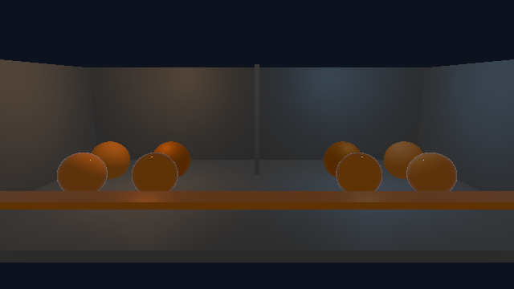
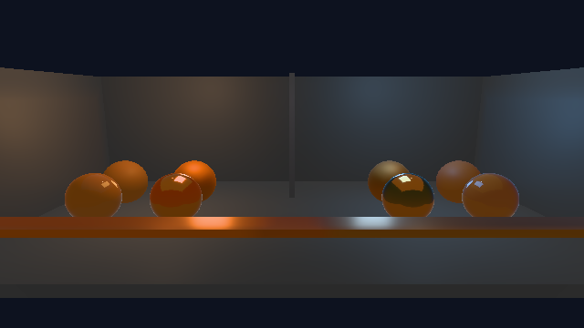

# Static local reflection probes

The implementation starts from the integrated shadow checkpoint
`489a4bc732c7ea870ead0b2a09a3faea4af4629d` on `feature/3d-foundations`.
See the [combined-shadow record](combined-shadow-quality.md) for the historical
qualification limits and the owner's visual checkpoint.

## Design

Hazel already prepares a linear HDR panorama into a world-oriented background,
cosine irradiance, GGX specular mip chain, and historical BRDF artifact. The
accepted generation is immutable and runtime resolution verifies its hashes
and intent. The local path uses exactly this producer and consumes the specular
and cosine cubes. The cosine cube supplies the dense roughness-one specular
endpoint, as in global IBL. It is never evaluated as local diffuse irradiance.
See the [IBL quality pass](ibl-quality-pass.md) and [RuntimeBRDF_v2](ggx-multiscattering.md).

Filament documents split-sum factorization of filtered incident radiance and the
view-dependent BRDF integral. Hazel likewise blends the incident specular
radiance before multiplying by the existing material Fresnel/DFG term. Sébastien
Lagarde's local IBL work separates the point of capture, the projection proxy
and the influence function. Hazel uses one world-aligned box as an influence
volume, a containing world-aligned proxy box, and a capture point that coincides
with the influence center. [Filament IBL architecture](https://google.github.io/filament/Filament.md)
[Lagarde's box projection and blending](https://seblagarde.wordpress.com/2012/09/29/image-based-lighting-approaches-and-parallax-corrected-cubemap/)

At a shaded world position $P$, the shader uses the reflection $R$ from the
existing view vector and repaired shading normal. Geometric visibility and the
reflection horizon are resolved before projecting. For each influenced probe,
compute the first exit $Q=P+tR$ from the containing box and sample along
`Q - C`, where $C$ is its capture point. The exit uses the forward face of
each axis. Comparing the span with the current candidate times the absolute
ray component prevents division by zero and overflow. The authored constraint
ensures the ray begins inside the proxy. A negligible projected length falls
back to $R$. Cubemap face order is +X, −X, +Y, −Y, +Z, −Z with the existing
prepared artifact row orientation. Scene environment yaw applies to the global
cube only. Local captures use the world axes.

Each weight $w_i$ is smoothstep from zero to one over the authored blend
distance, measured inward from the nearest influence face. With
$S=\sum_i w_i$, local weights are $w_i/\max(1,S)$ and the global weight is
$\max(0,1-S)$. The weights sum to one and remain continuous as either probe
enters or leaves influence. The shader skips zero-weight local fetches and
skips global specular fetches at full local coverage. Local roughness uses
explicit integer mip samples with FP32 interpolation and the same normalized
roughness-to-LOD mapping as global IBL. The global gain scales the global
residual. Its irradiance still supplies diffuse and the existing Kulla–Conty
multiple-scattering contribution, with material occlusion and screen AO
handled by their existing paths. Local specular works with the global light
disabled or absent. In a local-only scene the probe supplies the single-scatter
specular term. Compensation for locally incident multiple scattering would
require a separately qualified radiance estimate.

## Ownership and authoring

The scene accepts two enabled probes and admits them in stable entity-ID order.
It rejects a third instead of reassigning a slot based on the camera, so
view motion alone cannot change admission. The scene schema validates asset
references and bounds, and project runtime and export validation audit the
complete accepted environment dependency graph. Disabled components can retain
authored settings. Editing a probe is an Inspector transaction with scene
history. The viewport draws a selectable capture marker and selected volume
bounds.

The view retains its realized probe set. The project cache shares up to eight
prepared GPU generations, including entries pinned by a queued Metal frame or
another view. The render thread creates only the two required cubes per
generation. Metal's immutable draw packets and frame owners keep textures
resident through command completion. OpenGL retains texture objects through
ordered GL use and deletion. Enablement, projection edits, accepted asset
generation changes, resizing, and scene replacement invalidate Metal TAA
history. Metal binds regular specular cube samplers and two static linear
clamp cosine samplers. OpenGL 4.1 uses 15 fragment texture units for forward
PBR with all its declarations active, within its 16-unit minimum.

Specular and cosine faces are each bounded to 256 pixels. With the study's
128-pixel specular and 32-pixel cosine assets, each probe has 1.57 MiB of RGB32F
texels in the OpenGL images and 2.09 MiB of RGBA32F texels on Metal. These are
logical payloads, before driver allocation granularity. In an overlap, the
prefilter can take up to two reads per influenced probe and two global reads
where global weight remains. Roughness one uses one cosine read per influenced
probe. A scene with no probes follows the same global shader math and performs
zero local texture reads.

## Reproduce the study

Generate two HDR captures and a small two-room project, then collect matched
fixed-exposure camera poses through the existing renderer. The script produces
warm and cool captures with a different wall color and panel placement. The
study has overlapping volumes, a shared threshold, and smooth and rough
metallic and dielectric spheres. It also runs an independent FP64 six-plane
intersection and cubemap-direction oracle using a deliberately asymmetric
face/mip pattern.

```sh
python3 scripts/hazel.py build --config Release --tests \
  --target HazelProject --target MetalRenderer2DQuadSmoke --target MigrationRenderer2DSmoke
python3 scripts/macos/metal_shaders.py --config Release --build --output Hazel/Resources/shaders/metal
python3 scripts/macos/reflection_probes.py --config Release --output build/reflections-study
python3 scripts/macos/reflection_probes.py --config Release --backend metal --benchmark \
  --baseline 489a4bc732c7ea870ead0b2a09a3faea4af4629d \
  --project 'build/reflections-study/Study Project/Reflection Study.hproj' \
  --output build/reflections-timing
python3 scripts/macos/reflection_probes.py --config Release --backend opengl --benchmark \
  --project 'build/reflections-study/Study Project/Reflection Study.hproj' \
  --output build/reflections-timing-gl
```

The two-room generator is an offline study, independent of the production
runtime. Production accepts a Radiance HDR panorama through the existing
Environment editor workflow. The prepared data and source can be kept in
separate deliverable trees. For the generated fixture, make a copy without
the two probe HDR inputs, then package that copy with the standard Nutella
command. Keep the accepted descriptors, artifact directories and shared BRDF
dependencies in the copied project.

```sh
python3 - <<'PYTHON'
from pathlib import Path
import shutil

project = Path('build/reflections-study/Study Project')
shutil.copytree(project, 'build/reflections-runtime/Project café',
                ignore=shutil.ignore_patterns('*.hdr', '*.lock', '*.log'))
PYTHON
python3 scripts/hazel.py package --app Nutella \
  --project 'build/reflections-runtime/Project café/Reflection Study.hproj' \
  --output build/reflections-package
```

The standard OpenGL player package uses GLSL source. Metal can consume the
shipped native artifacts with GLSL and MSL sources absent. Recheck the archive
from an unrelated directory with the checkout and SDK denied. Omit
`--offscreen-only` to include the separate native player desktop smoke.

```sh
python3 scripts/macos/reflection_probes.py --config Release \
  --archive build/reflections-package/Nutella-macos-arm64-Release.zip \
  --offscreen-only --output build/reflections-relocation
```
 A future explicit in-engine bake would need a
defined linear-radiance capture path for six 90-degree views and a coherent
publication step through the environment producer. Existing world shading,
sky, local-probe exclusion, and display postprocessing would each need explicit
capture policies. Continuous recapture and other reflection techniques are
outside this milestone.

## Qualification

The FP64 gate runs at 97×49 across six orthographic viewing directions,
four roughnesses and two materials. Its analytical comparison excludes cube
seams and covers all six faces using both sides of the reference surface. The study
compares all nine matched poses at 640×360, requiring the 99th-percentile
same-surface RGB delta to stay below .015 and at most 460 picking-ID
differences per pose. A gated Metal test pins three pending draws while a view
is reset, resized and released, then compares their readbacks with serialized
controls. The performance test uses five warmups and 15 samples per extent and
configuration. Timings are offscreen, with the release Metal forward-pass GPU
counter and identical surface coverage for zero, one, and two active probes.

### Native results

Apple M4, macOS 27.3. Native Metal 4 and Apple's OpenGL 4.1 driver were
measured under the same camera and exposure. Source and artifact digests and
the full native parity measurements are in the [results](evidence/ReflectionProbes_v1/results.json).

| Scope | Result |
| --- | --- |
| Metal and OpenGL FP64 reference, Debug and Release | PASS. 175,560 comparisons per backend and configuration, including 41,160 overlaps and 130,192 samples with residual global weight. All six cube faces exercised. |
| FP64 radiance and material-energy error | PASS. Maximum radiance error 0.000102, maximum single-scatter term error 0.000050, measured diffuse change zero. |
| Nine-pose study, native Metal and GL 4.1 | PASS. Worst same-surface p99 RGB delta 2.99e-8, maximum RGB delta 0.001068 and at most two differing picking IDs per pose. |
| Metal AO/TAA, resize, reactivation, and scene replacement | PASS. The nine-pose movement sequence kept history, with worst same-surface moving versus stationary p99 RGB delta 0.036103. |
| GPU lifecycle | PASS. Three queued draws retained their generations across view teardown and resize. Both probe owners retired after completion. |
| Editor and serialization | PASS. Inspector history, scene round-trip and dependency closure. The editor history regression passed on native OpenGL Debug/Release and Metal Release. |
| Source-free archive | PASS. Archive checksums, signature and isolated render/readback on both backends from an unrelated Unicode path without project HDR inputs. The Metal run also excluded GLSL and MSL sources. |
| Native packaged player desktop smoke | BLOCKED by the locked macOS graphical console. |
| Frozen IBL, GGX multiscattering, XeGTAO, and TAA | PASS in the focused regression suites. The historical shadow and visual qualification records retain their original status. |
| Native Retina, Windows/Linux, and Intel GPU execution | NOT RUN. The connected 2560×1440 display ran at 1×. |

The following Release captures use the same camera and exposure. The threshold
shows contributions from both probes without a hard color boundary. The warm
and cool panels are sharp on the smoother spheres and broaden on rough surfaces.

| Global IBL | Static local probes |
| --- | --- |
|  |  |

See the [left pose](evidence/ReflectionProbes_v1/local-left.png),
[right pose](evidence/ReflectionProbes_v1/local-right.png), and
[center pose with Metal AO and TAA](evidence/ReflectionProbes_v1/local-temporal-ao.png).

### GPU and preparation costs

Each study probe contains six 128-pixel specular faces with the full prepared
chain down to 4×4 and six 32-pixel cosine faces. The measured Metal device
allocation delta for both probe pairs was 4,587,520 bytes (4.375 MiB).
OpenGL's nominal combined RGB32F payload is 3,292,416 bytes (3.14 MiB).
The Release preparation tool measured 2.181 s for the warm capture and
2.177 s for the cool capture, with a process RSS peak of 19,660,800 bytes.

Release Metal forward/world GPU counter, in milliseconds. The scene covers
the entire image with a PBR receiver intersecting two probe volumes. Active
counts alternate within each extent. Each entry is median/p95 over 15
samples after five warmups. The checkpoint run uses the old shader body
with the same uniform-block layout, in a separate process. The measured
zero-probe deltas include run-to-run GPU variability.

| Physical extent | Checkpoint zero | Current zero | One probe | Two probes | Paired median increase, one / two |
| --- | ---: | ---: | ---: | ---: | ---: |
| 1280×720 | 0.935 / 2.042 | 1.101 / 1.967 | 1.270 / 2.227 | 1.430 / 2.527 | 0.153 / 0.331 |
| 1920×1080 | 2.287 / 2.792 | 1.981 / 2.844 | 2.252 / 3.204 | 2.540 / 3.332 | 0.266 / 0.590 |
| 2560×1440 | 2.377 / 2.902 | 2.630 / 3.103 | 2.992 / 3.549 | 3.370 / 3.855 | 0.364 / 0.738 |

The zero-probe comparison varied with resolution. The 2560×1440 run was
0.253 ms slower at the median. The separate processes leave that difference
unattributed between shader overhead and GPU run-to-run variability.
Native OpenGL 4.1 Release used a time-elapsed GPU query around the same scene
render, including the display composite. Its interval is broader than the
Metal forward counter. The same 5/15 warmup/sample protocol applies.

| Physical extent | Zero probes | One probe | Two probes | Paired median increase, one / two |
| --- | ---: | ---: | ---: | ---: |
| 1280×720 | 1.552 / 1.830 | 1.570 / 2.500 | 1.610 / 1.859 | 0.010 / 0.051 |
| 1920×1080 | 3.748 / 4.389 | 3.914 / 4.538 | 3.997 / 4.382 | 0.149 / 0.223 |
| 2560×1440 | 6.883 / 7.857 | 6.999 / 7.723 | 7.079 / 7.775 | 0.168 / 0.123 |

The high-resolution OpenGL difference was smaller than the spread of
the samples. The paired medians characterize this workload, without a
cross-driver scaling claim.

[OpenGL GPU samples](evidence/ReflectionProbes_v1/timing-opengl.csv)
[Current GPU samples](evidence/ReflectionProbes_v1/timing-metal.csv)
[Checkpoint GPU samples](evidence/ReflectionProbes_v1/timing-checkpoint.csv)
[Metal FP64 samples](evidence/ReflectionProbes_v1/reference-metal.csv)
[OpenGL FP64 samples](evidence/ReflectionProbes_v1/reference-opengl.csv)
