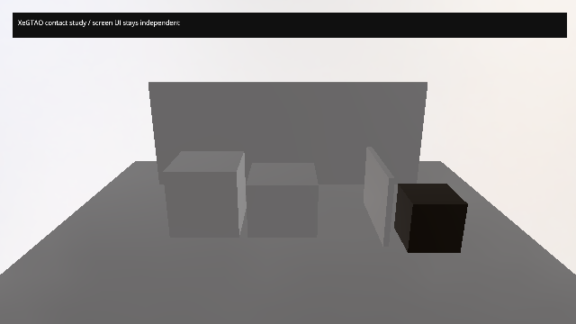
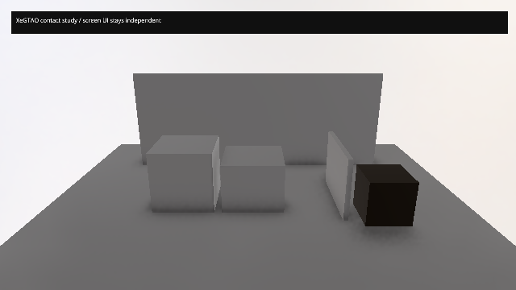
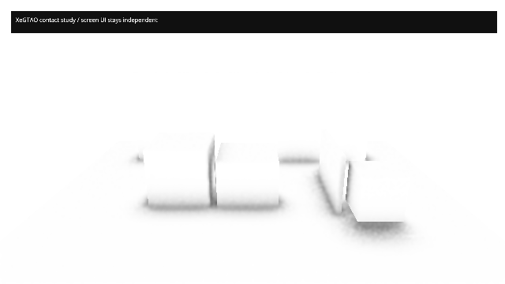
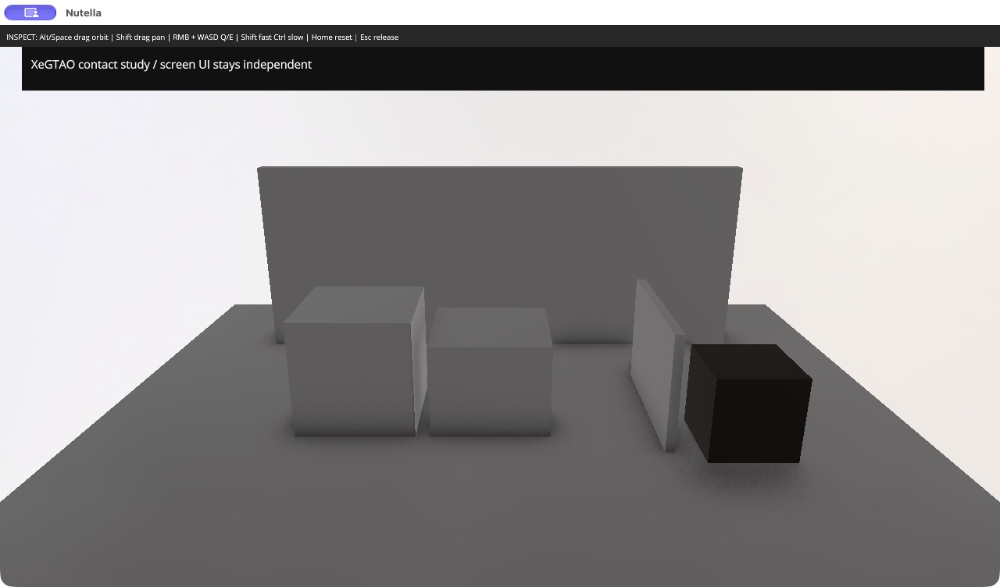

# XeGTAO — implementation and qualification record

Baseline: `86c581c13fd5c944c2a06d720314a753d7607d8f`,
`feature/3d-foundations`. Initial tree has an unrelated modified
`examples/RenderingReference/Assets/Reference/IBLQuality_v2/Materials/M0R3.hmat`,
untracked shader artifacts and Finder metadata. Preserve these; do not use the
modified material as frozen-reference evidence.

## Source-grounded integration decision

SceneRenderer owns world ordering and per-view framebuffer lifetime. Renderer3D
owns the single mesh/material traversal; MetalRendererAPI captures immutable draw
packets. MetalDeviceRenderer2D prepares arguments/residency and encodes the packet
into the existing Metal 4 submission, whose completion retains its resources.
ForwardPBR evaluates direct, diffuse IBL, specular IBL and emission separately.
The current color-compute ABI (one float input and one output) cannot represent
XeGTAO and must not be silently reused with incompatible resources.

Chosen order: masked mesh depth preparation → FP32 view-depth mip preparation →
XeGTAO horizon integral and edge output → spatial denoise → ordinary forward PBR
→ world 2D → world exposure/Neutral composition → screen UI. Reuse the mesh
traversal with a narrow depth shader, preserving material masks and culling.
Reconstruct geometric normals from depth using upstream edge-weighted neighbors;
no extra authored normal buffer, deferred renderer or alternate scene traversal.
Per-view working textures must be completion-retained and reused only after their
prior submission retires. Barriers cover render-to-compute, every dependent mip,
main-to-denoise and denoise-to-fragment. Final forward IDs/depth remain authoritative.

Diffuse visibility combines material AO and screen-space AO by minimum, avoiding
multiplication of overlapping occlusion estimates. Screen-space AO does not alter
direct, emission, sky, UI or specular IBL. Existing material specular occlusion and
accepted single-scattering GGX/split-sum equations stay unchanged. AO-off must
preserve existing output. OpenGL has no AO implementation and must disclose this.

## Upstream adaptation

Intel XeGTAO, pinned commit `a5b1686c7ea37788eeb3576b5be47f7c03db532c`:
https://github.com/GameTechDev/XeGTAO . Reviewed XeGTAO.h, XeGTAO.hlsli and
vaGTAO.hlsl. MIT notice accompanies the adaptation.

Retain the weighted depth mip filter, squared radial distribution, R1 sample
jitter, Hilbert/R2 fixed spatial noise, normal-relative horizon bounds, analytic
slice integral, slope-aware symmetric edges and edge-path spatial denoiser.
FP32 depth/math initially avoids FP16 normal-reconstruction artifacts. No bent
normals: they add cost without a qualified directional-lighting consumer here.
No temporal noise or TAA dependency. Screen-space missing/offscreen/hidden geometry
and height-field thickness ambiguity remain inherent limitations.

Raster GLSL remains authoritative through shaderc/SPIR-V/SPIRV-Cross. That pipeline
currently accepts only vertex/fragment stages and rejects storage images. A narrow
offline MSL compute adaptation is preferable to adding a general HLSL runtime or
misrepresenting raster artifact support. Runtime must load packaged metallib only.

## Predeclared acceptance

All requested visual, native Debug/Release editor/player, motion/resize/1×/2×,
AO-off frozen PBR/IBL, exact signed IDs/depth, M1–M6 relevant regressions, OpenGL,
source-free packaging, failure cleanup and sustained resource gates are required.
Geometric cases include isolated plane, contact box, perpendicular corner, thin
occluder, masks, double-sided surfaces, perspective and orthographic projections.
Unsupported projection must fail explicitly. Numeric plane visibility, bounded
finite AO and independent geometric contact expectations supplement screenshots.

Serialized 720p/1080p AO-off and each quality benchmark must report warmup/sample
counts, CPU/GPU median/p95, pass timing scope, complete-frame time, memory and frame
pacing. No timing result can substitute for a missing pass measurement. Windows
historical full-suite timeout is separately deferred. New platform execution is
reported separately from static portability review.

Status: **PASS — functional/correctness acceptance under the owner’s amended
2026-11-24 scope. Final visual-quality qualification remains INCOMPLETE.**
See the final acceptance section; earlier checkpoints below remain historical.

## Continuation checkpoint (2026-11-21)

Actual resumed HEAD is `4e01c5c1d361110fc8fcff4e8b9b755e3be23581`
(`Start of XeGTAO integration`), with a clean initial tree. That owner-created
commit contains the initial work and the unrelated material/Finder/generated
artifact changes. They are preserved. New work is a diff on this checkpoint.

### Adaptation details and discriminating experiments

- Upstream's finite slice integral exhibits a small view-dependent constant
  visibility bias on an isolated plane. The initial strict >=.97 plane gate
  failed. Hazel normalizes the sampled integral by the same analytic integral
  over the unobstructed tangent hemisphere before the upstream final power.
  Horizon sampling/integration, radius/falloff, R1 jitter, Hilbert/R2 pattern and
  edge-path filter remain XeGTAO. This normalization is an explicit adaptation,
  not an upstream-equivalent byte port. The gate is unchanged.
- The first implementation used a queue producer barrier between dispatches in
  one encoder. Native captures exposed zero-valued tiles. This was corrected to
  `barrierAfterEncoderStages`; render/compute boundaries retain queue barriers.
  Metal API/GPU validation alone had not caught the missing dependency.
- The first MSL compile had three syntax errors; the first box-contact fixture
  placed the sampled front face outside the AO radius. Both failed attempts
  remain in `build/xegtao-evidence/`. The reference ray test initially compared a
  hidden floor point to a visible box pixel near the silhouette. It now traces
  the nearest primary surface and evaluates the same 3x3 pixel footprint.
- Initial matched high-preset main-pass medians were 2.784 ms (720p) and
  6.192 ms (1080p), Debug/native M4, 579 samples per extent after warmup/tail.
  This exposed repeated inverse-matrix reconstruction per horizon sample. The
  current constant block supplies the equivalent per-view UV-to-view mapping.
  One subsequent exploratory benchmark overlapped a validation fixture at its
  tail and is excluded from final performance claims.
- The mesh preparation framebuffer now allocates/stores **depth only**. It
  neither allocates nor writes color/picking attachments. The final forward pass
  still owns authoritative depth and IDs. The per-view depth framebuffer owns a
  completion-safe AO resource pool shared by shaded/inspection consumers.
  Counter heaps are reused with each retired generation; idle and in-flight AO
  textures participate in the existing 1 GiB native resource admission budget.
- Low/medium/high/ultra use 4/8/18/54 horizon samples per pixel at full physical
  resolution. Low/medium use two edge-aware passes; high/ultra use three to
  support spatial stability without TAA. Constants/math/depth are FP32; scalar
  working visibility is R16F and edge weights are RGBA8. Bent normals and
  screen-space specular occlusion are not implemented. Material specular AO
  remains unchanged; diffuse combines material and GTAO visibility by minimum.

### Focused executed evidence

`build/xegtao-evidence/depth-only-debug/` passes native API/GPU-validated plane,
contact, fixed-frame determinism, perspective/orthographic, masked geometry,
camera/object motion, exact direct/ID/depth preservation, diffuse/specular IBL
separation, singular-camera rejection/recovery, odd/one-pixel resize, three gated
pending frames, view destruction before GPU completion, and final retirement.
The independent physical-radius cosine hemisphere reference uses 16,384 rays per
pixel in eight 3x3 probes. RMS visibility error is .0541 against the predeclared
.15 bound. This is a contact fixture, not a general ray-traced ground-truth pass.

The later maintained fixture additionally checks depth-only API rejection,
reprojected contact variation during camera orbit/translation/dolly (range <=.15),
and exact screen UI preservation. These later additions require their own fresh
runs; the earlier focused result does not cover them.

### Frozen inputs and qualification provenance

The owner's checkpoint changed `IBLQuality_v2/Materials/M0R3.hmat` relative to the
requested baseline. Tests must not reset that file or bless its new bytes as a
frozen reference. `HAZEL_TEST_EXAMPLE_REVISION=86c581c13fd5c944c2a06d720314a753d7607d8f`
selects explicitly logged private example snapshots for frozen regression tests.
`Renderer3DParity` honors the existing `HAZEL_RENDERING_REFERENCE_PROJECT`
selector so Metal and OpenGL consume that same private snapshot. No second source
checkout is created. The new AO demonstration uses the current authored study,
not a changed frozen scene or reference generation.

**INCOMPLETE:** broader Debug/Release/native product, temporal, 1x/2x, shader/cache,
AO-off frozen, OpenGL, relocated export, warning and performance gates are still
being executed. Windows historical full-suite timeout remains separately deferred.
No completion commit/push or full feature PASS is claimed at this checkpoint.

## November 24 continuation

Resumed from clean owner checkpoint `880975d09584c8502340ea2d4472b38d13ac976c`.
The native console was available initially, then relocked before interactive and
1x/2x lifecycle acceptance. The blocked runner stopped before changing the display
mode or launching its scene. No visible-product pass is inferred from readiness.

A new partial-mask comparison exposed 22,516 **background-color-only** mismatches:
zero ID or depth mismatches. The AO path cancelled the caller's pending display
packet and replaced its clear with the scene background. It now temporarily
unbinds and resumes that CPU packet across depth preparation. Non-inspection
clears and custom signed picking clears survive unchanged. Inspection color
replacement likewise preserves the caller's picking/depth clear. The maintained
fixture exercises a partial mask with clear ID -77777. Empty geometry also clears
stale AO timing availability.

The first source/SDK-isolated export probe failed in dyld before engine startup:
its helper retained the loose development Mono rpath. The helper is now relocated
and re-signed with the same maintained packaging functions as the applications;
it does not depend on DYLD environment variables surviving the sandbox launcher.
`nov24-relocation/` passes exported artifact/signature/Intel-license inventory,
source/SDK/compiler/MSL-source-denied native AO/lighting/UI/ID/depth/lifetime checks,
explicit missing-library rejection and restored signature verification. This is
an **offscreen probe of exported resources**, not pristine application acceptance.

The CPU/shared renderer has passed the full native Apple OpenGL suite in both
configurations (18 executables each), plus M3/M4 and shader/cache gates in both
configurations. Their exact earlier tree/path scopes remain in raw reports;
the latest native-only clear/resume correction has focused Debug/Release proof
in `nov24-focused-{debug,release}/`. Later inspection-clear-ID and empty-view
additions require fresh focused runs before closing this continuation.

Native offscreen captures on Apple M4 (640x360, photographic IBL, high preset,
strength .8). These are actual renderer readbacks, **not product screenshots**:

| AO off | AO on | Visibility inspection |
| --- | --- | --- |
|  |  |  |

### Measured Release observations

The retained [measurement matrix](xegtao-measurements.json),
`nov24-benchmark-release/results.json` and per-preset raw logs contain the
serialized 1280x720/1920x1080 matrix: AO off, low, medium, high and ultra. Each
extent runs 720 CPU frames, excluding 120 warmup and 20 tail frames. GPU samples
require positive presentation timestamps and valid intervals. Precise phase
counter records with zero/non-monotonic boundaries are rejected; the report
retains valid counts and rejected/missing counts. GPU completion intervals can
include overlapping work/synchronization and **are not exclusive/additive costs**.
Forward/world includes mesh shading and world 2D, not an isolated texture-fetch
cost. Whole-submission feedback includes output/presentation synchronization.
CPU scene, layer, native submission, loop spacing and positive presentation
spacing are separate scopes. Tracked frame/attachment/allocator peaks overlap;
RSS is process memory, not measured physical GPU allocation.

The matrix ran 12:34:11–12:34:46 local time; the subsequent lifecycle fixture build
started at 12:35:47. There was no overlapping Hazel build/native run. These
observations precede the later inspection-only picking-clear and empty-view HUD
corrections; shaded GPU work and shader bytes are unchanged. They do not replace
final-tree visible product, sustained or 1x/2x qualification.

| Preset | 720p whole GPU median / p95 ms | 1080p whole GPU median / p95 ms | 1080p main median ms | 1080p denoise median ms |
| --- | ---: | ---: | ---: | ---: |
| Off | .742 / .765 | 1.636 / 1.901 | N/A | N/A |
| Low | 1.818 / 2.036 | 4.533 / 4.982 | 1.260 | .608 |
| Medium | 2.081 / 2.376 | 5.092 / 5.691 | 1.957 | .604 |
| High | 3.080 / 3.375 | 7.408 / 7.449 | 3.381 | .916 |
| Ultra | 5.869 / 5.895 | 12.981 / 13.027 | 8.953 | .910 |

AO textures consume 15,155,200 bytes per 720p generation and 32,587,776 bytes per
1080p generation; depth preparation attachments are separate. Low/medium reduce
sampling and use two denoise passes. High uses 18 samples with three spatial
passes; ultra's 54 samples are substantially more expensive. No performance
improvement is claimed from unmatched whole-frame scopes.

**INCOMPLETE:** real Nutella/Hazelnut interaction and screenshots, native 1x/2x
lifecycle, repeated visible launches, sustained resource/pacing acceptance and
final packaged-product presentation remain blocked by the locked desktop.
No completion commit or push is authorized by these partial results.

## Unlocked-desktop continuation (2026-11-24)

HEAD remains `880975d09584c8502340ea2d4472b38d13ac976c`; changes below
are uncommitted. `nov24-final-offscreen/results.json` records fresh Debug/Release
product/fixture builds, both focused numerical runs, fresh demo exports and the
isolated exported-resource probe: **PASS**. These runs include the caller-clear,
inspection signed-clear-ID and empty-view timing fixes. The incremental build
logs contain existing libtool/Xcode build-phase warnings and no new first-party
compiler diagnostics. Python compilation and diff whitespace checks pass.

`nov24-native-final/results.json`: **PASS** Debug/Release × native 1x/2x AO
lifecycle, each with over 320 positively presented completed frames, camera
translation, minimize/restore/resize, drawable failure/zero extent, VSync changes,
three gated pending submissions at shutdown and same-process OpenGL recovery.
All final pending bytes, attachment generations/bytes, allocator bytes and
residency owners are zero; GPU errors are zero. Actual Cocoa/GLFW 2x scale and
physical extents are recorded, and the original display mode is restored.

Two fixture/report defects were found and corrected without relaxing completion,
presentation or lifetime requirements. The new selector initially missed the
existing scene-completion parser branch. The allocation budget also omitted the
separate 8x8 retirement target. Final Debug 2x observed **two** extents and 25
allocations (three targets × four generations × two extents, plus retirement),
not a leaked owner or an additional third extent. The earlier hypothesis about
an extra clamped extent was not supported by this final count. The test now logs
actual extent/allocation/reuse counts and enforces the per-target generation
budget for observed extents. Original non-AO scene limits are unchanged. Failed
attempt logs remain in `nov24-lifecycles-unlocked/`.

`nov24-packaged-products.log` and `nov24-packaged-products/`: **PASS** both
pristine Release applications with the demo, source/SDK/compiler denial, private
profiles, >=60 rendered frames, positive presentation/completion, normal close,
native loaded-library closure, signature preservation and zero retained owners.
This is actual product execution, distinct from the offscreen relocation helper.

`nov24-interactive/` contains actual Debug player home/dolly/resize screenshots.
Camera translation and resize visibly changed the native scene; UI remained
readable and contact shading was present. The player completed 4,137 submissions
with zero GPU errors and zero final retained generations/pending bytes. This is
limited visual observation, not a full temporal-artifact acceptance. The Debug
editor rendered the authored scene and standard docked layout, but injected
clicks did not activate grid, menus, play or AO popup controls. This is an
**unresolved interaction gate**, not evidence that those workflows pass. A
LaunchServices exported-editor observation is excluded from Metal/private-profile
acceptance because that launch had no controlled environment/backend overrides.

The first manual wrapper attempt omitted editor icons, and the next omitted the
standard layout. Both were fixture assembly mistakes, corrected using existing
editor resources; no production fallback was added. Full human editor AO control,
undo/redo, picking/selection and play/stop acceptance, Release manual motion and
long sustained resource/pacing acceptance remain **NOT QUALIFIED**. The desktop
unlock resolved the earlier lock blocker; it does not resolve these gates.

Public documentation audit: 80 Markdown files, 667 local links/images, zero
findings (`nov24-public-docs-final.log`). No new Windows/Linux build or CI result
is claimed. Historical Windows full-suite timeout remains deferred.

Comparison accounting: exact token/model usage telemetry is unavailable. Active
work is approximately 1.5–2 hours across Nov 20/21/24, excluding long pauses,
with multiple build/test iterations and failed attempts retained above. Runtime
instructions changed model during continuation, so this is not a controlled
pure Astra Low versus Sol Medium measurement. Verification thresholds were not
reduced. **INCOMPLETE; no completion commit or push.**

The maintained Release M5 actual-editor workflow also passes on this continuation
(`nov24-m5-workflow-release/results.json`): 1,121 completed submissions, 1,007
positive presentations, normal retirement. Its scripted general editor checks
are separate from the still-unqualified human AO-control workflow.

Release player native observation (private profile/disposable project):

`nov24-interactive/release-player.log` records 18,251 submitted/completed frames,
18,244 positive presentations at the retirement snapshot, zero GPU errors and
zero retained attachment generations/pending bytes after normal close. Translation,
Home reset (held 300 ms) and resize were visibly observed; screenshots are retained.
Eight RSS observations between process elapsed 34 and 104 seconds span
186,560–187,472 KiB (about 182.2–183.1 MiB). The ninth sample occurred after normal
close and has no process row. This short run supports bounded tracked GPU owners,
not a claim about arbitrarily long process-memory stability.

The owner reports normal mouse interaction works in the current Metal editor.
The injected-click issue is therefore treated as an automation limitation pending
manual confirmation, not a demonstrated engine input regression. A private Release
editor/disposable scene has been prepared for human AO controls, picking, motion,
resize and play/stop checks. Those checks remain pending until reported and the
resulting UI/retirement is observed.

## Final functional/correctness acceptance (2026-11-24)

The owner completed manual Release editor AO testing and explicitly accepted the
functional check as **PASS**. AO functions and visibly improves the scene, but
noticeable noise and shimmer remain **even on Ultra**. The owner amended this
milestone to permit committing/pushing after functional and correctness gates,
with temporal stability and visual polish recorded as limitations. This supersedes
the earlier locked-desktop/interaction blockers and original requirement for final
visual-quality acceptance. **Final visual-quality qualification is INCOMPLETE.**
No claim of production-finished temporal stability is made.

### Fixed sampling and localized correctness review

- `XeGTAO.metal:108` derives Hilbert/R2 noise solely from integer pixel coordinates.
  The constants contain camera/projection, extent/radius/falloff and quality, with
  no frame/time/temporal-noise input. Submission serials are used only for tracing.
  No camera jitter or temporal history is introduced. Frame-varying AO sampling
  remains disabled while TAA is unavailable.
- Fresh `nov24-temporal-check-{debug,release}/` focused suites **PASS**. Their
  existing tests compare repeated static-camera pixels exactly for every preset
  in both perspective and orthographic views. Additionally, all **16** full
  color/signed-ID/depth captures match the earlier separate-process captures
  byte-for-byte (`nov24-static-determinism.json`). This proves the exercised static
  cases are deterministic; it does not prove stable motion.
- Rechecked positive-Z reconstruction and lower-left rows, neighbor-normal cross
  products, slope-aware edges, depth-mip reduction, squared radial/R1 sampling,
  pixel-center offsets, mip selection, and the spatial filter against pinned
  Intel source. The screen-Y direction change is intentional for Hazel rows.
  Denoiser reciprocal cardinal edges, two-path diagonal weights, beta, intermediate
  ping-pong ordering and dispatch barriers are consistent. No clear localized
  correctness defect explaining the remaining noise was found in these paths.
  The previously fixed caller-clear defect and its masks/ID regression are retained.
- A deterministic pattern is anchored to screen pixels. Motion changes which
  surface locations and horizons those pixels sample, and spatial filtering alone
  cannot guarantee temporal convergence. This is a plausible mechanism for the
  observed shimmer, not a measured attribution of every artifact. No broad tuning,
  extra blur, uncontrolled temporal noise or TAA was introduced to hide it.

Proper motion-aware HDR TAA is a **separate future milestone**. Sampling and quality
tuning can be revisited afterward; neither is implemented or qualified here.

### Accepted evidence and practical limits

| Gate | Result | Evidence under `build/xegtao-evidence/` |
| --- | --- | --- |
| Final focused geometry, all-preset static determinism, lighting separation, masks/IDs/depth, clipping, invalid-projection cleanup, resizing and retirement | PASS Debug/Release | `nov24-temporal-check-{debug,release}/`, `nov24-static-determinism.json` |
| Independent physical-radius geometric reference | PASS, high-preset RMS about .0541, limit .15 | Focused `captures/geometric-reference.json` |
| AO-off frozen PBR/IBL, shader/cache and 2D/M3/M4 regressions | PASS at recorded scopes | `regressions-{debug,release}/`, final focused identity checks |
| Native OpenGL regression suite | PASS, 18 executables per configuration, earlier recorded scope | `opengl-{debug,release}.log` |
| AO lifecycle, recovery, native scaling and three pending submissions at shutdown | PASS Debug/Release × 1x/2x | `nov24-native-final/` |
| Source-free exported artifacts, license, missing-library failure and source/SDK/compiler-denied AO probe | PASS | `nov24-final-offscreen/{export,relocation}/` |
| Pristine Release Nutella/Hazelnut Metal startup, rendered frames, loaded closure, normal shutdown and signatures | PASS | `nov24-packaged-products/` |
| Maintained actual-editor workflow regression | PASS Release | `nov24-m5-workflow-release/` |
| Manual AO controls/effect | PASS, owner report; visibly improves scene | This record and `nov24-interactive/release-editor-manual.log` |
| Final temporal stability and visual polish | INCOMPLETE: noise/shimmer even on Ultra | Owner observation; deliberately deferred |
| New Windows/Linux execution/CI | NOT RUN; static compatibility retained | No new cross-platform certification claimed |

The manually exercised editor completed **87,667/87,667** submissions with **87,659**
positive presentations at retirement, zero GPU errors, zero retained attachment
generations/pending bytes and zero ImGui bytes on normal shutdown. Together with
the bounded-generation lifecycle gates and the Release player observations above,
this supports the exercised resource-lifetime behavior; it is not an unlimited
soak or physical GPU-memory measurement. Raw logs retain failed attempts.

The [measurement matrix](xegtao-measurements.json) retains both resolutions, all
presets, CPU/GPU median/p95, phase sample counts, pacing and memory scopes. Phase
completion intervals are non-exclusive and must not be added. The final focused
reruns use unchanged shader bytes; expensive benchmark/export/regression matrices
were not repeated merely to restate the same result. The [acceptance summary](xegtao-qualification.json)
retains static hash comparisons and gate provenance alongside this document.

AO-on/off and intermediate reference captures above are preserved. OpenGL remains
functional with AO explicitly inactive. No new first-party warnings were observed
in final targeted Debug/Release builds; existing libtool/Xcode phase warnings are
unchanged. Public README/example/editor documentation now states the visual
limitation. Usage telemetry is unavailable; the approximate active-work estimate
above excludes the manual handoff wait, and model changes prevent a controlled
single-model comparison. No merge, release, default-backend change or TAA work is
part of this acceptance.
