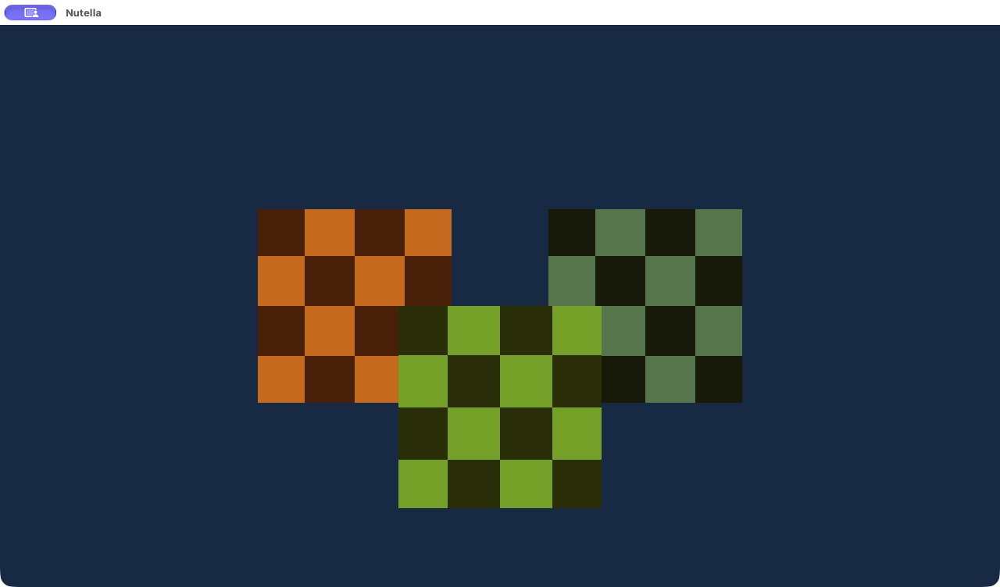

# Development, testing and troubleshooting

Use [setup/build](getting-started.md), [settings/resources](settings-and-resources.md) and the [dependency ledger](platforms-and-dependencies.md). Premake is the build system; builds are incremental with **two compiler jobs**. Keep Debug/Release outputs and platform caches separate.

Mac generation preserves the selected DerivedData location and uses Xcode's
configuration-specific intermediate directories. Switching Debug/Release should
retain each configuration's native objects. Generated project files remain
Premake-owned; do not maintain separate manual build-setting fixes in them.

## Iterate on a change

Build the affected configuration with `python3 scripts/hazel.py build --config Debug --tests` (Windows: `python`). Run a focused existing check for the changed behavior before milestone qualification. `hazel.py test --only Renderer2DSmoke` selects a maintained check; `--only` is repeatable. `--suite cpu` selects the display-free subset. Both report excluded coverage explicitly and do not qualify the full suite.

Useful targets include `MigrationGameUIModelSmoke` (CPU layout/routing), `MigrationTypographySmoke` (CPU shaping), `MigrationFontSmoke` (font admission/pages), `MigrationSceneSmoke` / `MigrationSceneGPUSmoke` (scene/managed/serialization), `MigrationRuntimeSessionSmoke` (session transitions) and `MigrationEditorSmoke` (actual authoring/history). Direct graphics/managed invocations need the runner's Resources, Mono, private project and fixture arguments; inspect [the runner](../scripts/internal/tests.py) instead of launching with the checkout as writable cwd. The [typography fixture guide](../tests/fixtures/typography/README.md#run-the-cpu-check) gives a complete display-free invocation.

For milestone checks after a completed implementation:

```sh
python3 scripts/hazel.py build --config Debug --tests
python3 scripts/hazel.py test --config Debug --profile native
python3 scripts/hazel.py build --config Release --tests
python3 scripts/hazel.py test --config Release --profile gl41
```

`native` uses the current desktop/driver. macOS accepts only this profile: run both configurations with `--profile native`, using the real Apple OpenGL driver. The generated `MacOSQualification` aggregate builds applications, service/SDK checks and the maintained regressions. Its runner also prepares a private committed Sandbox tutorial and requires positive authoring evidence. Linux `gl41` forces Mesa 4.1/GLSL 410; `software` uses llvmpipe with two workers. Windows `software`/`gl41` use an isolated checksum-pinned test driver, never included in game packages. Headless Linux example:

```sh
xvfb-run -a -s '-screen 0 1600x1000x24 -noreset' python3 scripts/hazel.py test --config Debug --profile software
```

Do not overlap build/test campaigns or modify the user's examples/profile/saves. Existing test runners create private working directories; set isolated application/save roots for manual probes. Automated checks, physical GPU/controller/DPI use and competent-reader typography acceptance remain separate evidence.

Mac package qualification also runs the actual products' bounded `--smoke-test`
diagnostic: 60 normal frames with engine draw submissions, an accepted ordinary
close request and complete teardown. It requires explicit absolute `HAZEL_DATA`
and `HAZEL_SAVE_ROOT`; missing storage or a blocked document guard fails. This
does not simulate gameplay or prove physical dialogs/clipboard. The separate
rendering regressions check pixels/picking. See [bundle qualification](packaging.md#macos-bundle-qualification).

## Tutorial authoring qualification

Build matching Sandbox scripts first. Select a **private tracked copy** of Sandbox for local work; never regenerate the owner's startup scene. For example, on Linux:

```sh
tutorial_check=$(mktemp -d /tmp/Hazel-tutorial-check.XXXXXX)
# The archive excludes working-tree drafts.
git archive HEAD:examples/Sandbox | tar -x -C "$tutorial_check"
python3 scripts/hazel.py script-build "$tutorial_check/Sandbox.hproj" --config Release
HAZEL_FINAL_UI_PROJECT="$tutorial_check/Sandbox.hproj" \
HAZEL_SAVE_ROOT="$tutorial_check/private-saves" \
python3 scripts/hazel.py test --config Release --profile gl41
```

The native check makes another private project copy, selects `UI Tutorial.hazel` there, edits the actual Inspector, interleaves property/structural Undo, instantiates a prefab, saves/reopens and repeats Play/Stop/exit. It does not rewrite the original startup scene. With the selector present, the Python runner requires the exact native tutorial PASS marker; a skipped hook cannot count as qualification. CI selects this hook in each platform's Release GL4.1 suite after Release scripts are ready.

## Canonical CI

[C/C++ CI](https://github.com/cringlekaden/Hazel/actions/workflows/c-cpp.yml) is the single maintained workflow. It runs on **push to master**, **all pull requests**, and **manual dispatch**. Topic pushes alone do not duplicate a PR's full builds. For a feature checkpoint without a PR, dispatch once from Actions → C/C++ CI → Run workflow, selecting the branch, or:

```sh
gh workflow run c-cpp.yml --ref feature/runtime-ui-hardening
```

Linux and Windows remain separate jobs; their existing identities are retained:

- **Windows Debug, Release and extracted binaries** (`windows-build`).
- **Linux Debug, Release and extracted binaries (Ubuntu 24.04)** (`linux-build`).
- **macOS arm64 builds and CPU/service/managed subset** (`macos-build`), on the explicit `xcode-27` preview runner. It builds Debug/Release at deployment target 27.0. This does not qualify Apple GPU rendering or interactive desktop behavior; those remain local gates. No self-hosted runner or older deployment floor is substituted.

### Coverage retained and added

| Coverage, on both OSes | Before consolidation | Canonical workflow |
| --- | --- | --- |
| Debug / Release native products + tests | Both workflows built both, sometimes duplicating PR builds | One sequential two-job-compiler build per configuration/platform |
| General Debug software regressions | Main + editor workflows | Retained |
| General Release software regressions | Main | Retained |
| General Release GL4.1 regressions | Editor workflow | Retained in main |
| Native tutorial authoring | Hook unselected; runtime tutorial checked separately | **Added explicit selector + required positive evidence** in Release GL4.1 |
| Managed models, native game rules, example scripts | Main; five projects, both configurations | Retained |
| Real editor/history/prefab and source-game checks | General/source-game suites | Retained |
| Relocated applications, checksums/notices/native and managed closure | Main software + GL4.1 | Retained |
| Five relocated game packages, source/SDK/GAC-hidden runtime | Main software + GL4.1 | Retained; all five downloadable after gates |

The general runner currently executes 18 sequential executables; managed models and native example-game checks are additional layers. Counts in dated milestone records describe their revisions. Product artifacts upload **after all qualification steps in their platform job**; testing evidence uploads on failure too. Select successful whole runs for downloads. A skipped downstream gate is not a pass, and one successful platform job is not success for the other.

`editor-usability.yml` is retired. Its old check names were **Linux Debug / Release, bounded editor checks** and **Windows Debug / Release, bounded editor checks**. A read-only API inspection on 2026-10-28 found master and `feature/runtime-ui-hardening` unprotected and no repository rulesets; no settings were changed. Administrators using an external/other-branch policy that requires either retired check must replace it with the corresponding retained job above. Generation of VS projects is local configuration evidence, not Windows compilation.

## Native tools

Run `bin/Debug-linux-x86_64/HazelProject/HazelProject --help` after building (Windows: `bin/Debug-windows-x86_64/HazelProject/HazelProject.exe`). Maintained commands:

```text
create --name NAME --identifier ID --destination FOLDER --templates FOLDER
validate PROJECT.hproj
import-glb PROJECT.hproj SOURCE.glb ASSET_FOLDER [--scene INDEX]
reimport-glb PROJECT.hproj ASSET_FOLDER/Import.himport
slice-sheet ASSETS_ROOT SHEET IMAGE TILE_SIZE
add-clip ASSETS_ROOT SHEET NAME DURATION ORDINALS_CSV
set-region ASSETS_ROOT SHEET REGION_ID X Y WIDTH HEIGHT NAME
measure-scene PROJECT.hproj SCENE_ASSET
```

Sheet/image/scene arguments are asset-relative; use a disposable project for write commands. `slice-sheet` refuses existing files; normal edits should preserve region IDs in Hazelnut. `measure-scene` is a **maintainer CPU diagnostic**: metadata parse, ten YAML dirty snapshots and one hundred exact authored snapshots. It does not measure GPU rendering, whole frames or interactive editor-open latency. `--contract` is the internal creation readiness handshake; `--import-contract` identifies the matching native asset importer. [Native import](design/3d-import-stage2.md) records supported semantics and acceptance rules.

`SpriteAssetAudit` is the native package metadata/dependency authority, invoked by packaging; it is not an alternative authoring path. Historical Lightkeeper generators and migration comparison tools are described in [history](history.md#historical-tools), not required by setup/build/export.

## Experimental Metal shader resources



Actual Apple M4 Debug capture of the opt-in scene; this does not show full backend parity.

The `feature/3d-foundations` branch has an opt-in Metal 4 opaque quad scene
path in Nutella. Hazelnut and ordinary Nutella launches default to OpenGL.
This is **not full Metal backend parity**. It requires Apple Silicon supporting
Metal 4, native arm64 macOS 27+, Xcode and the optional Apple Metal Toolchain.
Follow the normal [build prerequisites](getting-started.md) on this branch first.

Build the player and produce the existing GLSL shader artifacts offline:

```sh
python3 scripts/hazel.py build --config Debug
python3 scripts/macos/metal_shaders.py --config Debug --build --output Hazel/Resources/shaders/metal
HAZEL_RESOURCES="$PWD/Hazel/Resources" python3 scripts/hazel.py run Nutella --config Debug --metal-quads --inspect-camera --project examples/Sandbox/Sandbox-Quads.hproj
```

Use `Release` for both build commands and the launch configuration to run Release.
The scene has three opaque textured quads. Its left quad alternates between
sprite regions every 0.7 seconds through ordinary runtime sprite animation.
With inspection enabled, hold RMB and use WASD/Q/E to move the camera; Home
restores the authored pose, Escape releases the pointer. No inspection text
is drawn in the Metal window. Close the window normally to drain GPU work.
`HAZEL_METAL_TRACE=1` optionally prints completion, positive/zero presentation
timestamps, native CPU/GPU timing and shutdown memory counters. A completed
command or zero presentation timestamp does not prove visible output.

[M2-C's integration record](design/metal-m2c.md) describes production ownership,
qualification and current limits: at most eight opaque sprites, one sample,
RGBA32F color / signed R32Sint IDs / Depth32Float world targets; 1..4096 pixels
per axis and at most 8,388,608 pixels total, within bounded owner/in-flight memory.
Scene-referred output uses existing Neutral/exposure conversion, followed by sRGB
encoding to the native BGRA8 drawable. Display-referred output bypasses exposure.
Framebuffer generations recycle after completion/feedback; full-frame readback
is requested by offscreen `Submit`, and is omitted from normal window output.

Meshes, lights, environments, circles, text, UI/ImGui, blending, mipmaps,
additional attachment profiles and editor Metal rendering are unsupported and
reject explicitly. File sprite sheets must specify supported nearest/linear,
repeat/clamp sampling with no mipmaps and opaque RGBA8 (sRGB/linear), or generated
linear RGBA32F data. Whole-file default mipmap sampling remains unsupported;
use a sprite-sheet sampling specification as in the quad example.

The producer reuses valid packages and rebuilds stale/corrupt ones. Generated
`.hzmetal` packages contain validated libraries; runtime needs no developer
compiler or GLSL/MSL source. Place them under the configured resource root's
`shaders/metal` directory. M2-C versions the artifact profile to reject stale
final-output orientation in source-free packages. Regenerate older packages.
OpenGL staging/export does not automatically produce Metal artifacts or select
Metal. General Metal game packaging is not qualified by this milestone.

The existing offscreen and native window runners reuse M2-B4 fixtures and M1's
window/lifetime tests (use fresh output directories):

```sh
python3 scripts/macos/metal_m2b2.py --config Debug --build --resources Hazel/Resources --output build/metal-m2c-offscreen-debug
python3 scripts/macos/metal_m1.py --config Debug --build --quads Hazel/Resources --output build/metal-m2c-window-debug
python3 scripts/macos/metal_m1.py --config Debug --quads Hazel/Resources --hidpi --output build/metal-m2c-window-debug-2x
```

The native runner requires an unlocked console. `--hidpi` temporarily selects an
advertised native 2× display mode and restores the original mode. Only the
explicit Metal framebuffer profile implements asynchronous readback operations;
existing OpenGL framebuffer workflows are unchanged. Historical
[B1 artifacts](design/metal-m2b1.md), [B2 sampling](design/metal-m2b2.md),
[B3 ordered flushes](design/metal-m2b3.md) and [B4 ownership](design/metal-m2b4.md)
records describe those earlier qualified revisions.


## Troubleshooting

| Symptom | Action |
| --- | --- |
| Missing pkg-config module/compiler/targeting pack | Install the named prerequisite from [getting started](getting-started.md#prerequisites-installed-by-you); setup never installs system packages |
| Script readiness rejects selected Mono | Inspect the explicit prefix/missing-file list; provide compiler + 4.7.2 reference profile, not only a runtime. `HAZEL_MONO_SDK` is authoritative; it is not silently replaced |
| Editor tools not found | Select the source checkout root, not bin/Resources. Build the editor's configuration and run `python3 scripts/hazel.py authoring-preflight --config Debug --operation scripts` (or Release). Export separately needs prepared Release products; see the [Mac SDK workflow](design/macos-port.md#source-sdk-integration-repair--2026-10-29) |
| Project script class/module missing | Build matching project scripts; inspect Console, descriptor ScriptModulePath and typed field/class diagnostics. `run` does not compile |
| Wrong/missing resource after relocation | Keep the complete archive layout; inspect `LAUNCH.txt`, Resources/mono roots and project-relative references. Do not add a source-tree fallback |
| GLFW cannot open display | Provide X11/Xwayland or Xvfb; retain `-noreset` for repeated CI client lifecycles |
| Unsupported GL feature | Report GPU/driver/version and effective capabilities; GL4.1 minimum does not make every optional sample/line/debug feature available |
| Save/open/asset replacement rejected | Preserve original bytes/draft; use the operation's diagnostic and explicit repair/reload workflow. Do not delete profile or save directories |

Compiler/test logs are in the invoking terminal and `build/testing/logs/`; game/package evidence uses `build/testing/games/` and `build/testing/packages/`. Check the **first failing CI step** before diagnosing skipped later gates. Report a minimal reproduction using [Contributing](../CONTRIBUTING.md).
