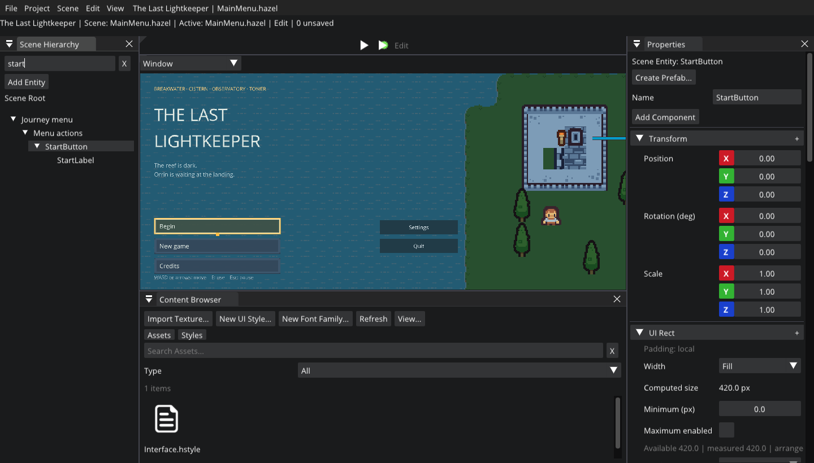
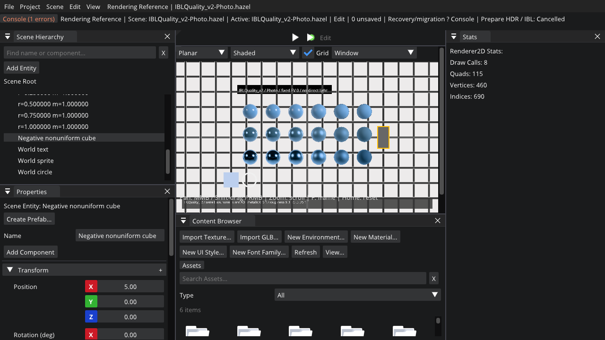
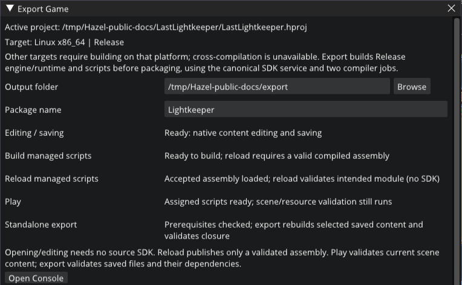

# Work in Hazelnut

[Set up or download Hazelnut](getting-started.md) first. Open a `.hproj` through **File > Open Project…**, or pass it to the source launcher. Hazelnut restores the last successful project when no explicit project is supplied.

*The title menu is scene content: select a button in Hierarchy, edit its Rect in Properties and open shared styles from Content Browser. [Full resolution](images/hazelnut-lightkeeper.png). Linux capture.*

## Metal editor and backend selection

Use [Project Settings backend selection](backend-selection.md) to save a request, inspect active capabilities and see restart requirements. Native and CI qualification are reported separately.

The default Automatic request selects OpenGL on Windows/Linux and available native Metal 4 on supported Apple Silicon/macOS configurations. On `feature/3d-foundations`, Apple Silicon
macOS builds can request available native Metal 4 through Automatic; `--metal` and `--opengl` explicitly override the project request
before window creation. Build and stage the offline shader packages using the
[Metal development instructions](development.md#experimental-metal-shader-resources).
The editor integration has **M5 PASS — Apple M4 local qualification** in Debug and
Release. The [acceptance record](design/metal-m5.md) covers native window lifecycle,
editor workflows, compute and resource retirement. Windows/Linux, Intel HD 4000
and new branch CI execution remain untested for M5. Existing screenshots on this page retain their
stated platform attribution.

*Native Metal 4 drawable captured after workflow qualification. The retained console
history includes deliberately tested failure and cancellation cases.*

## Create and open content

**File > New Project…** asks for a name, build identifier and destination. Creation produces editable content immediately; a compiler is needed when you build scripts, rather than to create the project. An existing destination is rejected. A later failed script build keeps the created project and source files available for repair.

Open scenes by double-clicking them in Content Browser or using **File > Open Scene…**. Normal Open reports repairable missing resources while retaining their authored references. Invalid/unsupported documents keep the previous session available.

## Arrange entities and prefabs

Use **Scene Hierarchy > Add Entity** to create a root. Drag onto an entity to parent it; drag onto **Scene Root** to detach it. Reparenting preserves world pose and rejects nonrepresentable transforms. Properties edits local transforms; rigidbody/collider owners must remain roots.

Select an entity to edit its components and typed script fields in **Properties**. Referenced entities are selected by name within the current scene. The viewport offers transform gizmos; Runtime UI Rect entities also expose move/resize editing and anchor presets.

**Create Prefab** saves the selected subtree. Include its referenced owners and local visual/focus targets: detached prefabs reject references outside their subtree. Open a `.hprefab` in Content Browser, edit/save in **Prefab Inspector**, then **Instantiate and Select**. Instances receive independent identities and values; editing the source does not propagate to existing instances. UI styles remain shared assets.

## Save, Undo and runtime copies

**Ctrl+S / File > Save** saves the active scene, prefab or sheet. **Save As…** selects a new scene destination; **Save All…** handles eligible dirty documents. Replacement/close/export prompts distinguish saving, using saved content, cancellation and discard.

UI property edits and structural creation, duplicate, delete, reparent/reorder, component edits and prefab instantiation share scene/prefab history. Use **Edit > Undo/Redo**, **Ctrl+Z**, **Ctrl+Shift+Z** or **Ctrl+Y**. Text fields retain their local editing undo. History is bounded; [the UI reference](runtime-game-ui.md#inspect-and-edit-ui) describes its coverage and exact conflict guards.

The viewport toolbar or **Scene** menu controls **Play, Simulate, Stop, Pause / Resume and Step**. Play runs a scene copy with scripts; Simulate runs physics without game scripts. Stop returns to the authored document. Runtime edits are not saved into it. Editor Play uses isolated in-memory game saves, cleared on Stop.

## Build scripts and export

**Project > Create Script…** creates C# source; **Build Scripts…** compiles Debug project scripts and **Reload Scripts** refreshes reflected classes/fields. See [Scripting](scripting.md).

**Project > Export Game…** uses saved content and performs the targeted Release build/script/package sequence. Choose a name and output directory; operation progress and results appear in **View > Console**. See [Packaging](packaging.md#export-from-hazelnut).

*Export uses the saved project; this upper portion shows the destination, name and readiness checks. The build/export action is below.*

## Settings and useful panels

**Project > Project Settings…** stores portable startup scene, asset/module paths, rendering requests and UI defaults in the `.hproj`. **Edit > Editor Preferences…** stores user tools, scale, session behavior and optional Windows custom caption. Renderer device/effective values are read-only; project requests are distinct from device capability. Linux uses native window decorations.

**View** restores hidden Hierarchy, Properties, Content Browser, Console and Runtime UI Debugger panels. Open `.hsprites`, `.hstyle` and `.hfont` assets from Content Browser to edit sprites, styles and font families. Follow [Sprite authoring](sprite-authoring.md) or [Runtime UI](runtime-game-ui.md).

Preferences, sessions, project workspaces, docking layouts and resource caches have different owners. Their locations and recovery behavior are in [Settings and resources](settings-and-resources.md); preserve them when diagnosing problems.

## Scene foundations

File > New Project creates a working 2D or PBR starter without Python or scripting
SDK readiness. Enter Name and Location; the technical identifier is suggested
and editable under Advanced identity. File > New Scene uses the same native
factory and the project's New scene defaults. The adjacent New Scene with projection
menu overrides only projection, retaining the selected content/presentation defaults.
Orthographic PBR and perspective unlit are supported. Lighting supports one
directional key and prepared image-based lighting, with scene-referred
exposure/Neutral presentation.
The metallic–roughness BRDF includes reciprocal GGX multiscattering with
coordinated diffuse energy accounting and an engine-owned converged BRDF table.
Rough metals retain more reflected energy; material values and prepared
environments keep their existing formats. Historical reference images remain
versioned separately. See the [mathematics and qualification record](design/ggx-multiscattering.md)
for measured numerical limits, pending owner visual acceptance and the unchanged
directional split-sum approximation.

Use the viewport Planar/Orbit selector to change editor navigation independently
of runtime cameras. Planar pans with middle drag and zooms with the wheel; Orbit
uses Alt-left orbit, Alt-middle pan and Alt-right/wheel dolly. Project workspaces
retain both poses and the grid/tool choice. Scene Settings applies a linear-color
background through Undo/Redo; the picker displays familiar sRGB values. See
[settings](settings-and-resources.md) and [color](color.md).

Environment authoring uses **Content Browser → New Environment**. Choose a project
HDR or use **Import HDR source…**, Create, Save, then **Prepare accepted lighting**.
Progress/cancellation and failures appear in Console. Scene Settings selects the
asset and applies yaw, radiance gain, lighting and image-background choices through
scene history. Source/quality changes need preparation; yaw/gain/exposure do not.
Preparation quality offers Preview, Production and High, with explicit offline
costs and an earlier-revision diagnostic. Accepted lighting loads without the original HDR. See the
[environment contract and qualification](design/3d-environment-stage4.md).

### Static reflection probes

In a scene with **Scene-referred** presentation, add a **Reflection Probe**
component to an entity. Import a linear Radiance HDR panorama captured at the
entity position. Create an Environment asset for it, choose **Preview** or a
custom specular face size up to 512 px, and select **Prepare**. Assign the
prepared `.henv` in the probe Inspector, then enable the component. You can
author several probes and enable up to two in the same scene.

The entity's world position is both the capture point and the center of the
influence box. Box sizes are half extents in world units. The projection box
approximates the room's walls and must enclose the influence box. Its offset
lets you place the capture off-center. The viewport shows the capture point
and the selected boxes. Use the blend distance to fade the influence near the
edges and overlap the two volumes around a doorway. Probe boxes are aligned
to world axes and the panorama must use Hazel's world orientation.

Probes blend the local prefiltered radiance into the existing specular IBL.
The scene environment still supplies diffuse light and the optional sky.
Probe settings participate in scene Undo/Redo. Player assets need the
accepted `.henv` generation and its dependencies. Keep the HDR source
in the authoring project for future preparation.

To capture the scene in Hazelnut, select **Bake face size** and click **Bake Static
Probe**. The inspector offers 128, 256 and 512 px per face. The completed bake
becomes the probe's environment assignment and participates in Undo/Redo.
Rebake explicitly after changing the scene. See the
[static probe bake workflow and Gallery comparison](design/static-probe-baking.md).

The [static reflection study](design/static-reflection-probes.md) includes
reproduction commands, captures, and current qualification results.

## Navigate the viewport

The navigation selector changes only the private editor view, in both Edit and
Simulate. Planar: pan with middle/right drag, Shift + left drag or Option/Alt +
left drag; scroll zooms. Orbit: Option/Alt + left drag or Space + left drag orbits;
Shift + left drag and middle drag pan; Option/Alt + right drag and scroll dolly.
Hold right mouse for temporary look and WASD movement, Q/E down/up; Shift boosts
speed and Ctrl slows it for close-up inspection. Release right mouse or Escape to
release the pointer. A gesture begun over the image continues outside it.

F frames selected world bounds; Home resets the current navigation mode. Empty
selection does nothing. Camera movement never dirties a scene or changes its
runtime camera. Text fields, menus, popups and active gizmos retain input. Focus
loss, mode changes and viewport closure cancel gestures.

Play uses game input. For a primary perspective camera with unit world scale,
explicitly enable **Inspect camera**
to explore its runtime copy without changing scene camera transforms; **Restore
authored view** or Home restores its starting view. Stop releases inspection.
The [Rendering Showcase](../examples/RenderingShowcase/README.md#inspect-in-motion)
has the same optional native controller in Nutella. Fixed views remain available.

Selected mesh entities use the visible, depth-resolved entity-ID silhouette in
Hazelnut's output. Alpha cutouts and occlusion match picking; fully hidden meshes
have no edge. The edge stays inside selected coverage, at about two logical points
(rounded to framebuffer pixels). Sprite, UI and non-mesh cues retain their existing
behavior. The current silhouette operation requires matching single-sample targets.

### Metal ambient occlusion inspection

The [XeGTAO contact study](../examples/RenderingReference/README.md#xegtao-contact-study-metal-4)
demonstrates the current Metal-only AO implementation. Scene Settings authors
its enable, quality, world radius, strength and falloff. Apply/Undo/Redo and Save
use the ordinary scene presentation settings. The viewport **AO...** popup shows
visibility/intermediate views and the last completed native GPU timing sample.
These inspection choices are private to the view. Timing intervals include GPU
synchronization; forward/world time also includes world 2D. They are not exclusive
pass costs. OpenGL displays an explicit inactive-request message.

Sampling is fixed across frames, but noticeable spatial noise and motion shimmer
remain even on Ultra. Static determinism does not imply motion stability.
Functional/correctness acceptance and the incomplete final visual-quality
qualification are recorded in [XeGTAO](design/xegtao.md).

### HDR bloom and manual exposure (development branch)

In **Scene Settings**, use scene-referred presentation and enable **HDR bloom**.
**Bloom intensity** scales the added highlight light. **Bloom radius** shifts
more of the filter weight to wider scales. The default intensity is 0.08 and
existing scenes keep bloom off. **Apply** participates in Undo/Redo, and
**Save** persists the controls. New-scene defaults can seed the enable switch.

**Exposure compensation (EV)** scales the scene by two per positive stop
before Neutral tone mapping. A value of 0 EV leaves the scene scale at unity.
Bloom responds to the same exposure as the scene and keeps the same
scene-linear highlight roll-in. In the material editor, **Emissive strength**
scales the emissive color in linear light. Use it to give a practical light
source HDR radiance. Screen UI, editor overlays, and outlines follow scene
presentation and do not feed bloom.

The [HDR bloom study](design/hdr-bloom.md) documents the pipeline, native
evidence, and steps to produce matched camera captures.

### HDR temporal antialiasing (development branch)

Scene Settings offers **HDR TAA (Metal 4)** for scene-referred presentation.
Apply participates in Undo/Redo; Save persists the request. Project Settings >
new-scene defaults can seed the same setting. Existing scenes default to off.
OpenGL keeps its ordinary rendering and reports the saved TAA request inactive.

The viewport **TAA...** popup shows rigid-mesh motion, projection jitter, history
acceptance/rejection, history contribution and resolved HDR clamped for display,
and raw jittered input (which isolates projection sampling),
plus completed resolve timing and retained HDR/depth/ID history memory/reuse counts.
World 2D and screen UI remain unjittered. Skinning, morphs and vertex deformation
have no temporal correspondence support. AO inspection stays available through
**AO...** and bypasses TAA. Pre-exposure HDR history keeps exposure changes
responsive. No sharpening control is exposed.

TAA is under qualification; **owner visual re-review is pending** after a
[geometric-edge correction](design/taa-edge-investigation.md). Consult the
[implementation/evidence record](design/taa.md) and
[manual moving-scene procedure](design/taa-manual.md) before approving sharpness,
ghosting or AO stability. History memory excludes the separate private radiance/motion targets,
final framebuffer generations and timing heaps.

### Point and spot lights

Use **Scene → Add Point Light / Add Spot Light** and edit the light component in
Properties. Transform controls position and local -Z spot direction. Range is a
world-unit distance independent of scale; spot controls use half angles in degrees.
Intensity is renderer-relative linear incident radiance, not candela or lumens.
Light gizmos support viewport picking; selection shows the influence sphere or
inner/outer cones. **Lights...** in the viewport opens transient radiance,
occupancy/overflow and timing inspection. Metal uses Forward+; OpenGL 4.1 evaluates
the same lighting with a bounded loop. The shared limit is 320 enabled local lights;
excess submission reports an error. Point and spot shadow maps are opt-in.
See [the local-light gallery](../examples/RenderingReference/README.md#locallights_v1-authored-point-and-spot-gallery)
for a reproducible scene and launch commands, and its linked qualification status.

## Directional cascaded shadows (development foundation)

On `feature/3d-foundations`, **Scene Settings → Directional shadows** enables an
opt-in four-cascade mesh shadow atlas. Apply/Save uses the existing scene history.
Choose 256/512/1024 or **2048 (Ultra)** texels per cascade and a finite world shadow distance; split
distribution trades near resolution against uniform coverage. Bias values are in
world texels: use the smallest normal/depth bias that avoids self-shadowing on
representative geometry. Cascade blend also controls the fade at shadow distance.
PCF retains the established three-texel box per cascade (16 explicit depth
fetches per map). Camera jitter does not move the atlas. Ultra's 4096×4096 depth
atlas uses 64 MiB per view, plus pending resized generations and other view resources.

Enable shadows and a directional key before inspecting. The viewport **Shadows...**
menu inspects visibility, cascade/overlap selection,
individual maps and current/next/blend in RGB. World-texel and normal-offset views
also expose raw numerical channels for capture tools. The unbiased pair keeps
the same fitted atlas and removes only receiver bias. Inspection is transient;
TAA history is inactive until returning to Shaded. Use fixed exposure for comparisons; capture tools can request raw linear channels.

Opaque and masked static meshes participate, including off-camera casters.
World 2D, sprites, point/spot lights and screen UI do not cast these shadows.
The [separate shadow study](../examples/RenderingReference/README.md#directional-shadow-study)
and [design/qualification record](design/directional-shadows.md) describe the
current limits. This foundation is under qualification; it has no owner visual
acceptance yet. Windows/Linux and Intel GPU execution require separate evidence.

### Spotlight shadow maps

Select a Spot Light, enable **Cast shadows**, and choose a **Shadow resolution**
of 256, 512 or 1024. New and older scenes default to shadows off. The viewport
**Lights…** popup reports how many lights received shadow maps. Up to four
enabled, emitting requests receive maps in ascending entity ID order. Remaining
spotlights keep illuminating the scene. Higher resolutions sharpen the fixed
PCF footprint and increase atlas memory and depth rasterization work.

The light's range and outer half angle define coverage. Opaque and masked
static meshes can cast shadows from outside the camera view. Open the
[spotlight shadow study](../examples/RenderingReference/README.md#spotlight-shadow-study)
to see two overlapping shadow maps, solid contact and a masked caster.
See the [spotlight design record](design/spotlight-shadows.md) for qualification
and platform coverage.

### Point shadow maps

Select a **Point Light**, enable **Cast shadows**, and choose 256 or 512
for **Shadow resolution per face**. The default is off at 256. The first
enabled, emitting request in ascending entity ID order gets omnidirectional
shadows. Additional point lights retain their full unshadowed contribution.
The viewport **Lights…** popup shows admission, atlas memory, and Metal GPU
generation time. The current atlas uses 1.5 MiB at 256 or 6 MiB at 512 per
view, plus pending replacement generations.

Opaque and masked static meshes cast point shadows, including off-camera
casters. Light rotation and scale leave coverage unchanged. See the
[point and spot shadow study](../examples/RenderingReference/README.md#point-and-spot-shadow-study)
and the [qualification record](design/point-shadows.md).
