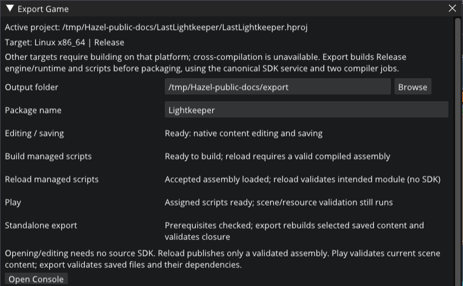

# Downloads and standalone games

A prepared game includes **Nutella**, compiled scripts, project assets and its runtime dependencies. Players need an OpenGL 4.1 driver and the [deployment baseline](platforms-and-dependencies.md#platform-status), without Python, a compiler or the Hazel source SDK.

## Choose a snapshot

There is no published release. In [C/C++ CI](https://github.com/cringlekaden/Hazel/actions/workflows/c-cpp.yml), select a **successful whole run**, then verify its branch, source SHA and platform. Application artifacts contain Hazelnut/Nutella archives; `Hazel-Examples-…` contains all five game archives. Testing-evidence artifacts are logs/fixtures, not player downloads. An artifact's presence alone is not a passed run.

The current guides describe master. Historical snapshots can predate the runtime UI, tutorial or Lightkeeper work; inspect their exact SHA and completed whole-run results. A current [source checkout](getting-started.md#clone-the-source) is the fallback when a matching qualified artifact is unavailable.

### Retained older downloads

Verified whole-run snapshot [`a31187d`, run 37756280905](https://github.com/cringlekaden/Hazel/actions/runs/37756280905) includes editor usability, sprite authoring, MeadowRun and Skybound, **before runtime UI and The Last Lightkeeper**. These valid historical links are retained for that version:

| Snapshot artifact | Windows x64 | Linux x86_64 |
| --- | --- | --- |
| Hazelnut + Nutella | [Applications](https://github.com/cringlekaden/Hazel/actions/runs/37756280905/artifacts/11541340516) | [Applications](https://github.com/cringlekaden/Hazel/actions/runs/37756280905/artifacts/11541596001) |
| MeadowRun | [Game](https://github.com/cringlekaden/Hazel/actions/runs/37756280905/artifacts/11541416345) | [Game](https://github.com/cringlekaden/Hazel/actions/runs/37756280905/artifacts/11541730832) |
| Skybound | [Game](https://github.com/cringlekaden/Hazel/actions/runs/37756280905/artifacts/11541147123) | [Game](https://github.com/cringlekaden/Hazel/actions/runs/37756280905/artifacts/11541532045) |

GitHub Actions downloads require a signed-in account and expire with retention. A login/permission error is not proof that an artifact expired; inspect its run/artifact metadata. No automatic updater or current-release guarantee is implied.

## Verify and run a download

1. Extract GitHub's outer artifact ZIP.
2. Verify the inner archive against its sibling `.sha256` file. Linux: `sha256sum -c <archive>.sha256`. PowerShell: `Get-FileHash <archive> -Algorithm SHA256`, then compare the digest.
3. Extract the inner `.tar.gz` or `.zip`, preserving its directory layout. Follow `LAUNCH.txt` and keep Resources, mono, Assets, native libraries and licenses together.
4. Linux: `./Nutella`. Windows: `./Nutella.exe`. The single root `.hproj` beside the executable is discovered from any working directory. Use `--project path/to/Game.hproj` to select explicitly; `--list-projects` lists adjacent candidates without starting graphics.

`build.json` records source/configuration/platform and dirty-state metadata; `SHA256SUMS` inventories extracted files. Linux may verify that inventory with `sha256sum -c SHA256SUMS` from the extracted root. Official Ubuntu builds require glibc 2.39 or newer. Locally built rolling-distribution archives inherit the host baseline. Packages use the system OpenGL driver; test Mesa is not shipped.

## Export from source

After [setup](getting-started.md), run from the checkout (Windows: `python`):

```sh
python3 scripts/hazel.py build --config Release
python3 scripts/hazel.py script-build examples/Skybound/Skybound.hproj --config Release
python3 scripts/hazel.py run Nutella --config Release --project examples/Skybound/Skybound.hproj
python3 scripts/hazel.py package --app Nutella --project examples/Skybound/Skybound.hproj --name Skybound --output dist/games
```

`run` launches existing products; `package` validates/packages existing Release native and script outputs. Neither compiles changed project scripts. Output: `dist/games/Skybound-linux-x86_64-Release.tar.gz` or `Skybound-windows-x86_64-Release.zip`, with archive checksum. Substitute another project/name to export it.

The targeted build/export alternative is:

```sh
python3 scripts/hazel.py editor-export examples/Skybound/Skybound.hproj --name Skybound --output dist/games
```

Both `--name` and `--output` are required. This incrementally builds Release Nutella, ScriptCore and audit tools, compiles the project's Release scripts and packages. It uses Premake and two compiler jobs. Plain `package` without app/project arguments builds neither: it packages both applications using SceneTransitions.

## Export from Hazelnut

Save the desired startup scene in **Project > Project Settings…**, then choose **Project > Export Game…**. Set an absolute output folder and a portable name (letters, digits, `_` or `-`, beginning with a letter/digit). **Export Release Game** runs the targeted sequence above. Save/continue or explicitly use saved content when prompted. Follow progress in **View > Console** and use **Open Output Folder** when complete.


*Choose an output folder and name; the readiness summary distinguishes editing, script builds and export. Upper portion of the Linux dialog.*

A packaged editor can edit/save and play prepared content without a source SDK. Script compilation/export additionally needs Python, a compatible prepared checkout and the relevant compiler tools. Select that checkout root in **Edit > Editor Preferences…** if discovery fails. An executable or Resources directory is not an SDK. Cross-compilation is unavailable; export Windows on Windows and Linux on Linux.

## What travels with the game

Exports carry the descriptor and eligible project Assets, Resources/fonts/shaders/ScriptCore, bundled Mono profile/config, native dependency closure, `LAUNCH.txt`, `build.json`, file/archive checksums and licenses. Project README/NOTICE/LICENSE files are copied when present. Intermediate script projects, build outputs and debugging symbols are excluded according to the maintained inventory rules; assets are not pruned merely because a scene does not currently reference them.

Native audit validates scene/prefab ownership, sprites, styles, font families/faces/notices and audio. Python retains package inventory, deployment and managed dependency/class closure checks. Missing/external resources fail export; source SDK paths are not a deployment fallback. [Licensing and provenance](platforms-and-dependencies.md#licensing-and-provenance) lists authoritative notices. Keep project asset notices alongside their assets and verify the relocated package before sharing it.
