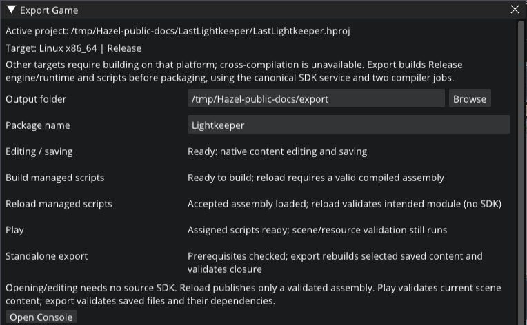

# Downloads and standalone games

A prepared game includes **Nutella**, project assets, required compiled scripts and its runtime dependencies. Players need an OpenGL 4.1 driver and the [deployment baseline](platforms-and-dependencies.md#platform-status), without Python, a compiler or the Hazel source SDK.

## Choose a snapshot

There is no published release. In [C/C++ CI](https://github.com/cringlekaden/Hazel/actions/workflows/c-cpp.yml), select a **successful whole run**, then verify its branch, source SHA and platform. Application artifacts contain Hazelnut/Nutella archives; `Hazel-Examples-…` contains all five game archives. Testing-evidence artifacts are logs/fixtures, not player downloads. An artifact's presence alone is not a passed run.

The current guides describe master. Historical snapshots can predate the runtime UI, tutorial or Lightkeeper work; inspect their exact SHA and completed whole-run results. A current [source checkout](getting-started.md#clone-the-source) is the fallback when a matching qualified artifact is unavailable.

### Retained older downloads

Verified whole-run snapshot [`a31187d`, run 37756280905](https://github.com/cringlekaden/Hazel/actions/runs/37756280905) includes editor usability, sprite authoring, MeadowRun and Skybound, **before runtime UI and The Last Lightkeeper**. These valid historical links are retained for that version:

| Snapshot artifact | Windows x64 | Linux x86_64 |
| --- | --- | --- |
| Hazelnut + Nutella | [Applications](https://github.com/cringlekaden/Hazel/actions/runs/37756280905/artifacts/11541340516) | [Applications](https://github.com/cringlekaden/Hazel/actions/runs/37756280905/artifacts/11541596001) |
| MeadowRun | [Game](https://github.com/cringlekaden/Hazel/actions/runs/37756280905/artifacts/11541416345) | [Game](https://github.com/cringlekaden/Hazel/actions/runs/37756280905/artifacts/11541730832) |
| Skybound | [Game](https://github.com/cringlekaden/Hazel/actions/runs/37756280905/artifacts/11541147123) | [Game](https://github.com/cringlekaden/Hazel/actions/runs/37756280905/artifacts/11541532045) |

GitHub Actions downloads require a signed-in account and expire with retention. A login/permission error is not proof that an artifact expired; inspect its run/artifact metadata. No automatic updater or current-release guarantee is implied.

## Verify and run a download

1. Extract GitHub's outer artifact ZIP.
2. Verify the inner archive against its sibling `.sha256` file. Linux: `sha256sum -c <archive>.sha256`. PowerShell: `Get-FileHash <archive> -Algorithm SHA256`, then compare the digest.
3. Extract the inner `.tar.gz` or `.zip`, preserving its directory layout. Follow `LAUNCH.txt` and keep Resources, mono, Assets, native libraries and licenses together.
4. Linux: `./Nutella`. Windows: `./Nutella.exe`. macOS: open `Nutella.app`, or run `Nutella.app/Contents/MacOS/Nutella`. Linux/Windows discover the single root `.hproj` beside the executable; Mac bundles discover it in `Contents/Resources/Project`, independently of cwd. Use `--project path/to/Game.hproj` to select explicitly; `--list-projects` lists installation candidates without starting graphics.

`build.json` records source/configuration/platform and dirty-state metadata; `SHA256SUMS` inventories extracted files. Linux may verify that inventory with `sha256sum -c SHA256SUMS` from the extracted root. Official Ubuntu builds require glibc 2.39 or newer. Locally built rolling-distribution archives inherit the host baseline. Packages use the system OpenGL driver; test Mesa is not shipped.

## Export from source

After [setup](getting-started.md), run from the checkout (Windows: `python`):

```sh
python3 scripts/hazel.py build --config Release
python3 scripts/hazel.py script-build examples/Skybound/Skybound.hproj --config Release
python3 scripts/hazel.py run Nutella --config Release --project examples/Skybound/Skybound.hproj
python3 scripts/hazel.py package --app Nutella --project examples/Skybound/Skybound.hproj --name Skybound --output dist/games
```

`run` launches existing products; `package` validates/packages existing Release native and script outputs. Neither compiles changed project scripts. Output: `dist/games/Skybound-linux-x86_64-Release.tar.gz`, `Skybound-windows-x86_64-Release.zip` or `Skybound-macos-arm64-Release.zip`, with archive checksum. Substitute another project/name to export it.

The targeted build/export alternative is:

```sh
python3 scripts/hazel.py editor-export examples/Skybound/Skybound.hproj --name Skybound --output dist/games
```

Both `--name` and `--output` are required. This incrementally builds Release Nutella, ScriptCore and audit tools, compiles the project's Release scripts when native asset inspection finds assigned script classes, then packages. It uses Premake and two compiler jobs. Plain `package` without app/project arguments builds neither: it packages both applications using SceneTransitions.

## Export from Hazelnut

macOS source SDK readiness, script compilation and bundle production are
implemented. Local ad-hoc bundles passed isolated native/managed/rendering and
actual-product startup/shutdown checks; observed editor/runtime interaction and
outstanding manual/distribution checks are [recorded separately](design/macos-port.md).
Script readiness and Release export readiness are separate capabilities.

Save the desired startup scene in **Project > Project Settings…**, then choose **Project > Export Game…**. Set an absolute output folder and a portable name (letters, digits, `_` or `-`, beginning with a letter/digit). **Export Release Game** runs the targeted sequence above. Save/continue or explicitly use saved content when prompted. Follow progress in **View > Console** and use **Open Output Folder** when complete.


*Choose an output folder and name; the readiness summary distinguishes editing, script builds and export. Upper portion of the Linux dialog.*

A packaged editor can edit/save and play prepared content without a source SDK. Script compilation/export additionally needs Python, a compatible prepared checkout and the relevant compiler tools. Select that checkout root in **Edit > Editor Preferences…** if discovery fails. An executable or Resources directory is not an SDK. Cross-compilation is unavailable; export each target on its own OS.

## macOS bundle qualification

Bundle layout is `Contents/MacOS/<app>`, native dylibs in `Contents/Frameworks`, resources/project in `Contents/Resources` and Mono profiles/config in `Contents/Resources/Mono`. SDK headers, mcs and reference packs are excluded. Packaging checks native arm64 architecture, minimum versions, install names/rpaths and signs inside-out after all modifications. `build.json` carries exact source/provenance; `Info.plist` uses ordinary development bundle version `0.1.0`/`1` rather than encoding Git hashes as Apple version numbers.

```sh
python3 scripts/hazel.py package --project /absolute/prepared/Game.hproj --output dist
python3 scripts/hazel.py test-packages --output dist
python3 scripts/hazel.py test-packages --output dist --interactive
```

The automated runner extracts into a spaces/Unicode path, verifies checksums and signatures, then launches each pristine product with private storage, restricted PATH and source/SDK/Homebrew reads denied. Its maintained `--smoke-test` mode requires 60 real application frames, engine draw submissions, an accepted ordinary close request and completed teardown; it never dismisses document guards. Missing private storage fails before application construction. Mapped native libraries and unchanged signatures are checked after execution.

Separate test-only probes in disposable bundle copies verify pixel readback/picking, RuntimeSession and Mono/helper lifecycle, including runtime-loaded native closure. Product frame/submission counts alone are not pixel-correctness evidence. `--interactive` adds observed physical dialogs/input/window checks using the same isolated installation and private storage. A timeout is a failure, not a skip/pass; unattended frames do not establish physical interaction.

Add `--interactive-app Hazelnut` or `--interactive-app Nutella` to qualify desktop behavior separately. The other app is explicitly reported unexecuted; both are required for complete desktop acceptance. Per-attempt desktop logs remain under `build/testing/packages/macos/desktop-*/`.

Bundles are locally **ad-hoc signed** only. Developer ID, notarization and fresh-download Gatekeeper acceptance have not been performed. Do not remove quarantine or weaken security to treat this local evidence as public distribution acceptance. No Mac application/SDK release is published by this workflow.

## What travels with the game

Exports carry the descriptor and eligible project Assets, Resources/fonts/shaders/ScriptCore, bundled Mono profile/config, native dependency closure, `LAUNCH.txt`, `build.json`, file/archive checksums and licenses. Project README/NOTICE/LICENSE files are copied when present. Intermediate script projects, build outputs and debugging symbols are excluded according to the maintained inventory rules; assets are not pruned merely because a scene does not currently reference them.

Native audit validates scene/prefab ownership, sprites, styles, font families/faces/notices and audio. Python retains package inventory, deployment and managed dependency/class closure checks. Missing/external resources fail export; source SDK paths are not a deployment fallback. [Licensing and provenance](platforms-and-dependencies.md#licensing-and-provenance) lists authoritative notices. Keep project asset notices alongside their assets and verify the relocated package before sharing it.

## Content-only projects and imported assets

Unassigned script stubs need no compiled project module. Native scene/prefab
inspection supplies actual required class names; assigned scripts require the
configured valid module/class and managed dependency closure. Present assemblies
are audited even when unused. Validation failure preserves the accepted archive.

Mesh/material/import documents use the same native dependency authority: accepted
geometry artifacts, material images, mesh references and detached prefabs must be
in the package inventory. Original GLB bytes/parser are not runtime dependencies. Source copyright text
is retained in the accepted manifest; keep separate model license files with assets.
A content-only Rendering Reference package includes both frozen Core_v1 and
additive Import_v1 metadata; its 2D startup runs normally. Mesh components cannot
run before stage-3 rendering exists.

Packaged Hazelnut carries its matching native `HazelProject` sibling helper, so
GLB import and native material authoring require no Python or scripting SDK.
Script builds/export retain their existing source-SDK requirements. On macOS the
helper shares the app's audited Frameworks closure and inside-out signing.
