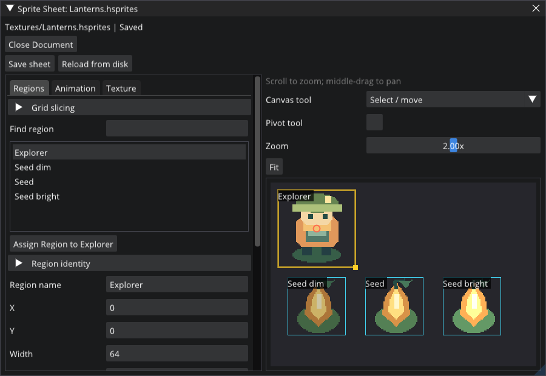

# Author sprites and animation

Sprite sheets (`.hsprites`) give image regions and clips stable identities. Scenes, detached prefabs and typed script fields reference those identities rather than atlas coordinates.

*The Sprite Sheet panel edits regions and preview playback using the project's actual atlas.*

## Import and slice

1. Import/copy a licensed image into the project's Assets through Content Browser. Keep its license/provenance with the project.
2. Right-click the image in Content Browser and choose **Create Sprite Sheet…**, or double-click an existing `.hsprites`. In **Sprite Sheet**, choose sampling deliberately: nearest filtering without mipmaps suits unpadded pixel art.
3. Preview a grid with cell dimensions, offset, spacing and prefix, then add regions; incomplete edge cells are omitted. Use manual rectangles for irregular sprites. Rectangles are image pixels from the top-left.
4. Name regions and set pivots. Save the sheet, then drag a region onto a Sprite Renderer source or use its region selector. **Save and Assign** applies a sheet edit to its captured eligible target.

Entity scale controls world dimensions; choosing a tall source region does not automatically resize the entity or collider. Match its aspect ratio and adjust collider offsets explicitly. Regions do not support seamless texture tiling. Linear filtering/mipmaps need suitable authored gutters to avoid neighboring texels.

## Animate

In the sheet's **Animation** tab, create a clip, order region frames, set positive per-frame durations and choose Loop. Preview it in the panel. Assign the clip to **Sprite Animation**, set autoplay/speed, save the scene or prefab and Play. Playback time is runtime state and is not serialized.

Try [MeadowRun](../examples/MeadowRun/README.md): `Textures/Lanterns.hsprites` supplies the Explorer region and the Lantern pulse clip used by `LanternSeed.hprefab`. [Lightkeeper](../examples/LastLightkeeper/README.md) demonstrates multiple atlases, quadrant terrain crops and tall tree regions.

## Edit safely

Rename/reposition existing regions without regenerating their IDs. Deleting a referenced region/clip requires repairing its users. Sheet Save validates the image, regions and clips and rejects a file changed on disk since opening. Preserve draft details before reopening an externally edited sheet.

Save the sheet and its referencing scene/prefab separately. Sheet asset creation/save is distinct from scene Undo; UI source assignment records the corresponding property edit. Export checks native image/sheet/dependency closure and rejects missing or external resources.

After an invalid external replacement, Edit previews and already running scenes use a magenta fallback and cache the diagnostic. Starting Play and export still reject invalid assets. Repair the file and explicitly refresh/reload; a disk edit alone does not clear the failure. Authored sprite/clip IDs are retained. [Resource ownership](settings-and-resources.md#fonts-styles-and-caches) explains epochs and existing resource pins.

The [sheet format and sampling record](design/sprite-sheet-authoring.md#coordinates-placement-and-atlas-limits) retains exact coordinate/identity details and historical qualification. Current UI images, including fits and nine-slice, are covered in [Runtime UI](runtime-game-ui.md). [Native sheet commands](development.md#native-tools) are optional authoring aids; normal editing uses Hazelnut.
