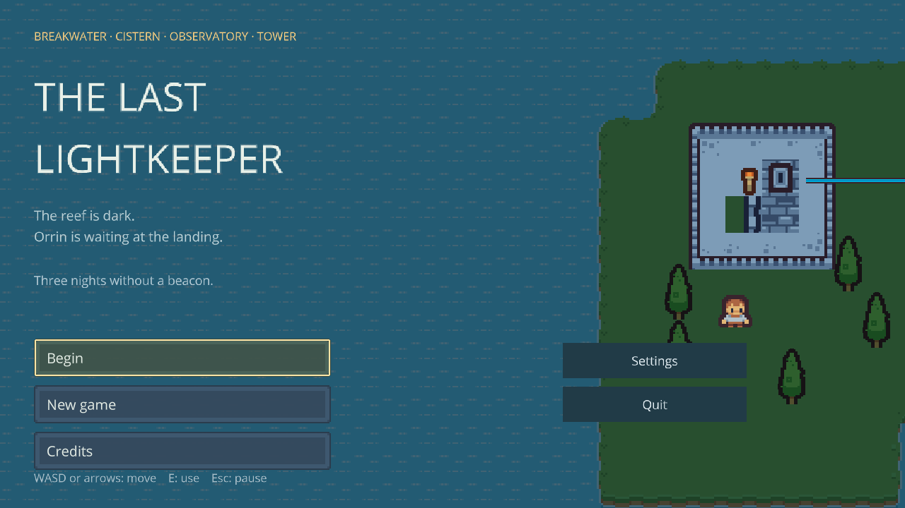
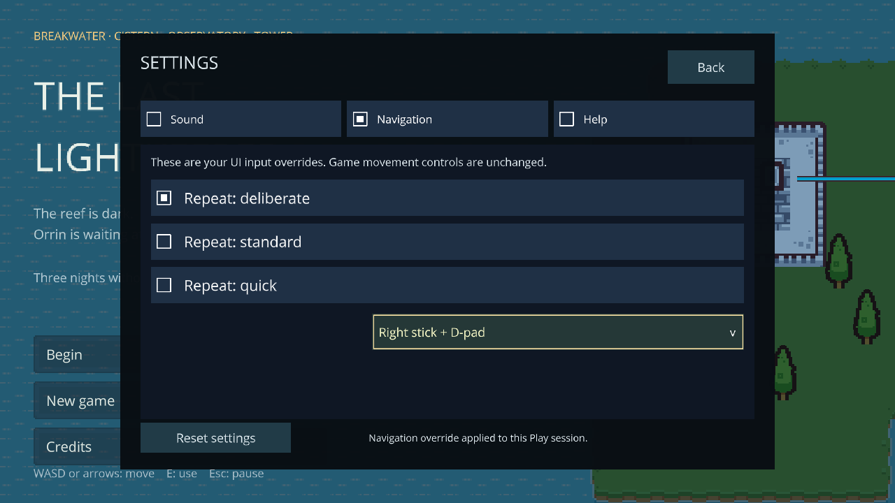

# The Last Lightkeeper

An original top-down Hazel adventure. Keeper Iona returns to a storm-damaged island, restores its lighthouse and brings the stranded crew home. Four authored chapters lead through **The Breakwater**, **Cliff Cistern / Sea Caves**, **The Observatory** and **The Upper Tower**, followed by the morning landing, ending and credits.


*Authored terrain, physics and puzzle landmarks with a native runtime HUD. Linux capture.*

Menus, HUD, dialogue, pause, settings and confirmations use editable native runtime UI. Scripts handle game decisions through declared event owners; they do not construct the interface. The original Breakwater took its author about five minutes after learning the mechanics. Later chapters need timed human playtesting; no full-game duration is claimed.

## Play and edit

From a [prepared checkout](../../docs/getting-started.md), with Debug native applications built (Windows: `python`):

```sh
python3 scripts/hazel.py script-build examples/LastLightkeeper/LastLightkeeper.hproj --config Debug
python3 scripts/hazel.py run Nutella --config Debug --project examples/LastLightkeeper/LastLightkeeper.hproj
python3 scripts/hazel.py run Hazelnut --config Debug --project examples/LastLightkeeper/LastLightkeeper.hproj
```

Open `Assets/Scenes/Breakwater.hazel`, `CliffCistern.hazel`, `SeaCaves.hazel`, `Observatory.hazel`, `UpperTower.hazel` or `HarborHome.hazel` for direct practice in Hazelnut. Terrain, landmarks, camera, audio and UI are ordinary entities; controller fields expose their references/tuning. Play uses a copy and Stop retains authored work. Rigidbody owners remain roots; visual districts and UI use hierarchy. Bounded beam segments instantiate from detached prefabs.

| Control | Action |
| --- | --- |
| WASD / arrows | Move |
| E | Interact, talk, turn a mirror, repair or collect |
| Enter / Space / E in dialogue | Advance |
| Q | Open/close notes |
| Hold Space outside dialogue | Focus upgraded lantern along last movement direction |
| Escape / HUD Pause | Close dialogue or pause |
| Enter while paused | Resume |
| M while paused | Return to title, retaining saved progress |

The title offers Begin/Continue, New Game with replacement confirmation, Credits, Settings and Quit. Keyboard shortcuts include N for a new journey and C for credits. Menu controls also use normal UI focus/accept/cancel.

## Follow the island

| Chapter | Explore |
| --- | --- |
| Breakwater | Reflection/bridge, grove tools, pump and tide causeway, service receiver and lower beacon |
| Cliff Cistern / Sea Caves | Focus sleeve, notched shutters, fixed mirrors, cave bridge, storm-wisp telegraph and Mara's dry return route |
| Observatory | Long-focus lens, span drive, carriage sightline, instrument room and crew departure |
| Upper Tower / morning landing | Three glass contacts, covered storm encounter, main lantern and the crew's boat farewell |

The journal records goals/directions. Blue means the tide crossing is clear; warning boards/countdown precede the surge. Higher ground at the eastern alcove is safe. Hazards return Iona to a safe checkpoint without losing completed repairs. Focus, cover and the visible locked attack mark provide wisp counterplay. Continue resumes safe checkpoints; a completed journey revisits the landing and can replay the boat ending.

## Menus, settings and saves


*Native screens connect Begin/Continue, confirmation, credits, settings and exit.*

Settings has **Sound, Navigation and Help** tabs. Mute/master volume drive the real scene mixer; navigation pace and stick choice configure the UI action adapter. Slider drag/Adjust is a live preview until release/confirm; Cancel restores its starting value. Back retains completed edits. Reset restores defaults; a failed write remains visible and does not claim persistence.


*Tabs, radio selection and dropdown navigation share screen focus and return-focus behavior.*

Nutella stores journey progress under the stable namespace `cringlekaden.TheLastLightkeeper`, in `slot-journey.save`. Sound uses `presentation`; navigation uses `engine-ui-bindings`. Editor Play uses an empty in-memory practice overlay and clears it on Stop, without touching player saves. [Storage/audio](../../docs/runtime-storage-audio.md) and [settings ownership](../../docs/settings-and-resources.md) give paths and exact guarantees.

Missing, corrupt and newer saves are distinguished; an explicit confirmed new journey is required to replace unreadable data. LK1–LK4 payload migration retains earlier repairs, optional discoveries and settings. Chapter exits commit only after a successful write; failure leaves the session available for repair/retry. Use the pump log or dry-ledge checkpoint to retry. Brief Kenney WAV cues supplement visual feedback; unavailable audio permits silent play. Ambient music and directional walk animations are not supplied.

`Styles/Interface.hstyle`, `Prefabs/TitleUI.hprefab` and `Prefabs/SettingsUI.hprefab` are editable assets. [Runtime UI](../../docs/runtime-game-ui.md) and the [Sandbox tutorial](../Sandbox/README.md) explain the shared authoring system. Human pacing/readability, physical Windows GPU/audio and controller/DPI acceptance remain separate from automated mechanics/package checks.

## Export

```sh
python3 scripts/hazel.py build --config Release
python3 scripts/hazel.py script-build examples/LastLightkeeper/LastLightkeeper.hproj --config Release
python3 scripts/hazel.py package --app Nutella --project examples/LastLightkeeper/LastLightkeeper.hproj --name LastLightkeeper --output dist/games
```

Extract `dist/games/LastLightkeeper-linux-x86_64-Release.tar.gz` or `LastLightkeeper-windows-x86_64-Release.zip`, then run `./Nutella` / `Nutella.exe`. No source checkout, SDK, compiler or Python is needed to play. [Packaging](../../docs/packaging.md) covers deployment requirements, checksums and editor export.

## Art and provenance

Art/sound: **Kenney**, CC0-1.0. Original pack licenses, exact sources and archive hashes remain in [Assets/Licenses/PROVENANCE.json](Assets/Licenses/PROVENANCE.json). No logo or endorsement is implied; see [NOTICE](NOTICE.md).

| Pack | Use |
| --- | --- |
| [Tiny Town 1.1](https://kenney.nl/assets/tiny-town) | Island, cottage, tower and tools |
| [Tiny Dungeon 1.0](https://kenney.nl/assets/tiny-dungeon) | Characters, stone, lens, mirrors and archive |
| [Tiny Factory 1.0](https://kenney.nl/assets/tiny-factory) | Pumps, pipes and relay machinery |
| [Tiny Battle 1.0](https://kenney.nl/assets/tiny-battle) | Water, shoreline and energy feedback |
| [UI Pack — Pixel Adventure](https://kenney.nl/assets/ui-pack-pixel-adventure) | Thin-outline frames and lantern pulse; included license labels 2.0, source update listing 1.0 |
| [Interface Sounds 1.0](https://kenney.nl/assets/interface-sounds) | Original cues plus PCM WAV conversions |

The Tiny family uses nearest-filtered 16×16 sprites; quadrant terrain crops and 16×32 trees retain native sheet IDs. Entity scale matches source aspect. Characters use static poses with movement bob; the lantern pulse is an authored clip. Open `Art/*.hsprites` in the native Sprite Sheet panel for edits; do not regenerate identities.

[Historical Authoring records](Authoring/README.md) retain composition scripts, reference collages and checkpoint captures. They predate later UI changes and are not current recipes. Current content is edited in [Hazelnut](../../docs/editor-guide.md), with [sprite authoring](../../docs/sprite-authoring.md) and shared UI assets.
