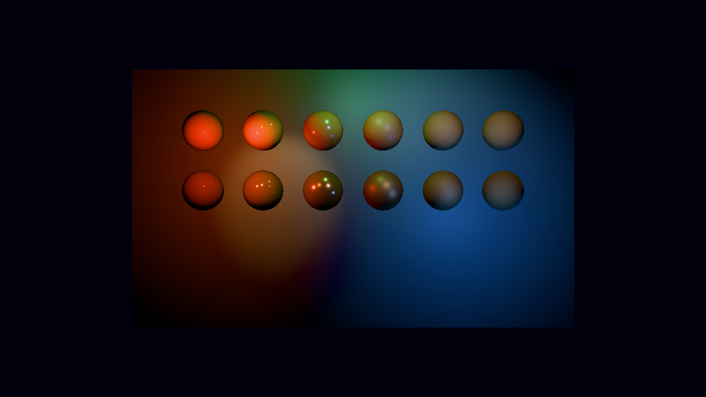

# Rendering Reference — Core_v1

A maintained diagnostic project, independent of showcase art direction. It uses
native-authored scenes, the normal project asset service and the ordinary editor
and RuntimeSession paths. No scripts need to be compiled for viewing or Play.
Core_v1 demonstrates unlit 2D with orthographic and perspective cameras. Additive
Import_v1 and Direct_v1 cover native assets and direct PBR. Additive IBL_v1 cases cover prepared image-based lighting.

After building the selected configuration:

```sh
python3 scripts/hazel.py run Hazelnut --config Debug --project examples/RenderingReference/RenderingReference.hproj
python3 scripts/hazel.py run Nutella --config Debug --project examples/RenderingReference/RenderingReference.hproj
python3 scripts/hazel.py run Nutella --config Debug --project examples/RenderingReference/RenderingReference-Perspective.hproj
```

Open either scene in Hazelnut's Content Browser and Play to use its named authored
camera. The editor navigation view remains independent. Select the swatches,
texture samples, overlapping sprites, circle, text and UI control to inspect their
UUIDs/components; resize the viewport to inspect picking/layout at framebuffer
scale. Hover/focus/press the styled UI control to exercise its ordinary state
colors. Screen UI is independent of world-camera projection.

The four grayscale patches store linear RGB 0, .21404114, .5 and 1, corresponding
to sRGB 0, .5, approximately .735357 and 1. Both texture samples reference the same
8×8 image: Color decodes sRGB; Data keeps numerical channel values. Its asymmetric
quadrants are top-left red, top-right dark green, bottom-left blue and bottom-right
light magenta; one corner has alpha 128. The layered red/blue sprites have alpha .5
and a white backing. Correct linear blending deliberately differs from historical
encoded-space blending. World text, circle coverage and screen UI share the
canonical linear RGB/linear alpha contract.

`Assets/Reference/Core_v1.json` freezes named camera IDs/values, content hashes, idle clock/seed,
1280×720 logical and physical reference extents and output formats. Hash paths
are relative to the source project root. A package includes its selected project
descriptor and both scenes; the second source descriptor is not an installed
startup choice. Metadata and NOTICE travel through the ordinary package paths. Interactive
resizing is useful exploration; record the actual extents as an override when
capturing it. Future stages add named cases. Do not restage Core_v1 to conceal a
rendering discrepancy. A deliberate correctness revision needs numerical evidence
and a new case version.

The native maintainer recipe is `HazelProject create-rendering-reference FOLDER
TEMPLATES`, using a new destination and the matching `Hazel/Resources/Templates`.
It has no GPU, Python, importer or script compiler prerequisite. Checked-in bytes
and metadata remain authoritative, rather than runtime regeneration.

For a relocated content-only package, build Release, then run:

```sh
python3 scripts/hazel.py package --app Nutella --project examples/RenderingReference/RenderingReference.hproj --name RenderingReference --output dist/reference
```

Keep the complete archive layout, resources and notices. The player needs no
source checkout or compiler SDK. Use private `HAZEL_DATA` and `HAZEL_SAVE_ROOT`
for experiments. See [runtime color](../../docs/color.md).

## Import_v1: native geometry metadata

Core_v1 startup/cameras and source assets are unchanged. Additive
`Assets/Reference/Import_v1` cases qualify import/cooking/metadata, with no rendered
mesh/PBR acceptance or expected lighting images.

Open the usual project in Hazelnut. In Content Browser, open
`Reference/Import_v1/Native/SlotsAndInstances/Import.himport` for mesh/primitive/slot
and local-bounds metadata. **Open detached prefab** exposes the native nodes;
**Instantiate prefab** copies independent authored nodes into the scene. Mesh
instances now render with their authored materials. Lit materials need scene-referred
presentation; select a directional key for direct lighting. Keep the Core_v1 scene unsaved
when exploring; use a disposable project for edits.

- `SlotsAndInstances`: two independent material slots; one shared mesh in three
  instances; normalized UV/color, interleaved attributes and U8/U16 indices;
  mirrored tangent boundary requiring corner splits; signed nonuniform transforms;
  embedded asymmetric sRGB color and linear normal data; Mask and explicit Unlit.
- `ProvidedTangents`: provided FLOAT normal/tangent/UV/color, U32 indices, default
  glTF material and exact reflected affine matrix.
- `Sources`: named malformed/unsupported inputs, each with an expected diagnostic
  in `sources.json`. Import into a new disposable destination; rejection must leave
  no accepted output folder.

`outputs.json` freezes native file hashes/identities and completed geometry
metadata. `sources.json` records licensed source hashes and exact meanings. The
small standard-library generator recreates **source fixtures only**. Normal native
import owns validation/cooking/publication; replacing accepted reference artifacts
requires a deliberate case revision. See [native import](../../docs/design/3d-import-stage2.md).


## Direct_v1 — direct rendering

Open `RenderingReference-Direct-PerspectivePBR.hproj` in Hazelnut or select it with
Nutella's `--project`. `RenderingReference-Direct-OrthographicPBR.hproj` and
`RenderingReference-Direct-PerspectiveUnlit.hproj` exercise the independent camera
and shading choices. The same saved content feeds both hosts. Direct lighting has
no ambient/IBL; rough metals can remain dark under this single-scattering model.

The 18 repeated analytic spheres cover roughness 0/.1/.25/.5/.75/1 and metallic
0/.5/1; the mirrored nonuniform cube, world sprite/circle/text and screen UI share
the view. Scene Settings exposes world exposure; the footer stays independent.
Use Orbit and **F** on a selected instance. Material overrides use stable slots.
Camera/output/light conditions and scene hashes are frozen in
`Assets/Reference/Direct_v1/outputs.json`. Geometry/material provenance is in its
NOTICE and Source.generated. No external photographic or lighting assets are used.
Core_v1 and Import_v1 bytes/conditions remain unchanged.

From the canonical checkout:

```sh
python3 scripts/hazel.py run Hazelnut --config Release --project examples/RenderingReference/RenderingReference-Direct-PerspectivePBR.hproj
python3 scripts/hazel.py run Nutella --config Release --project examples/RenderingReference/RenderingReference-Direct-PerspectivePBR.hproj
```

The maintained renderer regression compares direct GPU radiance to a separate
FP64 BRDF oracle. Runtime regression checks saved Direct_v1 through editor/player
submission and 1x/2x picking. These are direct-only cases, not IBL acceptance.


`RenderingReference-Direct-SurfaceConventions.hproj` adds mapped +Y normals,
mirrored/nonuniform transforms, asymmetric masked/double-sided material, rear
geometry and the frozen Stage-2 supplied tangent/COLOR0 mesh. Its separate
`Surfaces/outputs.json` freezes conditions without changing the original grid.
Viewport inspection offers base color, world normal/tangent, metallic/roughness/AO
and SDR-clamped pre-exposure radiance. These private tools bypass world tone
mapping and never change the authored scene or player presentation.

`Reference/Direct_v1/conditions.json` additionally freezes the completed materials,
images, geometry, native documents and scenes by asset-relative SHA-256. The
maintained native reference check verifies this inventory before rendering. Add
new cases rather than changing these conditions to accommodate a discrepancy.


## IBL_v1 — prepared image lighting

From `/Volumes/External/kadencringle/Projects/Hazel`:

```sh
python3 scripts/hazel.py run Hazelnut --config Release --project examples/RenderingReference/RenderingReference-IBL-Combined.hproj
python3 scripts/hazel.py run Nutella --config Release --project examples/RenderingReference/RenderingReference-IBL-Photo.hproj
```

Adjacent `-IBL-DirectOnly`, `-IBL-IBLOnly` and `-IBL-AxesYaw90` descriptors choose
the other saved cases. DirectOnly disables both uses of its image environment;
IBLOnly disables the sun and uses constant RGB .25. Combined uses the asymmetric
axis environment and explicit directional key. Photo uses original Studio Small
09 by Sergej Majboroda / Poly Haven (CC0-1.0), with the sun disabled. Yaw90 rotates
the axis environment +90 degrees. Exposure is 0 and presentation is fixed Neutral.
No automatic exposure, extracted sun or ambient compensation is involved.

`Assets/Reference/IBL_v1/conditions.yaml` freezes saved scenes, cameras, source/
resource/recipe hashes, orientation, gain and output conditions. Source provenance
is in each `.henv` and NOTICE. Default cubes are 256/128/32 background/specular/
irradiance faces with explicit GGX mips and 1024 convolution samples; the shared
128-square A/B LUT uses 4096 samples. These are portable FP32 resources. Existing
Core_v1, Import_v1 and Direct_v1 bytes remain unchanged.

In a disposable copy, open a `.henv` in Content Browser for accepted versus stale
status, Save and native Prepare/Cancel. Scene Settings owns runtime yaw/gain and
background/lighting flags. Prepare is never required by native New Project or
player startup: the PBR starter bundles a small exact constant environment.
Runtime closure excludes the HDR source and baker. Stage 4's focused closure
checks do not replace Stage 5's broader mixed-scene/export qualification. See
[the Stage-4 record](../../docs/design/3d-environment-stage4.md) for actual evidence.

## IBLQuality_v2 — controlled quality diagnosis

`RenderingReference-IBLQuality-Photo.hproj`, `-TinyEmitter.hproj` and `-Constant.hproj`
are additive fixed-camera cases with identical base RGB, geometric normals, AO=1,
metallic 0/.5/1 and roughness 0/.1/.25/.5/.75/1. Direct light is disabled. They use
the versioned solid-angle radiance/GGX MIS recipe and explicit angular-tail mips.
Existing IBL_v1 remains evidence of the original bake, with its bytes unchanged.

```sh
python3 scripts/hazel.py run Hazelnut --config Release --project examples/RenderingReference/RenderingReference-IBLQuality-Photo.hproj
python3 scripts/hazel.py run Nutella --config Release --project examples/RenderingReference/RenderingReference-IBLQuality-Photo.hproj
```

Play uses the fixed camera. The editor's diffuse/specular inspection views help
separate the low-metallic diffuse grain from high-roughness specular errors;
Scene Settings yaw exposes stability without rebaking. The numerical FP32 captures
use the same pipeline before presentation. See [quality evidence and recipes](../../docs/design/ibl-quality-pass.md).
For aesthetics and real material textures, use the separate [Rendering Showcase](../RenderingShowcase/README.md).

## Experimental Metal 4 M4

The feature branch implements native cooked meshes/materials and prepared PBR/IBL
through the shared scene path. M4 is **locally qualified on Apple M4**; see the
[acceptance record](../../docs/design/metal-m4.md). OpenGL remains default. After
following the [Metal artifact build instructions](../../docs/development.md#experimental-metal-shader-resources),
the photographic surface selector can be launched with:

```sh
HAZEL_RESOURCES="$PWD/Hazel/Resources" python3 scripts/hazel.py run Nutella --config Debug --metal --project examples/RenderingReference/RenderingReference-IBLQuality-Photo.hproj
```

Add `--inspect-camera` for the existing transient navigation controls. This
experimental run does not qualify Hazelnut Metal ImGui or general Metal export.
The packaging commands above retain their established OpenGL scope.


## XeGTAO contact study (Metal 4)

`RenderingReference-XeGTAO.hproj` opens a separate contact/crevice study with a
photographic environment, closely spaced boxes, a thin slab, a wall and a dark
rough metal. Its authored AO is enabled; existing reference scenes keep AO off.
Functional/correctness acceptance passes locally on Apple M4. Noticeable noise
and motion shimmer remain, even on Ultra; final visual-quality qualification is
incomplete. See the [XeGTAO record](../../docs/design/xegtao.md) for evidence and
limitations.

On the implementation branch, build the applications and offline shader artifacts
as described in [development](../../docs/development.md#experimental-metal-shader-resources), then run:

```sh
python3 scripts/hazel.py run Hazelnut --config Debug --metal --no-restore --project examples/RenderingReference/RenderingReference-XeGTAO.hproj
python3 scripts/hazel.py run Nutella --config Debug --metal --inspect-camera --project examples/RenderingReference/RenderingReference-XeGTAO.hproj
```

Scene Settings provides enable, low/medium/high/ultra quality, radius in world
units, strength and falloff. Apply participates in Undo/Redo; Save persists the
scene. The viewport **AO...** popup provides visibility, raw visibility, edges,
view depth and completed GPU phase timing. Inspection is transient. Nutella's
inspection camera uses RMB + WASD/Q/E, with Home restoring the authored view.

AO affects diffuse image-based lighting. Material occlusion and GTAO combine by
minimum visibility; direct lighting, emission, specular IBL, sky and screen UI
retain their existing behavior. Sampling is fixed and static-camera output is
deterministic; there is no temporal history or TAA. Spatial filtering alone does
not eliminate visible noise or motion shimmer. Very thin,
hidden or offscreen geometry remains subject to screen-space limitations. OpenGL
keeps the authored request but reports it inactive; it has no AO fallback.

## LocalLights_v1: authored point and spot gallery

The separate `RenderingReference-LocalLights.hproj` selects
`Assets/Scenes/LocalLights_v1.hazel`. This new output has no frozen-image baseline.
It contains dielectric and metallic roughness sweeps, overlapping warm/cool point
lights and narrow/broad spot cones against a neutral backdrop. Build scripts to
animate the warm light; the other lights and all geometry remain independent.

```sh
python3 scripts/hazel.py script-build --config Debug examples/RenderingReference/RenderingReference-LocalLights.hproj
python3 scripts/hazel.py run Hazelnut --config Debug --project examples/RenderingReference/RenderingReference-LocalLights.hproj --no-restore
python3 scripts/hazel.py run Nutella --config Debug --project examples/RenderingReference/RenderingReference-LocalLights.hproj
```

Use Scene → Add Point Light / Add Spot Light, or add either component in Properties.
Transform sets position; local -Z sets spot travel. Range uses world units and
ignores transform scale. Cone controls are **half angles in degrees** (scene files
store radians). Colors are linear RGB. Intensity is renderer-relative incident
radiance at unit distance in the inverse-square far field, before smooth range
and cone factors; it is not calibrated candela/lumens. A smooth centimetre-scale
source core removes the point singularity; this is not an area-light model.

Light crosses are selectable in the editor; selected point lights show influence
spheres and spots show inner/outer cones. The viewport **Lights...** inspection
provides local radiance, tile occupancy and magenta overflow (Metal), along with
completed culling/forward GPU timings, CPU collection/light preparation and list memory.
Diagnostics are transient view state. Direct light remains independent of material
AO and XeGTAO; existing GGX multiscattering, emissive and IBL are retained.

Both backends support **320 enabled local lights**. Exceeding the limit reports an
error and never truncates the submitted lights. Metal uses tiled compute culling;
a tile with more than 64 candidates evaluates the complete loop, preserving all
contributions at higher shading cost. OpenGL 4.1 uses the bounded complete loop
with the same GLSL BRDF/attenuation. Neither backend has local-light shadows yet.
Direct-light transitions follow the unperturbed authored normals: smooth normals
produce continuous lighting across triangle edges, while split/flat normals retain
hard edges. Normal maps perturb the material response within that surface horizon.
IBL keeps its geometric reflection-horizon protection. Polygonal silhouettes and
occlusion geometry remain unchanged; see the linked correction record for limits.

Maintainers can regenerate only this additive scene/project with
`python3 tools/assets/generate_local_lighting.py`. See the
[architecture and qualification record](../../docs/design/local-lighting.md) for
current acceptance status and measured limits. Existing Core/Direct/IBL/AO/TAA
frozen fixtures must not be regenerated to accept this new scene.



This is an actual native Metal capture of the static authored camera, before the
warm light's script motion. Owner visual acceptance remains a separate gate.

## Directional shadow study

`RenderingReference-Shadows.hproj` opens the separate
`Assets/Scenes/DirectionalShadows_v1.hazel` study on `feature/3d-foundations`.
Regenerate it with `python3 tools/assets/generate_directional_shadows.py`.
It contains a contact receiver, hard cube, smooth sphere, mirrored nonuniform
cube, thin/tall and masked casters, plus blocks at increasing camera distances.
Existing accepted lighting/AO/TAA scenes remain separate.

After building and staging [offline Metal shaders](../../docs/development.md#experimental-metal-shader-resources):

```sh
python3 scripts/hazel.py run Hazelnut --config Release --metal --no-restore --project examples/RenderingReference/RenderingReference-Shadows.hproj
python3 scripts/hazel.py run Nutella --config Release --metal --inspect-camera --project examples/RenderingReference/RenderingReference-Shadows.hproj
```

Use `--opengl` for the OpenGL 4.1 path. **Scene Settings → Directional shadows**
controls resolution, distance, splits, bias and cascade blending. Inspect static
contacts first, then translate/rotate the camera and directional key and move
casters with the existing transform gizmos. Move a tall caster out of the camera
while retaining its shadow. Compare 512/1024 and **2048 (Ultra)** cascades, near/far crossings and
shadows off; enable AO/TAA independently on Metal. Smooth normals do not change
actual triangular caster geometry. Watch grazing self-shadow terminators, thin
surface leaks and detached contacts; report them against the exact settings.
Use **Shadows... → Current / next / blend** to inspect the two map visibilities
and blend weight in RGB. Inspect **Visibility** and the individual maps at a
matching camera pose; the unbiased pair keeps projection fitting unchanged.
Ultra uses a 64 MiB depth atlas. The [cohesion follow-up](../../docs/design/directional-shadows.md#csm-cohesion-investigation-and-ultra)
records a rejected filter experiment and the unresolved contour/coverage limitations.

This is an experimental foundation, pending owner visual acceptance and the
remaining gates in the [CSM record](../../docs/design/directional-shadows.md).
Native macOS evidence does not qualify Windows/Linux or Intel hardware.
