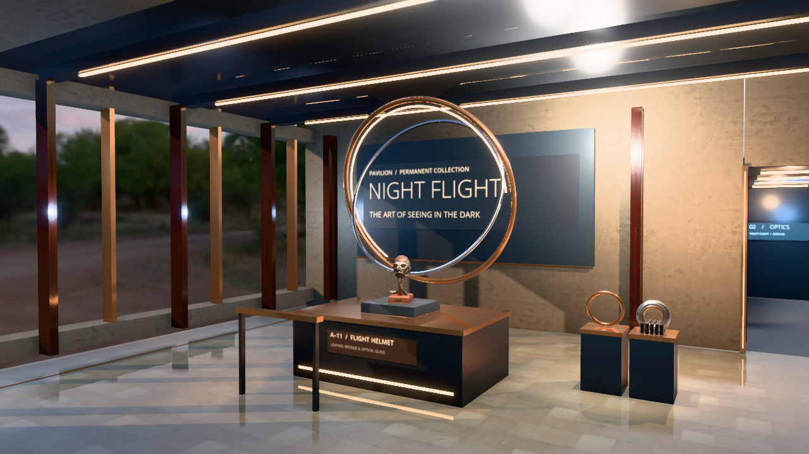

# The Pavilion qualification

Tested on Apple M4 with 16 GiB RAM, macOS 27.3, on the development tree based
on `224a779`. The Pavilion acceptance gates below passed on this host. The Pavilion uses native scene, mesh, material and environment
formats. It requires no application-specific rendering code or managed module.
The test programs use the authored scene and the regular runtime and editor paths.



## Scene and feature coverage

| Feature | Authored evidence and procedure |
| --- | --- |
| GGX metallic/roughness and material response | View 03 shows warm bronze, cool steel, smooth dielectric marble, rough concrete and oak. View 07 shows the helmet's mixed materials at source scale. Use the editor's normal and material inspections to isolate the UV0 normal, roughness and metal channels. The shot compares behavior visually. The separate [GGX reference](../../docs/design/ggx-multiscattering.md) supplies the independent numerical checks. |
| HDR sky, diffuse and specular IBL | View 01 has the photographed sunset and courtyard surfaces. Toggle the environment's lighting independently of the visible background in scene settings. View 04 includes a [global-only versus local-probe comparison](evidence/04-global-only.jpg). |
| Directional CSM, spot and point shadows | Views 01, 03 and 05 show the directional and local shadows, with the ring rotating under its moving spot. Captured Metal frames record four shadowing spots and one admitted omnidirectional point shadow. The gallery practical is selected first by the renderer's stable light-ID order. The blue point adds fill in the passage. |
| Local lights and Forward+ | Ultra and High submit 25 local lights. View 03 shows intersecting light volumes. The performance counters record Metal tile-cull GPU time. OpenGL uses the portable full light loop. |
| Masked materials | Inspect the grass cards along the courtyard boundary in view 01. The silhouette and shadow passes use the alpha cutoff. |
| Room-box local reflections | Hall captures at `(-1.90, 2.05, -1.80)`, Archive at `(4.28, 1.60, -6.65)`. They use separate floor-aligned projection boxes and 1.1 m falloff. The influence boxes overlap by 0.89 m laterally around the entrance side of the hall. View 04 exposes the door, fittings and reflected sculpture at changing ground angles. |
| Native static FP32 bake | Two 256-face captures, with 256 specular faces, 32 irradiance faces and 1,024 base samples in each preparation. The capture uses scene-linear shading and the global sky. The authored project opens with both accepted generations. The bake tool verifies view-effect invariance, independence from local-probe enablement and byte-exact cooked specular mip zero. The relocated raw captures matched the shipped raw inputs byte for byte. |
| SSR and probe/global fallback | [View 04 holds the pose and toggles SSR](evidence/04-probe-only.jpg), then removes both local probes. Compare near-field reflection of the pedestal and rims, the heavier influence of off-screen architecture, and the result near image boundaries. The separate native probe reference passed its FP64 overlap and fallback checks on both APIs. |
| XeGTAO and TAA | Metal view 04 and the moving tour exercise both paths together. Look at the floor junctions and narrow rail silhouettes. The Diagnostic scene disables TAA for fixed sampling. OpenGL defers these compute paths. |
| Automatic and manual exposure | View 02 moves across the doorway at fixed camera identity. [View 06 compares centered automatic metering with manual physical exposure](evidence/06-manual.jpg). Diagnostic uses f/4, 1/64 s and ISO 100 for gain 1. |
| Physical lens and autofocus | The camera gate is 36×24 mm. Compare the 25–28 mm architecture cameras with the 63 mm f/1.3 view 07. The tour switches the tracked target between the helmet and the back wall and returns to the helmet. [Matched DOF toggle](evidence/07-dof-off.jpg). |
| Shutter motion blur | View 08 moves past the rail with a 180° shutter. [Matched off/on capture](evidence/08-shutter-off.jpg) uses identical movement and the same sample time. |
| Bloom, lens glare and dirt | [Bloom comparison](evidence/06-bloom-off.jpg) and [lens comparison](evidence/06-lens-off.jpg) hold view 06 fixed. Warm strips, the cool sign and the visible practical highlights drive HDR optics. The tour moving down the passage changes which sources are in view. The independent visible-source fixture exercises exact occultation. |
| White balance, tint, film/tonal controls and LUT | View 06 uses a 5900 K balance, tint, tonal controls and the 17³ Night Flight Rec.709 LUT in the established Khronos PBR Neutral pipeline. [Matching neutral grade](evidence/06-neutral.jpg). Camera Inspector **Apply preset** and the local optical settings use the ordinary Hazel controls. |
| Presentation | Film controls act on world shading, with one final sRGB encode. The rendered [26.2-second tour](evidence/tour.mp4) uses 786 fixed-timestep frames. Native window startup/teardown is exercised separately. |

The Stage A budget was roughly 80–100 MiB of new checkout art, 1K material
maps, one 2K HDR panorama and two 256-face probes. The authored package data
stays within that range. The native mesh cache admits 32 entries. The Pavilion
batches the static architecture by material, keeping the rotating and display
objects independently addressable.

## Native acceptance

[Native result summaries](evidence/native-results.json) include desktop, resize,
package and reference checks.

| Gate | Status |
| --- | --- |
| Debug and Release desktop startup | **PASS.** Hazelnut and Nutella opened the shipped Ultra descriptor on Metal 4 and native Apple OpenGL 4.1. Eight launches met their 60-frame smoke gates and shut down normally. Metal requires GPU completion and positive drawable presentation for that gate. OpenGL uses rendered frames. |
| User-facing launch commands | **PASS.** All four Release `scripts/hazel.py run` commands in the showcase README reached the Pavilion ready message. The two Nutella runs also used the inspection flag. |
| Camera configuration and serialization | **PASS.** The study serializes, deserializes and reserializes the authored scenes and checks equality. It exercises every Ultra camera, High on Metal and Diagnostic view 04. |
| Native Metal/OpenGL image studies | **PASS, visual.** Both APIs ran the stills and feature pairs in Release. Debug ran view 04 on both APIs. The [display differences](evidence/image-differences.json) are an image-study summary. Comparisons retain the same settings, time and pose except for the named control. |
| Automatic exposure, focus and shutter | **PASS.** The tour uses a single view through the doorway and keeps render history across authored camera cuts. View 07's focus transitions and view 08's motion blur are visible. The independent exposure, defocus and shutter checks passed Release on both APIs. They cover expected exposure gain, cut history and the thin-lens and shutter equations. See the [camera record](../../docs/design/camera-system-qualification.md). |
| HDR optics and source occultation | **PASS.** Pavilion visual pair plus the existing Release lens reference on both native APIs. That reference checked exact occlusion/fallback, grading-independent picking depth and Metal resize/queue lifetime. |
| Editor resize and GPU retirement | **PASS.** The real EditorLayer opened the Pavilion, rendered, resized the drawable from 1280×720 to 1120×760 and rendered again on both APIs in Release and on Metal in Debug. Metal completed with zero GPU errors, in-flight frames, live attachment generations and retained editor bytes. |
| Source-free package and relocation | **PASS.** Both Release apps packaged the relocated project under a path containing a space and `é`. The archive project excludes HDR, original GLBs and raw probe cubes. Extracted ad-hoc signed apps passed native Metal and OpenGL startup and normal close with access to the checkout and developer SDK denied. |
| Missing resource and failed preparation | **PASS.** On a disposable copy, Nutella named the missing marble normal in its startup error. An invalid raw probe cube was rejected by HazelProject, leaving the accepted manifest byte-identical. |
| Directional CSM stress parity and IBLQuality_v2 | **Inherited failures remain open.** The default Release runtime regression reproduced the frozen IBLQuality_v2 checksum failure. The same regression passed with immutable fixture revision `86c581c`. The [CSM record](../../docs/design/directional-shadows.md) retains its stress-parity findings. The [camera record](../../docs/design/camera-system-qualification.md) records the default fixture checksum failure and its immutable baseline. |
| Human editorial approval, Windows/Linux and other GPUs | **NOT RUN.** The Apple work is native. No hosted CI run or software rendering run is represented as Apple GPU evidence. |

In Hazelnut, the usual “Scripts not built/available” entry is expected for
these content-only scenes. Native Play remains available. Close-up reflections
of curved nearby objects retain the known static box-projection error, and
SSR cannot find geometry outside the current view. The sky uses a photographed
environment and a separate authored directional light. No dynamic atmosphere
or volumetric effect is authored. The helmet's lens finish is opaque.

## Performance

[Detailed measurements](evidence/performance.json) retain sample sizes,
median/p95 and per-pass GPU timing. Raw instrument output is under
`build/pavilion/` in the authoring checkout.

The window benchmark runs the authored Arrival camera, makes a VSync-off
request and counts only positive presentation timestamps joined to completed
GPU work. It excludes the first 30 matched presentations per resolution.
The 1440p interval uses fullscreen on the 2560×1440 monitor at its existing
refresh setting. 720p and 1080p are decorated window measurements.

| Presented physical extent | Ultra median / p95 interval | High median / p95 interval |
| --- | ---: | ---: |
| 1280×720 | 8.30 / 15.35 ms | 7.75 / 14.98 ms |
| 1920×1080 | 16.47 / 25.79 ms | 15.50 / 25.07 ms |
| 2560×1440 | 24.33 / 24.92 ms | 23.12 / 23.71 ms |

The offscreen benchmark runs a deterministic motion through the floor
sweep, the DOF close-up and the shutter shot. It keeps 18 measured frames per
shot after six warmup frames. Metal frame timing here includes GPU readback
work. OpenGL elapsed queries end before readback. These timings cover different
stage boundaries.

| Offscreen physical extent | Metal Ultra frame median range | Metal High frame median range | OpenGL Ultra elapsed median range | Metal Ultra peak tracked / native |
| --- | ---: | ---: | ---: | ---: |
| 1280×720 | 18.54–23.02 ms | 13.67–17.69 ms | 32.28–36.37 ms | 543 / 557 MiB |
| 1920×1080 | 38.42–46.38 ms | 28.24–34.95 ms | 44.58–46.82 ms | 876 / 889 MiB |
| 2560×1440 | 65.79–78.27 ms | 48.09–60.77 ms | 121.52–156.90 ms | 1,350 / 1,361 MiB |
| 3840×2160 | 144.07–168.45 ms | 105.11–126.12 ms | 95.92–174.97 ms | 2,703 / 2,709 MiB |

At Ultra 1080p, the floor sweep drew 309 draw commands across its passes.
Median measured GPU times were 0.59 ms directional, 0.25 ms spots and 0.15 ms
point shadow, 0.04 ms light culling, 9.90 ms forward shading, 15.84 ms AO
and 5.35 ms TAA resolve. Bloom was 1.16 ms and exposure was 0.04 ms.
The close-up's DOF and lens intervals were 1.45 and 0.08 ms. The shutter
shot's measured shutter interval was 0.62 ms. The pass timings can overlap
and cover different intervals. See the detailed record for draw counts and GPU
pass durations. In separate 1080p floor-sweep runs, Metal complete-frame medians
were 38.39 ms and 38.47 ms for the repeated authored control, 34.18 ms with SSR
disabled and 38.49 ms with neutral grading. The SSR toggle reduced this
workload by about 4.2 ms. The grading delta was within the repeat variation.

The 4K case used the existing device-aware policy. It measured 2.65 GiB of peak native memory against 12,713,115,648 bytes of device working-set guidance.

### Reproduce

```sh
python3 scripts/hazel.py build --config Release --tests \
  --target MetalRenderer2DQuadSmoke --target MigrationRenderer2DSmoke \
  --target MetalM1Smoke --target MigrationEditorSmoke
python3 examples/RenderingShowcase/tools/study.py benchmark --width 1920 --output build/pavilion-bench-1080
python3 examples/RenderingShowcase/tools/study.py present --width 2560 --output build/pavilion-present
python3 examples/RenderingShowcase/tools/study.py editor-resize --output build/pavilion-resize
python3 examples/RenderingShowcase/tools/study.py bake --output build/pavilion-rebake
```

Use the High descriptor with `--project` for a matched quality run. The window
test uses a visible native desktop. The bake command publishes new accepted
probe assets to the selected project. Use a staged copy for a disposable bake.
