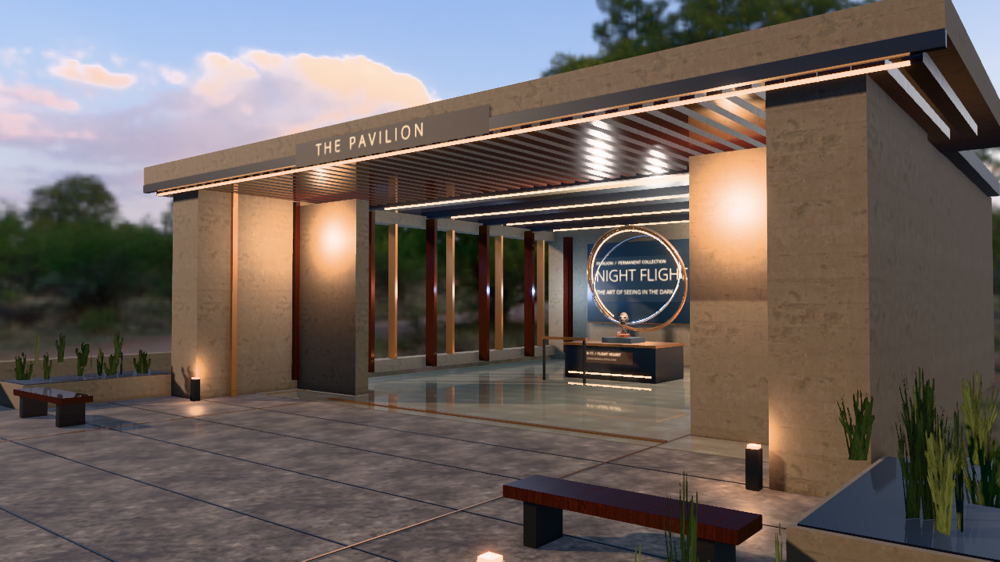

# The Pavilion

A dusk aviation exhibition built around an A–11 flight helmet and a suspended
bronze sculpture. The courtyard opens onto a polished marble hall and then
onto a narrower optics archive. The same scene and local reflection bakes serve
all three quality configurations.



## Launch

From the Hazel checkout root on Apple Silicon macOS, with the matching products
built. The checkout includes cooked geometry, textures, HDR lighting and the
reflection bakes. The project launches without a project script module, asset
downloads, or an authoring tool.

```sh
python3 scripts/hazel.py build --config Release --target Hazelnut --target Nutella
project=examples/RenderingShowcase/RenderingShowcase.hproj
python3 scripts/hazel.py run Hazelnut --config Release --metal --project "$project"
python3 scripts/hazel.py run Hazelnut --config Release --opengl --project "$project"
python3 scripts/hazel.py run Nutella --config Release --metal --project "$project"
python3 scripts/hazel.py run Nutella --config Release --opengl --project "$project"
```

Nutella starts the eighty-second loop in Ultra and High. Diagnostic starts
from its fixed reflection camera. Hazelnut **Play** keeps the authored entrance
camera for editing and fixed-pose studies.
In Edit, select an object and press **F** to frame it. For one of the nine fixed
cameras, stop Play, clear **Primary** on the current camera, and set it on the
desired camera before playing again. Close without saving if the change was for
inspection only.

### Inspect in motion

In Hazelnut Play, check **Inspect camera** in the viewport. In Nutella, press
**I** during the tour to suspend its movement and fly from the current pose.
Press **I** again to resume. Add `--inspect-camera` to enter inspection at launch. Hold the right mouse button and use WASD
and Q/E to fly. Hold Shift for speed or Ctrl for precision. Use Option/Alt or
Space with left drag to orbit, Shift with left drag to pan, and the wheel to
dolly. Press **Home** to restore the authored view and **Escape** to release
the pointer.

### Nutella tour controls

| Key | Action |
| --- | --- |
| Space | Play or pause |
| R | Restart at the courtyard and reset camera history |
| [ or ] | Slow down or speed up, from 0.25× to 2× |
| I | Suspend the tour and enter inspection, or return to the tour |
| T / Y | Toggle TAA / SSR, including during inspection |
| D / M | Toggle physical DOF / shutter blur |
| F / G | Toggle lens flare / source-driven dirt |
| E / C | Compare manual gain 1 against auto exposure / neutral against Night Flight grading |

Around 24 seconds, the camera approaches the helmet at f/1.3. Focus moves
from the helmet to the wall and back. Near 40 seconds, the archive lightbox
and ceiling bars resolve into warm and cool ghosts and streaks. Dirt modulates
the light-spread response in that passage. Pause and press D, F, or G at the
corresponding pose for an A/B. Shutter differences need a moving view, such
as the low sweep or the return turn.

### Quality

| Configuration | Launch descriptor | Settings |
| --- | --- | --- |
| Ultra / Cinematic | `RenderingShowcase.hproj` | 2048 per CSM cascade, four 1024 spot maps and one 512 point cube. SSR quality 2 with 56 steps, XeGTAO quality 3 and TAA on Metal. The tour varies aperture and optical strength across zones, with Cinematic reconstruction. |
| High / Interactive | `RenderingShowcase-High.hproj` | 1024 cascades, 512 spot maps, 256 point cube, SSR quality 1 with 36 steps, XeGTAO quality 2, Balanced optics and the same authored lighting and grading. |
| Diagnostic / Comparison | `RenderingShowcase-Diagnostic.hproj` | Starts at the reflection sweep with manual gain 1 at f/4, 1/64 s and ISO 100. TAA, bloom, grading and dedicated camera effects are disabled. Spatial reflections, probes, shadows and Metal AO remain available. |

OpenGL 4.1 uses spatial rendering, the portable local-light loop and raster
camera passes. XeGTAO, TAA and tiled Forward+ are exercised on Metal 4.
The shared scene uses one baked probe in the hall and one by the archive
entrance. Box projection approximates large room surfaces and can misplace
nearby curved objects. SSR contributes when it finds a valid on-screen hit.

The previous Studio scene and its fixed material studies are available through
`RenderingShowcase-Studio.hproj`, `RenderingShowcase-RoughnessSweep.hproj`, and
`RenderingShowcase-SurfaceDetail.hproj`. Their fixed poses remain recorded in
[views.yaml](Assets/views.yaml).

## Camera study

[Continuous Nutella track render](evidence/pavilion2/loop.mp4) uses the same
periodic sampler as the player. The native test samples it at 20 Hz to make
paired captures and validate the loop seam.

```sh
python3 examples/RenderingShowcase/tools/study.py loop --width 640 --output build/pavilion-loop
python3 examples/RenderingShowcase/tools/study.py loop-pairs --output build/pavilion-optics
```

See the [2.0 stabilization record](PAVILION-2.md) and the
[glTF capability audit and roadmap](GLTF-AUDIT.md).

### Fixed-camera reference study

[Watch the rendered tour](evidence/tour.mp4). The native study plays the same nine
authored cameras at 30 Hz. It eases camera moves within each shot, tracks the
helmet and rack-focus marker in shot 07, and changes camera identity at the
editorial cuts. Shot 02 keeps one camera identity from the courtyard through
the doorway so exposure can adapt. The tour is rendered by the native test
host. Manual exploration uses the applications above.

```sh
python3 scripts/hazel.py build --config Release --tests \
  --target MetalRenderer2DQuadSmoke --target MigrationRenderer2DSmoke
python3 examples/RenderingShowcase/tools/study.py tour --width 640 --output build/pavilion-tour
python3 examples/RenderingShowcase/tools/study.py pairs --width 1280 --output build/pavilion-pairs
python3 examples/RenderingShowcase/tools/study.py 07 --backend opengl --output build/pavilion-gl-detail
```

The study produces numbered PPM frames with the final sRGB transfer applied.
To encode the whole tour with FFmpeg:

```sh
ffmpeg -framerate 30 -pattern_type glob -i 'build/pavilion-tour/*.ppm' \
  -c:v libx264 -pix_fmt yuv420p -crf 20 build/pavilion-tour.mp4
```

| View | What to inspect |
| --- | --- |
| 01 Arrival | Gold directional light, concrete aggregate, clipped grass silhouettes, contact shadows and the HDR sky. |
| 02 Threshold | Walk into the hall in one shot and watch auto exposure settle. |
| 03 Night Flight | Marble and bronze under diffuse/specular IBL, warm and cool spots, and the main point shadow. |
| 04 Reflection sweep | Compare the moving sculpture reflection and the same view with local probes only and with global IBL only. |
| 05 Kinetic exhibit | Watch the moving ring and warm spotlight on the two optics displays. |
| 06 Archive passage | Compare HDR bloom, occlusion of visible glare, automatic/manual exposure and the Night Flight grade. |
| 07 Flight helmet | Check the frontal focus point, bokeh and the rack focus to the back wall. |
| 08 Shutter sweep | Compare the same moving camera sample with the 180° shutter on and off. |
| 09 Closing gallery | Wide composition across the suspended sculpture, artifact and exit. |

[Feature coverage, performance and qualification](QUALIFICATION.md) ·
[Asset credits and licenses](NOTICE-Pavilion.md)

## Package for offline use

Stage one preset into a content-only project, then package the Release player.
The stage retains the accepted sky and reflection generations, mesh geometry,
texture maps, grade, and project notice. It omits the sampled HDR and cube
sources and the source GLBs.

```sh
python3 examples/RenderingShowcase/tools/study.py stage --output 'build/Pavilion café'
python3 scripts/hazel.py package --app Nutella \
  --project 'build/Pavilion café/RenderingShowcase.hproj' --output build/pavilion-package
```

Extract the archive and open `Nutella.app`. The packaged project is selected
automatically. The app executable also accepts `--metal` or `--opengl`.
