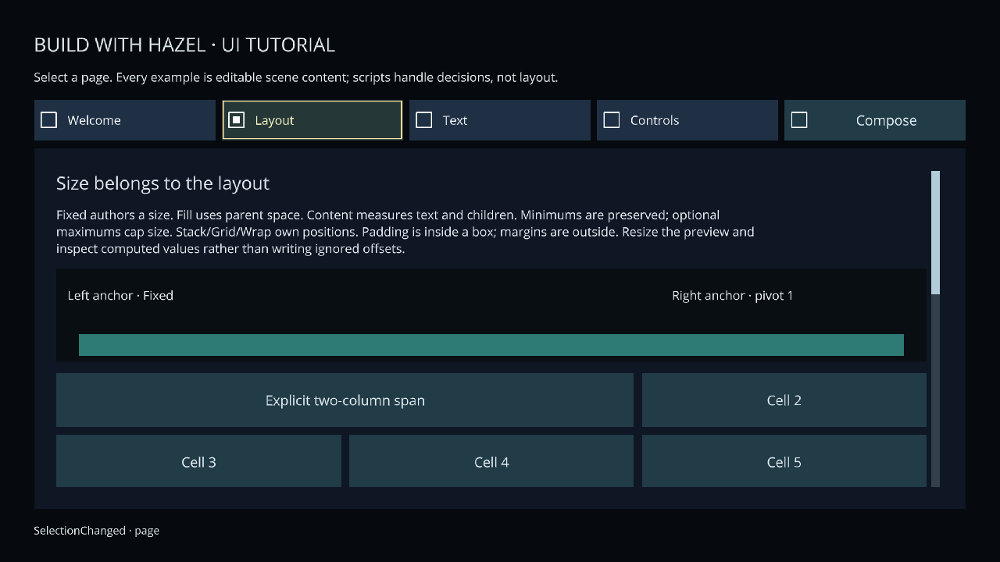

# Sandbox — UI Tutorial

Open **Sandbox.hproj** in Hazelnut, Build Scripts, then double-click
**Assets/Scenes/UI Tutorial.hazel** in Content Browser. Press Play and click the
viewport. Stop returns to the authored scene. Sandbox keeps `Start.hazel` as its startup scene; opening the tutorial does not change that project default.


*Adjust a slider, select a dropdown value and edit text; native UI owns focus, capture and routing.*

## Build and launch

From a [prepared checkout](../../docs/getting-started.md), use `python3` on Linux or `python` on Windows:

```sh
python3 scripts/hazel.py script-build examples/Sandbox/Sandbox.hproj --config Debug
python3 scripts/hazel.py run Hazelnut --config Debug --project examples/Sandbox/Sandbox.hproj
```

These commands use existing native Debug products. A prebuilt Hazelnut may open the project through **File > Open Project…**; script changes need the source SDK/compiler. For a current prebuilt project, select a successful whole CI run and download its `Hazel-Examples-…` bundle: extract the Sandbox game archive and open its root `Sandbox.hproj` in Hazelnut from the **same run/SHA**. The authored tutorial is at `Assets/Scenes/UI Tutorial.hazel`; the default Nutella startup remains Start. Older snapshot downloads can predate the tutorial—check their SHA and included content. [Download/checksum instructions](../../docs/packaging.md#choose-a-snapshot).

## Export the tutorial

Copy the Sandbox project before changing defaults. In **Project > Project Settings… > Startup scene**, select `Scenes/UI Tutorial.hazel`, save the copied project, then use **Project > Export Game…**. Export builds Release scripts/runtime and packages the saved tutorial startup selection. CLI alternative (replace the copied descriptor path):

```sh
python3 scripts/hazel.py editor-export /absolute/path/to/Sandbox-copy/Sandbox.hproj --name UITutorial --output dist/games
``` Open/run the exported
project from any directory. The project-local script is
`Assets/Scripts/Source/UITutorial.cs`; the declared event owner is **UI Tutorial owner**.
Runtime control values and events are scene-owned; the script only updates the
preview and feedback. No interface is constructed by the script.

## Five pages


*Compare stacks, grids and wrapping at different logical widths. Edit the authored group to change constraints.*

| Page | Try it | Inspect in Hazelnut |
| --- | --- | --- |
| Welcome | Open/Cancel/confirm a modal; advance progress | Canvas/screen owner, initial/return focus, HUD and dialog subtrees |
| Layout | Change the wrapping group width or viewport aspect; click grid cells/chips | Fixed/Fill/Content, anchors/pivots, margins/padding, stack/grid/wrap, min/max, atlas image fits and nine-slice |
| Text | Resize constrained paragraphs | Families/real Bold/Italic, typed color/face spans, wrap, Clip/Ellipsis, MaxLines, pinned multilingual samples |
| Controls | Toggle, adjust slider, choose radio/dropdown, edit name/note | Shared style and local foreground override; derived cues; silent setter versus user events; clipboard/local undo |
| Compose | Select offscreen journal rows; scroll nested cards | ScrollView content/tracks, focus reveal, passive tooltip, finite selection, detached prefab references |

Keyboard defaults: Tab/Shift+Tab traverse; arrows navigate; Enter/Space accepts;
Escape cancels; Page keys scroll. Accept on a slider enters adjustment; Cancel
restores that edit. Text entry owns its editing shortcuts. Multiline Enter inserts
a newline; command+Enter submits. Pointer dragging and gamepad actions use the
same control service. Controllers do not provide an on-screen keyboard.

Select **Silent reset**, then wait or focus it to discover its tooltip. Selecting
Ocean/Amber/Cloud updates the preview color. Changing amount updates progress;
**Set amount to 50 silently** intentionally produces no user-change event.

`Styles/Interface.hstyle` is shared, with named variants. **Shared style 2** has an
explicit local foreground override. Edit/reload the style to compare them.
`Prefabs/Tutorial card.hprefab` is a detached reusable composition, with independent
values and shared appearance. Select a Canvas/page parent and instantiate it through Content Browser; no linked
prefab inheritance is implied.

For authoring history, change a property, duplicate/delete the composed control,
Undo deletion, then Undo the property. Save/reopen and repeat Play/Stop. Asset-file
creation is separate from scene Undo. **View → Runtime UI Debugger** exposes the
actual layout, clipping, focus/capture, input actions, text pages, resource limits
and failures. Resource limits and structural Undo are editor/debugger lessons,
not fake runtime controls.

The [runtime UI reference](../../docs/runtime-game-ui.md) documents declared font coverage, finite-list/text-entry limits and remaining human acceptance. The tutorial is a representative authored example, not universal language or hardware certification.

Resources: Open Sans comes from Hazel's shipped licensed default family. The
Corpus family is the existing pinned DejaVu Sans test face, redistributed under
`Assets/Fonts/Corpus-NOTICE.txt`. Tutorial frame art is the existing Kenney CC0
Pixel Adventure frame; `Assets/Licenses/ui-pack-pixel-adventure/License.txt` travels
with it. No installed system fonts are required.

Event envelopes create new managed Entity wrappers: compare their stable `.ID`
with an assigned target’s `.ID`, rather than using object-reference equality.
The owner script demonstrates this on radio selection.

Canvas reference scaling preserves readable proportions as pixel size changes.
For an obvious horizontal reflow, edit **Wrapping chips → Fixed width** (540 by
default); vertical wrapping already breaks at its fixed height. Aspect changes
can also change available logical space; proportional pixel resizing alone does
not promise a new line break.


[Runtime UI reference](../../docs/runtime-game-ui.md) · [Styles/fonts and resources](../../docs/settings-and-resources.md#fonts-styles-and-caches) · [Packaging](../../docs/packaging.md)
