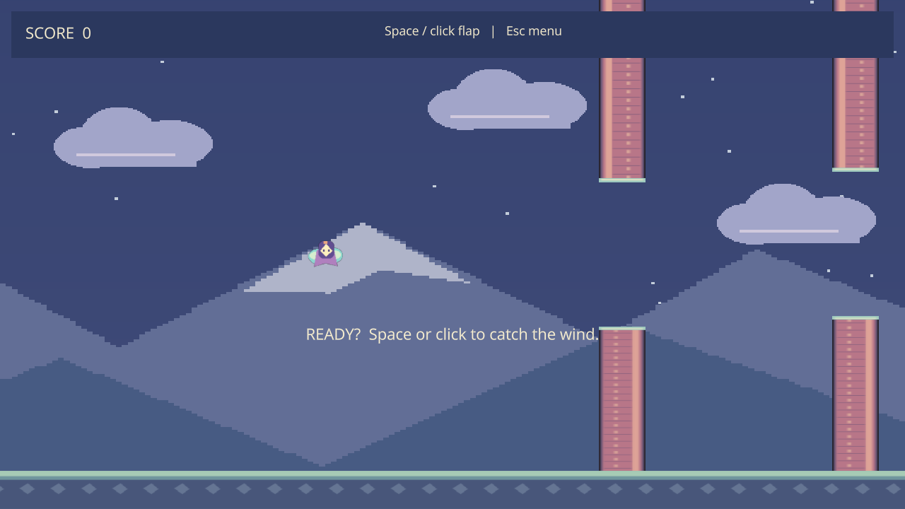

# Skybound

A wind-sprite flight game. Flap through lantern towers on a scrolling course. A fresh press starts the flight; towers, the ground and the ceiling end it.


*Parallax scenery, prefab obstacles and screen-space score UI. Linux capture.*

## Play and edit

**Space / left click** flaps; **R / fresh Space** restarts after a crash. Native **Try Again / Title Menu** buttons and **Escape** provide navigation.

From a [prepared checkout](../../docs/getting-started.md), build Debug scripts and launch the player or editor (Windows: `python`):

```sh
python3 scripts/hazel.py script-build examples/Skybound/Skybound.hproj --config Debug
python3 scripts/hazel.py run Nutella --config Debug --project examples/Skybound/Skybound.hproj
python3 scripts/hazel.py run Hazelnut --config Debug --project examples/Skybound/Skybound.hproj
```

Open `Assets/Scenes/Flight.hazel` in Hazelnut for direct practice. Play runs a copy; Stop retains authored content. MainMenu and Flight contain authored cameras, parallax clouds, mountains, ground, wind sprite, pipe-prefab references and screen-space UI. Four course slots instantiate fresh UpperPipe/LowerPipe prefab pairs and destroy retired entities. The ground banner follows the camera bottom; its top defines the collision floor. Fixed 120 Hz game steps preserve fair gap spacing and once-only scoring; stalls above 250 ms count as a pause.

Select a pipe in Content Browser to edit/save it in **Prefab Inspector** or instantiate detached content. Select **Game rules > Script** to assign typed assets and tune fields. UI title/crash screens use normal Canvas/Rect controls and owner events; they are not off-screen world-space buttons.

The camera fits a 16×12 world area, revealing additional scenery at other aspects. Native menus/HUD use runtime UI canvas coordinates, including the editor viewport offset; gameplay/world queries remain separate. A 900×640 or larger window is recommended.

## Export

```sh
python3 scripts/hazel.py build --config Release
python3 scripts/hazel.py script-build examples/Skybound/Skybound.hproj --config Release
python3 scripts/hazel.py package --app Nutella --project examples/Skybound/Skybound.hproj --name Skybound --output dist/games
```

Extract the archive and run `./Nutella` / `Nutella.exe` from any directory. Prepared games need no compiler, Python or SDK. [Packaging](../../docs/packaging.md) covers checksums, host deployment baseline and the editor-export alternative.

## Assets

All assets/scripts belong to this project; no shared mutable state or assembly.
Texture paths are asset-relative. Original pixel art is documented in LICENSE.txt;
optional regeneration source is `examples/art/generate.py` (Pillow required only
for regeneration). Open Sans and all required engine/runtime licenses are packaged.

[Editor guide](../../docs/editor-guide.md) · [Runtime UI](../../docs/runtime-game-ui.md) · [All examples](../../docs/README.md#learn-from-an-example)
